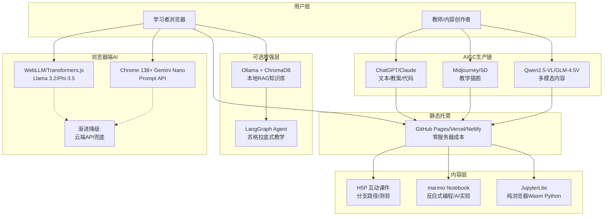

# AI + 互动教育：社区/教程/兴趣型模式深度调研报告

> **调研时间**：2026年7月13日
> **调研范围**：全球及中国AI教育市场、开源生态、亲子共学模式、成人学习社区、轻量级商业模式、技术基础设施、政策环境
> **核心问题**：AI + 互动教育方向，如何以非产品/非SaaS的社区/教程/兴趣型模式切入

---

## 执行摘要

### 核心发现

全球AI教育市场正处于高速增长期。2025年全球市场规模约420亿美元，预计到2030年突破980亿美元，年复合增长率约18.5%。中国GenAI+教育市场2025年约3442亿元，预计2028年达8910亿元，CAGR高达37%。然而，市场高度集中于B端学校采购和C端学科辅导产品，以"社区+教程+兴趣驱动"为核心理念的轻量级模式仍属蓝海。

**亲子共学AI是明确的差异化定位。** 当前绝大多数AI教育产品定位为"用AI辅导孩子"，而"家长和孩子一起学AI"是真正的市场空白。可栗口语作为2026年亲子共学AI标杆，已验证"学科场景+AI工具+亲子共创"模式的可行性——其用户家庭日均共学时长32分钟，是传统学习软件的5倍。

**浏览器端AI技术消除了服务器门槛。** WebLLM和Chrome内置Gemini Nano使AI能力可在纯静态网页中运行，零服务器、零API密钥。结合开源课件工具H5P和AIGC内容生产，一个教育社区的年度技术成本可降至500元以下，内容生产成本压缩70%以上。这意味着"一人公司运营教育社区"从技术可行性变为现实。

**社会学习效应已被多项研究验证。** University of Exeter数据显示，参与社区互动的"社会学习者"MOOC完成率中位数为50-100%，而独立学习者仅9-46%。社区互动是留存的核心杠杆，这一效应在亲子共学场景中尤为显著——家长的参与本身就是孩子的"社交激励"。

### 关键建议

1. **以"家庭AI项目"为差异化定位**：聚焦"家长和孩子一起用AI完成具体项目"（如AI设计花园、AI编写家族故事），而非直接推"AI素养课"或"AI辅导学科"。

2. **采用"PGC骨架+UGC血肉+AIGC加速器"的混合内容模式**：创始人/核心团队提供高质量项目教程框架，社区成员通过AI工具辅助生产内容，审核迭代形成质量闭环。

3. **以浏览器端AI技术实现Bootstrap自举启动**：利用WebLLM/Transformers.js + H5P + 静态托管的技术组合，将启动成本降至最低，验证社区模式后再考虑扩展。

4. **设计"可见成果+社交激励"双引擎**：每个项目产出可展示的成果物，社区提供展示-互评-点赞机制，线下活动（家庭AI作品展）作为线上社群的"强心剂"。

---

## 1. 市场全景：AI+互动教育的规模与趋势

### 1.1 全球市场规模与增长

人工智能与教育行业的融合已进入规模扩张阶段，但不同研究机构对市场规模的估计存在显著差异，这种差异主要源于统计口径的界定。若采用**AI in Education**的狭义口径（仅含AI软件、平台与解决方案），Grand View Research测算2025年全球市场规模约为83亿美元，预计以25.9%的年复合增长率（CAGR）增长至2033年的572亿美元[^1]。若采用**AI智慧教育**的广义口径（涵盖硬件、基础设施与软件服务），IIM信息则给出2025年420亿美元的估值，并预计2030年突破980亿美元，CAGR约18.5%[^2]。Precedence Research以2025年70.5亿美元为基准，预测2035年市场规模将达到1367.9亿美元，CAGR高达34.52%[^3]。Technavio的测算更为激进，预计2025至2030年间CAGR可达45%[^4]。上述差异并非数据矛盾，而是反映了统计范围的分野：GenAI+教育（含校端采购与C端消费）> AI智慧教育（含硬件基础设施）> AI教育软件（纯解决方案）。对于社区与教程型项目而言，更相关的指标并非宏观市场总额，而是**成人兴趣学习市场**的体量（近1万亿元人民币）与**GenAI教育渗透率**（当前15-20%）[^5]。

中国市场的增速显著高于全球平均水平。艾瑞咨询测算，2025年中国GenAI+教育产品服务总规模约为3442亿元，预计以37%的CAGR增长至2028年的8910亿元；其中纯粹的技术能力价值（剥离硬件与内容后的AI技术服务）增长更为迅猛，从2025年的664亿元以45%的CAGR攀升至2028年的2023亿元[^6]。这一增长的动力结构呈现明显的双轮驱动特征：C端市场自2023年起已体验技术红利，而校端采购自2025年下半年开始展现强劲需求势头。2025年中国消费端教育市场整体规模约为1.3万亿元，GenAI类产品服务在成人教育赛道的覆盖率为15%-20%，在K12赛道为10%-15%[^6]。

**表1：全球AI教育市场规模预测（主要研究机构口径对比，2025年）**

| 研究机构 | 2025年规模 | 预测终点 | CAGR | 统计口径 |
|:---|:---:|:---:|:---:|:---|
| Grand View Research | 83亿美元 | 2033年572亿美元 | 25.9% [^1] | AI教育软件与服务 |
| IIM信息 | 420亿美元 | 2030年980亿美元 | 18.5% [^2] | AI智慧教育（含硬件） |
| Precedence Research | 70.5亿美元 | 2035年1367.9亿美元 | 34.52% [^3] | AI教育解决方案 |
| 艾瑞咨询（中国） | 3442亿元 | 2028年8910亿元 | 37% [^6] | GenAI+教育产品服务 |

上表揭示了市场规模估计的核心分歧：当统计范围涵盖硬件采购与校端基础设施时，数值被显著放大；而聚焦于纯软件与技术服务时，市场规模相对收敛。对于社区/教程型轻资产项目而言，**技术能力价值**（即剔除硬件后的纯AI服务价值）是更具参考意义的锚点。艾瑞咨询的"技术能力价值占比"模型显示，2025年GenAI教育产品中平均约20%的支出直接购买技术能力，且这一比例随用户需求深化而逐年上升[^6]。这意味着，即便在万亿级教育市场的大背景下，AI技术本身的直接变现空间仍处早期阶段，社区与教程模式恰好可以填补这一"技术普及"与"用户落地"之间的缝隙。

区域格局呈现明显的分化态势。北美以37.5%的收入份额主导全球市场，其成熟的EdTech生态系统与高水平AI研发投入构成了持续领先的结构性基础[^1]。亚太地区则展现出最快的增速，Technavio预测该区域CAGR可达48%，主要受政府主导的AI素养计划与多语言AI导师部署推动[^4]。中国以约28%的全球份额成为单一最大市场[^2]，但本土市场的独特性在于：教育文化、家长行为与政策环境与全球存在显著差异，简单的技术移植难以奏效，深度本地化本身构成了竞争壁垒。

### 1.2 细分市场结构

AI+教育的增长并非均匀分布于各垂直领域，而是呈现K12稳健渗透、成人兴趣学习快速扩张、企业培训规模化部署的三层结构。

在K12领域，智能作业批改与学情分析系统构成了GenAI落地的第一波浪潮。IIM信息的数据显示，2025年国内约47%的公立学校已覆盖智能作业批改与学情分析系统，预计2028年将突破70%[^2]。另一份行业调研则指出，AI助教系统在K12公立学校的渗透率已突破45%，覆盖超过68万所中小学校，日均活跃教师用户达320万人[^7]。然而，GenAI在C端K12教育中的渗透率仍处于10%-15%的低位[^6]，表明技术在校端的采购推进与在家庭学习场景中的真实渗透之间存在显著落差。家长对AI教育应用的认知正在提升——57.3%的家长在辅导孩子时使用GenAI类应用，但"使用"不等于"深度依赖"，近九成家长认为AI辅助工具有帮助，但有效辅助差异化教学的比例仅为29.6%[^7]。

成人教育市场提供了更广阔的增量空间。中国成人学习行业市场规模从2017年的3833亿元增长至2021年的5664亿元，预计2026年将达到9947亿元，接近万亿元水平[^8]。量子之歌（NASDAQ: QSG）的上市验证了这一市场的商业可行性：2024年实现营收37.95亿元，归母净利润3.86亿元，正式实现盈利，旗下启牛学堂注册用户超5970万[^8]。值得关注的是，成人学习的代际结构正在发生变化。在全球电子学习市场中，千禧一代仍是最主要的用户群体，但在印度等新兴市场，2023年已有40%的在线教育用户来自Z世代[^9]。LinkedIn Learning的报告也指出，Z世代的在线学习参与增速在2020年超过了所有其他世代，人均学习时长增加了50%[^10]。这一趋势意味着，面向年轻人的AI互动教育社区拥有天然的用户基础——Z世代作为数字原住民，对交互式、项目制、社交驱动的学习模式接受度更高，而传统课程付费模式的完课率不足15%[^11]，恰恰为社区驱动的学习模式提供了替代性机会。

企业培训领域是AI助教渗透最为迅速的板块。IIM信息预测，企业培训领域AI助教的渗透率将从2025年的34%攀升至2030年的62%以上[^2]。香港人力资源管理学会2025/26年的调查提供了更即时的微观证据：AI学习工具在企业培训中的使用率已从2024年的16%急升至40%，29%的受访企业已将AI辅助工具纳入员工培训体系，另有14%计划在2026年内引入[^12]。麦肯锡预测，到2030年中国对AI专业人才的需求将达600万人，人才缺口可能高达400万人[^13]。这一供需缺口为企业AI培训社区创造了明确的市场需求——社区不仅是知识传播平台，更可以成为企业人才筛选与技能认证的对接枢纽。

**表2：中国AI+教育细分市场关键指标（2025年）**

| 细分市场 | 市场规模/覆盖率 | GenAI渗透率 | 关键增长指标 |
|:---|:---:|:---:|:---|
| K12教育 | 智能批改覆盖47%公立学校[^2] | 10%-15% [^6] | AI助教系统渗透率45%[^7] |
| 成人教育 | 预计2026年达9947亿元[^8] | 15%-20% [^6] | 量子之歌2024年营收37.95亿元[^8] |
| 企业培训 | AI助教渗透率34%（2025年）[^2] | — | 预计2030年达62%[^2] |
| 校端采购 | 教育信息化经费约5515亿元[^6] | 高校25%-35%/中小学20%-30%[^6] | 2028年预计6802亿元[^6] |

表中数据显示，校端采购是当前GenAI教育规模最大的板块，教育信息化经费2025年约在5515亿元水平，高校与中小学采购项目中的GenAI类产品服务覆盖率分别在25%-35%和20%-30%[^6]。但校端市场的准入门槛高、决策链条长、合规要求严格，对社区/教程型轻资产模式并不友好。相比之下，成人兴趣学习市场的付费动力更强（尽管当前以免费自学为主[^14]），社区运营可以通过"社交激励+项目成果"机制解决完课率低的痛点。企业培训则因人才缺口的刚性压力，存在明确的B端付费意愿，但社区模式需要与企业的培训预算体系对接，这意味着商业化路径需要更结构化的设计。

### 1.3 增长驱动因素

AI+互动教育市场的扩张由技术、政策与需求三重力量共同驱动，其中技术的成本下降与政策的战略定位构成了基础条件，而用户对个性化学习体验的真实需求则决定了市场的长期空间。

技术层面的成熟正在重塑教育AI的成本结构。大语言模型（LLM）、检索增强生成（RAG）与智能体（Agent）技术的迭代，使个性化辅导从"高成本人工服务"转变为"可规模化部署的技术产品"。OECD《数字教育展望2026》指出，LLM驱动的智能教学系统（ITS）已能进行开放式苏格拉底式提问和个性化实时反馈，哈佛大学随机对照试验（RCT）显示其学习效应量达0.63，甚至优于课堂主动学习[^15]。更关键的是，浏览器端AI推理技术（如WebLLM）使AI能力可以在纯静态网页中运行，实现约80%的本地推理速度，零服务器、零API密钥、100%隐私[^16]。这意味着一个教育社区可以完全脱离服务器成本运营，将技术基础设施投入从数千至数万元/月压缩至近乎为零。AIGC技术进一步将教育内容生产成本压缩70%以上——教师使用ChatGPT创建具有分支路径的互动故事书，从构思到完成仅需15分钟，过去可能需要数小时[^17]。对于社区/教程模式而言，这两重技术突破共同构成了"轻资产启动"的技术基座。

政策层面的战略定位为中国市场提供了确定性的增长环境。2025年被视为中国"智慧教育元年"，教育数字化已成为国家战略。教育部等九部门发布的《教育数字化战略行动计划》将AI教育基础设施覆盖率目标设定为80%，地方政府配套资金超过300亿元[^18]。2025年中国教育信息化数字化经费规模约在5515亿元水平，预计2028年稳步上升至6802亿元[^6]。在国际层面，韩国已将GenAI驱动的数字学习材料纳入国家课程，爱沙尼亚2025-26年AI Leap计划向全体高中生提供免费教育LLM，希腊与OpenAI合作在高中试点ChatGPT Edu[^15]。盖茨基金会通过Digital Promise发布了700-800万美元的"EDU AI"资助计划，专门用于开发开源K-12 AI辅导模型[^19]。政策与资助的双向推力，正在从供给侧加速AI教育基础设施的普及，而社区/教程型项目恰好可以填补"基础设施部署"与"终端用户有效使用"之间的落地鸿沟。

需求层面的演变则为社区模式提供了最本质的增长动力。个性化学习体验的需求已从教育科技行业的营销话术，转变为真实用户行为。University of Exeter 2018年的MOOC数据显示，参与论坛社交的"社会学习者"完成率中位数为50%-100%，而未参与社交的"非社会学习者"仅为9%-46%[^20]。这一差距揭示了教育社区的核心价值主张：学习完成率并非由内容质量单独决定，而由社交激励与同伴问责机制共同塑造。在成人兴趣学习领域，"兴趣爱好"是持续学习意愿的最强正向影响因素[^14]，但非职业学习者的付费动力较低，主要依赖"免费自学"[^14]。这意味着社区模式需要设计"阶段性可见成果"与"同伴学习社群"的双引擎机制，通过项目成果展示和同伴认可来替代传统考试的外在激励。双减政策释放的非学科时间窗口也为兴趣学习社区提供了结构性机会——学科培训参与率从36.1%降至13.5%，但释放的时间并未自动转化为非学科培训支出的显著增长[^21]，社区需要通过"可见成果+社交激励"来填充这一时间窗口。

### 1.4 市场数据图表

上图展示了全球AI教育市场（狭义口径，AI教育软件与服务）的规模和增长趋势。根据Grand View Research的数据，该市场从2024年的约58.8亿美元增长至2025年的83亿美元，预计2030年将达到约287亿美元，2026-2033年期间的CAGR为25.9%[^1]。若采用更广泛的AI智慧教育口径（含硬件、基础设施与软件服务），市场规模将被显著放大——IIM信息估算2025年已达420亿美元，2030年将突破980亿美元[^2]。图表的收敛趋势表明，即便在狭义口径下，全球AI教育市场仍将在未来五年保持近四倍的增长空间。对于社区/教程型项目而言，市场规模的绝对数值并非最关键的变量，更值得关注的是GenAI在C端教育中的渗透率曲线——当前成人教育15%-20%、K12教育10%-15%的渗透率水平，意味着社区模式仍有充足的用户教育窗口期，技术普及的早期阶段恰恰是社区建立用户认知和品牌信任的最佳时间窗口。

# 2. 开源生态：可借鉴的技术与项目模式

## 2.1 明星开源项目全景

2025–2026年，GitHub平台上基于大模型的开源项目已突破17万个，AI相关项目占据开源生态增长的45%以上[^1]。在这一波浪潮中，教育领域涌现出多个具有代表性的开源项目，其技术架构与产品形态为后来者提供了可直接参考的蓝图。

### 2.1.1 DeepTutor：Agent原生个性化辅导

香港大学数据智能实验室（HKUDS）于2026年初开源的DeepTutor，是AI教育开源领域增长最快的项目之一。该项目自发布以来在GitHub上迅速积累超过17,000 Stars[^2]，采用Apache 2.0许可证。DeepTutor的核心差异化在于其"Agent原生"架构——它不是将AI简单嵌入聊天界面，而是围绕学习目标构建多智能体协作工具链[^3]。

技术上，DeepTutor采用四层架构：用户界面层负责双向交互与结构化输出；智能Agent层协调多个专业Agent（问题解决、练习生成、深度研究、引导学习等）动态协作；工具集成层提供RAG混合检索、实时Web搜索、学术论文数据库、Python代码执行和PDF解析等能力；最底层的知识记忆基盘则结合知识图谱与向量存储，实现语义检索与实体关系映射的双循环[^4]。该系统支持六种统一工作模式——Chat、Deep Solve、Quiz Generation、Deep Research、Math Animator和Visualize——所有模式共享同一上下文线程，学习者的交互历史在每个模式间持续流转[^3]。DeepTutor还引入了TutorBot概念：每个Bot是拥有独立工作区、记忆和个性的持久化Agent实例，能够主动提醒学习者复习，实现真正意义上的"个性化"而非"会话化"辅导[^3]。

### 2.1.2 edu-agent：LangGraph+RAG驱动的文档转化引擎

由StudentTraineeCenter发布的edu-agent（又称EduAgent）代表了另一类技术路线：将静态文档转化为动态、个性化的辅导环境。该项目基于LangGraph工作流编排和RAG检索增强生成，支持用户上传PDF、DOCX、TXT等格式的课程材料，系统自动生成自适应学习计划、互动测验、闪卡和语义思维导图[^5]。

技术栈上，edu-agent采用FastAPI构建后端，PostgreSQL配合pgvector扩展实现向量检索，前端使用React 19与TanStack Router，LLM能力依赖Azure OpenAI的GPT-4o和text-embedding-3-large[^5]。其试点评估数据显示：文档检索成功率达93%，幻觉率为0%，向量搜索延迟低于150毫秒[^5]。edu-agent的亮点在于"主动召回"（Active Recall）机制——AI Agent在对话过程中使用ReAct模式主动生成测验和笔记，而非被动等待用户提问。这种设计将LangGraph的Agent编排能力与教育心理学中的主动学习原则相结合，为"文档→互动教程"的自动化转化提供了工程范本。

### 2.1.3 EduAI：全栈游戏化AI平台

EduAI（Yashparmar1125/EduAI）展示了一个功能完整的全栈AI学习管理系统概念验证。其技术栈涵盖React 18前端、Node.js + Express.js后端、MongoDB数据库，并集成Firebase客户端SDK、Cloudinary媒体存储与JWT认证[^6]。

该项目的教育价值在于其游戏化机制的完整实现：系统内置积分系统（Point System）、成就徽章（Achievement System）、排行榜（Leaderboards）和连续学习 streak 追踪。后端API明确划分了课程管理、评估系统、进度追踪、成就系统和游戏化功能等模块[^6]。EduAI证明了在教育开源项目中，"AI推荐+游戏化激励"的双轮架构已经可以以纯开源方式实现，为构建社区驱动的学习平台提供了可直接 fork 的技术骨架。

### 2.1.4 AITutorAgent：轻量级对话体系统

AITutorAgent由开发者Ebimsv发布，是一个基于LangGraph的轻量级交互式辅导系统。与DeepTutor和edu-agent的复杂架构不同，AITutorAgent走的是"小而精"路线：专注于结构化教程的生成与逐节随堂评估，代码量小、部署门槛低[^7]。该项目适合作为教育Agent的入门模板，展示了如何用LangChain/LangGraph在最小的工程复杂度内实现"教学→测验→反馈"的闭环。

### 2.1.5 EduGPT：基于Gradio的交互式AI讲师

EduGPT（hqanhh/EduGPT）采用一种独特的多Agent协作模式：两个角色扮演Agent先进行对话，基于用户的学习目标协同设计课程大纲；随后一个专职讲师Agent按照大纲对用户进行教学[^8]。该项目基于LangChain和Gradio构建，交互方式完全通过Web界面完成。EduGPT的启示在于：教育Agent的"个性化"不仅可以通过RAG实现，还可以通过"Agent间协商"生成定制化的学习路径——这种架构在课程生成场景中具有独特优势，尽管其在深度知识检索和长程记忆方面的能力弱于RAG驱动方案。

上述五个项目覆盖了当前AI教育开源的三种主流技术路线：以DeepTutor为代表的“RAG+知识图谱+多Agent”重型架构，以EduAI为代表的全栈应用框架，以及以edu-agent、AITutorAgent和EduGPT为代表的文档转化与轻量级对话系统。它们共同验证了LangChain/LangGraph在教育Agent领域的事实标准地位——GitHub上绝大多数教育Agent类开源项目的依赖声明均指向该框架[^9]。

## 2.2 教育开源基础设施

### 2.2.1 Open edX：全球高校广泛采用的开源LMS

Open edX作为全球最大的开源学习管理系统（LMS）平台之一，已被包括MIT、哈佛、伯克利等顶尖高校在内的数千家机构采用。2026年5月，Open edX大会在盐湖城召开，核心议题聚焦于AI集成路径——如何将LLM能力嵌入传统的课程管理、作业评估和学习分析工作流中[^10]。Open edX的演进方向代表了"传统教育基础设施AI化"的核心场景：不是推翻现有LMS重建，而是通过插件化和API扩展逐步引入AI能力。对于计划构建教育社区的团队而言，Open edX提供了一个经过验证的课程托管和交付基座，其成熟的权限管理、进度追踪和证书系统可以大幅降低后端开发成本。

### 2.2.2 H5P：50+免费内容类型的开源互动课件工具

H5P是一个专注于交互式教学内容创建的开源项目，提供超过50种免费内容类型，包括互动视频、分支场景、 drag-and-drop 练习、时间轴、记忆卡片等。2026年1月，H5P推出OER Hub（Open Educational Resources Hub），允许教育者上传、共享和复用互动课件资源[^11]。H5P的价值在于将"内容创作"从程序员手中解放出来：教师无需编写代码即可生成专业级的互动课件。对于一个教育社区而言，H5P提供了"内容层"的现成解决方案——社区成员可以基于H5P快速生成互动教程，而核心团队则可以专注于AI Agent层和社群运营层的建设。

### 2.2.3 JupyterLite/marimo：纯浏览器计算消除服务器门槛

JupyterLite是Jupyter的纯浏览器发行版，基于Pyodide/WebAssembly技术，无需任何服务器即可在浏览器中运行Python内核、执行代码和渲染Notebook[^12]。marimo则是一种新型反应式Python Notebook，采用纯Python存储格式（对Git友好），内置AI原生编辑器，支持实时重新计算和交互式控件[^13]。

这两个项目的共同意义在于：它们将编程教育的计算环境从"服务器端"迁移到"浏览器端"，彻底消除了服务器运维、环境配置和部署成本。对于技术教育社区，这意味着"教程+可执行代码"的呈现成本趋近于零——社区可以在GitHub Pages或Vercel上托管静态页面，用户打开浏览器即可运行代码。从成本结构上看，传统在线编程教育需要持续的云服务器投入（通常每月数百至数千美元），而JupyterLite/marimo方案将这一成本压缩到域名和静态托管的水平[^12][^13]。

## 2.3 中文开源社区标杆

### 2.3.1 Datawhale：中国最大AI开源学习社区

Datawhale成立于2018年，是中国规模最大的AI开源学习社区。截至2026年中，该组织旗下75+份开源教程累计获得GitHub超过70,000 Stars，在全球GitHub组织中排名前200位[^14]。其代表性项目包括：面向大模型应用开发入门者的LLM-Universe（6.3K Stars）、从零构建大模型的Happy-LLM（4.8K Stars）、以及AI时代编程教程easy-vibe（8.7K Stars）[^15][^16]。

Datawhale的核心机制是"开源教程+社群学习"：教程以GitHub仓库形式公开发布，配合飞书或微信群进行组织化学习。其内容生产方式兼具PGC（核心团队编写大纲和核心章节）与UGC（社区贡献者补充案例和代码）特征，通过Pull Request机制保证内容质量。Datawhale的启示在于：在中文语境下，"开源教程"不仅是内容载体，更是社群凝聚的锚点——高质量教程吸引学习者，学习者在使用过程中自然转化为贡献者和社区成员。

### 2.3.2 "通往AGI之路"：从个人笔记到900万用户社区

"通往AGI之路"（WaytoAGI）是中国AI学习社区中最具代表性的"非典型"案例。它起步于一个人的飞书知识库，逐步发展为拥有900万用户的社区，且整个运营团队为零全职员工[^17]。其内容策略是"PGC骨架+UGC血肉+AIGC加速器"：创始人提供知识框架和核心内容，社区成员围绕框架生产衍生内容，AIGC工具则大幅降低内容生产门槛[^17]。

与Datawhale的"教程驱动"模式不同，WaytoAGI的核心是"知识库驱动"——其内容以结构化知识图谱而非线性教程的形式组织，用户以"查资料"而非"上课"的方式使用。这一模式在信息密度高、更新速度快的AI领域尤为有效，因为知识图谱结构天然适应快速迭代。WaytoAGI的验证了一个关键假设：在AIGC时代，社区运营的核心能力从"内容生产"转向"内容策展和质量控制"——创始人定义内容标准和社区文化，AIGC工具负责放大社区成员的贡献能力[^17]。

### 2.3.3 技术栈趋势：LangChain/LangGraph主导，MIT/Apache 2.0许可证占主导

从许可证分布看，AI教育开源项目呈现高度商业化友好的特征。MIT许可证在GitHub上占比约30%–35%，是AI教育项目的首选；Apache 2.0因包含专利保护条款，被大型公司和基金会项目广泛采用；GPL在教育开源领域占比相对较低[^18]。这种许可证结构意味着：教育Agent的开源生态对商业复用极为友好，社区项目可以在不担心法律风险的前提下 fork、修改和二次发布现有项目。

下表对比了三个具有代表性的中文/国际开源学习社区的核心运营模式：

| 维度 | Datawhale | 通往AGI之路（WaytoAGI） | freeCodeCamp（国际参照） |
|------|-----------|----------------------|------------------------|
| 成立时间 | 2018年 | 2023年（个人笔记起步） | 2014年 |
| 核心内容形态 | 开源教程（GitHub仓库） | 知识库+社群内容 | 互动课程+项目认证 |
| 内容组织方式 | 线性教程（按章节递进） | 知识图谱（网络化检索） | 课程路径（线性闯关） |
| 社区规模 | 70K+ Stars（组织累计） | 900万用户 | 超10万人获首份开发者工作 |
| 全职员工 | 核心团队数人 | 零全职员工 | 约50名全职员工 |
| 内容生产机制 | PGC+UGC（PR审核） | PGC骨架+UGC血肉+AIGC | 志愿者贡献+捐赠支持 |
| 盈利方式 | 企业培训+合作课程 | 社群服务+知识付费 | 捐赠+企业合作 |
| 主要服务语言 | 中文 | 中文 | 英文（多语言翻译） |
| 典型代表项目 | LLM-Universe、easy-vibe | 飞书知识库、线下活动 | 前端/后端认证课程 |

[^14][^17][^19]

上表揭示了一个关键模式：中文AI学习社区与国际成熟社区（如freeCodeCamp）在规模上已接近，但运营模式显著不同。Datawhale和WaytoAGI都选择了更轻量化的组织形式——前者依靠核心团队+社区贡献，后者完全依靠志愿者和AIGC工具。这种模式在中文市场的独特优势在于：能够快速响应技术变化（AI领域每3–6个月即有重大更新），且无需承担高额的人力成本。然而，其挑战也同样明显：长期内容维护和质量一致性依赖于创始人的持续投入，社区规模扩大后可能出现"内容稀释"风险。对于计划构建教育社区的项目而言，Datawhale的"教程+PR审核"机制适合结构化知识的系统传递，而WaytoAGI的"知识库+策展"模式适合快速迭代的信息整合——两者可以结合使用，以PGC教程保证基础质量，以知识库补充前沿动态。

## 2.4 开源项目对比表

### 2.4.1 主要AI教育开源项目功能、技术栈、社区活跃度对比

| 项目 | 核心定位 | 技术栈 | 关键特性 | Stars（截至2026年中） | 许可证 |
|------|---------|--------|---------|-------------------|--------|
| DeepTutor | Agent原生个性化辅导平台 | Python + Next.js + FAISS/GraphRAG/LightRAG | 多Agent协作、知识图谱+RAG双循环、六种工作模式、持久化TutorBot | 17K+ [^2] | Apache 2.0 |
| edu-agent | 文档→互动辅导转化引擎 | FastAPI + LangGraph + PostgreSQL/pgvector + React 19 | 主动召回学习、PDF智能解析、语义思维导图、自适应学习计划 | 未公开（新项目） | MIT |
| EduAI | 全栈游戏化AI LMS | React + Node.js/Express + MongoDB + Firebase | 积分成就系统、排行榜、AI推荐学习路径、完整LMS功能 | 未公开 | ISC |
| AITutorAgent | 轻量级对话辅导系统 | Python + LangGraph | 结构化教程生成、随堂评估、低部署门槛 | 未公开 | 未明确 |
| EduGPT | 多Agent协作AI讲师 | Python + LangChain + Gradio | 双Agent大纲协商、单Agent逐章教学、Gradio交互界面 | 未公开 | 未明确 |
| OpenTutor | 块式自适应学习工作区 | 多技术栈（支持10+ LLM） | PDF→结构化笔记/测验/闪卡、自适应导师、本地优先 | 未公开 | 开源 |
| marimo | 反应式Python Notebook | Python（纯Python存储） | Git友好、反应式重计算、AI原生编辑器、可嵌入网页 | 活跃增长中 | Apache 2.0 |
| JupyterLite | 纯浏览器Jupyter | WebAssembly/Pyodide | 零服务器运行、离线支持、低带宽环境可用 | 活跃增长中 | BSD-3-Clause |

[^2][^5][^6][^7][^8][^10][^12][^13]

上述对比表呈现出AI教育开源项目的三个清晰分层。第一层是"重型Agent平台"，以DeepTutor和edu-agent为代表，它们采用RAG+知识图谱+多Agent的复合架构，技术复杂度高但功能完整，适合作为社区核心AI能力的基座。第二层是"全栈应用框架"，以EduAI为代表，提供从用户管理到游戏化积分的完整LMS功能，适合需要快速上线完整学习平台的场景。第三层是"轻量级工具/基础设施"，以AITutorAgent、EduGPT、JupyterLite和marimo为代表，它们各自聚焦单一问题（对话辅导、课件创作、编程环境），部署门槛低，适合作为社区生态中的"积木"与其他项目组合使用。对于计划构建教育社区的技术选型而言，一个务实的路径是：以DeepTutor或edu-agent的Agent架构作为"AI大脑"，以JupyterLite或H5P作为"内容载体"，以EduAI的游戏化机制作为"激励层"——这种组合式架构避免了单一项目的功能局限，同时保持了各组件的可替换性。

### 2.4.2 开源许可证分布与商业化友好度分析

| 许可证类型 | 在AI教育项目中的占比 | 专利保护 | 商用友好度 | 典型采用项目 | 社区分裂风险 |
|-----------|-------------------|---------|----------|------------|------------|
| MIT | 约30%–35%（最高） | 无 | 极高：可自由商用、修改、闭源衍生 | edu-agent、众多小型教育工具 | 低 |
| Apache 2.0 | 约25%–30% | 有显性专利授权 | 极高：企业友好，可防御专利诉讼 | DeepTutor、OpenClaw（部分组件） | 低 |
| BSD-3-Clause | 约10%–15% | 无 | 高：类似MIT但保留版权声明 | JupyterLite | 低 |
| GPL（含AGPL） | 低于10% | 无 | 低：衍生作品必须开源，限制商用 | 少数教育平台 | 中（商业化时面临License传染） |
| ISC/自定义 | 约10%–15% | 无 | 中高：类似MIT | EduAI、部分初创项目 | 低 |

[^18]

许可证分析揭示了AI教育开源生态的一个结构性特征：教育类项目对商业化的包容性显著高于系统软件或基础设施类项目。MIT和Apache 2.0合计占据约55%–65%的份额，这意味着一个教育社区几乎可以"零法律成本"地基于现有开源项目构建商业产品。对比Redis从BSD转向SSPL引发社区分裂的案例[^20]，教育开源领域尚未出现类似的License变更争议——这反映出教育项目的创始人更倾向于"影响力最大化"而非"商业利润最大化"的目标函数。对于社区运营者而言，这一许可证格局意味着技术栈选择的自由度极高：可以安心地基于DeepTutor（Apache 2.0）构建AI辅导层，基于JupyterLite（BSD-3-Clause）构建编程环境，基于edu-agent（MIT）构建文档转化流程——三者组合不会引入License冲突。唯一需要注意的是，若未来计划引入GPL类组件（如某些AI模型推理框架），必须评估其"传染性"对整体商业化的影响。

---

# 3. 亲子共学：教育心理学、市场验证与产品设计

亲子共学AI并非简单的"家长监督孩子使用AI工具"，而是一种根植于教育心理学理论、经市场初步验证、并伴随政策结构性窗口兴起的学习范式。从班杜拉的社会学习理论到华盛顿大学的"第三空间"实证研究，从可栗口语的日均32分钟共学数据到双减政策释放的时间窗口，理论支撑、市场信号与政策环境正在形成罕见交汇。本章系统梳理教育心理学基础、标杆产品实践、家长态度数据与政策结构性机会，并据此提出产品设计原则。

## 3.1 教育心理学基础

### 3.1.1 班杜拉社会学习理论：家庭作为观察学习的核心场景

阿尔伯特·班杜拉的社会学习理论指出，个体通过观察和模仿他人的行为、态度及其后果来习得新行为，家庭作为儿童社会化的第一场景，父母的行为模式构成了孩子观察学习的"活教材"[^1]。当AI工具进入家庭时，孩子观察到的不仅是AI功能，更是父母对待AI的态度——是好奇探索还是焦虑回避。研究表明，家庭与学校在教育态度上的一致性能够显著加强学生对学习行为的认同和内化[^1]。当家长以学习者而非权威者的身份参与AI互动时，孩子更可能将AI视为探索工具而非应试捷径。

### 3.1.2 联合媒介参与（JME）框架：7条设计原则指导亲子互动产品设计

Takeuchi与Stevens于2011年提出的联合媒介参与（Joint Media Engagement, JME）框架包含7条核心原则：儿童驱动、多层面参与、角色差异化、支架中的支架、前后衔接、共创与契合度[^2]。传统AI辅导产品的设计逻辑是"AI驱动、孩子响应"，家长仅在后端查看报告；而JME框架要求产品将家长纳入交互循环，使AI成为"家长—孩子—AI"三元关系中的媒介而非替代者。后续研究将家长参与细化为三种角色：创造性中介（支持孩子创造学习成果）、预备性中介（为孩子探索准备媒介环境）与管理性中介（监管使用时长与内容边界）[^3]，为亲子共学AI产品的角色分配提供了可操作的设计坐标。

### 3.1.3 华盛顿大学研究：家庭作为AI素养"第三空间"的实证证据

华盛顿大学Stefania Druga团队在18个家庭（孩子5—11岁）中开展了为期5周的"家庭作为AI素养第三空间"研究，设计了图像分类、物体识别、语音助手交互和"AI unplugged"共创四类活动[^4]。研究发现，父母的AI素养参与强度显著受"感知效用"（perceived utility）影响——当AI活动与具体家庭任务相关联时，父母的参与度和持续性明显提高；当活动抽象化为"学习AI知识"时，家长的参与意愿迅速衰减[^4]。更具启发性的是"知识双向流动"现象：当父母对某些AI技术不熟悉时，孩子会主动分享知识，形成反向mentoring关系；但父母在讨论AI伦理和算法偏见时的引导仍然不可或缺[^4]。

## 3.2 市场验证与标杆产品

### 3.2.1 可栗口语：2026年亲子共学AI标杆，日均共学32分钟，AppStore 4.9分

可栗口语（KeliSpeak）是2026年中国亲子共学AI领域最具代表性的产品。该产品专为6—12岁小学生及家长设计，采用"课标深度融合+亲子共学模式"，实现"家长预习—孩子学习—亲子互动—共同进步"四步法[^5]。后台数据显示，使用家庭的日均亲子共学时长达到32分钟，约为传统学习软件平均使用时长的5倍[^6]。

其核心创新在于"双轨学习体系"：儿童端覆盖18个基础主题与25个高频场景，紧扣义务教育英语课程标准；家长端提供学校沟通英语、辅导技巧训练等成人刚需内容，使家长能够"提前学一步，辅导更有底气"[^5]。这一设计精准击中了家长的深层焦虑——不是"孩子英语不好"，而是"我想辅导但自己也不会"。产品已获得8000余名小学英语教师推荐，AppStore教育类评分达4.9分（满分5分）[^5][^6]。

可栗口语的成功验证了一个关键假设：亲子共学AI的付费动机并非"家长为孩子购买AI教育"，而是"家长与孩子共同解决一个具体的教育问题"。在英语口语场景中，家长既有明确需求（学校沟通、作业辅导），又有可感知的能力缺口（自身英语水平有限），亲子共学恰好同时满足了"解决需求"与"弥补缺口"两个条件。

### 3.2.2 KidsAiTools：全球最早提出"亲子共学AI"理念，7天AI探索营模式

KidsAiTools是全球最早系统提出"亲子共学AI"理念的平台之一，主张家长不应只是监督者，而应与孩子在AI领域共同学习，提供面向6—12岁孩子的AI素养课程，包括"7天AI探索营"和55余种AI工具目录[^7]。然而，与可栗口语的规模化成功不同，KidsAiTools尚未实现可量化的市场突破。其核心挑战在于直接切入"AI素养"缺乏家长端的刚需锚点——"AI素养"既不是升学考试科目，也没有明确评价标准，付费动力显著弱于具体学科场景。这一对比揭示了一条关键的市场规律：亲子共学AI的成功路径更可能是"学科场景→AI工具嵌入→素养自然习得"，而非"AI素养课程→家长孩子一起学"。

### 3.2.3 科大讯飞AI英语宝：AI教育硬件代表，支持家长与孩子共同使用

科大讯飞AI英语宝覆盖从单词记忆到听力、口语训练的全链条，支持家长与孩子共同进行英语对话练习[^8]。其硬件形态的优势在于使用场景的固定化与物理接触的仪式感，但限制了迭代速度和内容丰富度。与可栗口语相比，科大讯飞AI英语宝在"家长端内容深度"上存在明显差距——硬件产品更多强调"共同使用"而非"共同学习"，家长的角色仍偏向陪伴者而非学习者。这一差异说明，亲子共学的核心不在于"同时使用同一设备"，而在于"在同一学习进程中获得各自所需的能力提升"。

| 产品 | 切入点 | 家长角色定位 | 日均共学时长 | 核心数据 | 规模化验证 |
|:---|:---|:---|:---|:---|:---|
| 可栗口语 | 英语口语（课标对应） | 学习者+辅导者 | 32分钟[^6] | AppStore 4.9分；8000+教师推荐[^5] | 已验证 |
| KidsAiTools | AI素养（直接切入） | 共学伙伴 | 未公开 | 55+ AI工具目录；7天探索营[^7] | 未规模化 |
| 科大讯飞AI英语宝 | 英语训练（硬件载体） | 陪伴使用者 | 未公开 | 全链条英语能力覆盖[^8] | 硬件渠道验证 |

上表呈现了三种亲子共学AI产品路径及其市场验证状态。可栗口语选择垂直学科场景，将家长重新定义为"学习者+辅导者"的双重角色，通过课标对应建立明确的教学价值锚点，实现了日均32分钟的高频使用与4.9分的高满意度。KidsAiTools理念前瞻但缺乏家长端刚需驱动，尚未规模化。科大讯飞AI英语宝依托硬件形态确立了使用场景的稳定性，但"共同使用"与"共同学习"之间存在本质差距——前者仅保证物理共在，后者才能实现认知共进。这一对比表明，亲子共学AI的差异化竞争力不在于技术复杂度，而在于能否将AI能力嵌入家长已有关心的具体教育场景，并为家长创造"自身也在成长"的感知价值。

## 3.3 家长态度与付费意愿

### 3.3.1 63.3%家长同意AI应尽快应用于孩子教育，但65%仅"听过但不清楚"AI

艾瑞咨询2024年报告显示，63.3%的家长同意"AI技术应尽快应用于孩子教育"，73.7%的家长认为AI能促进教育硬件升级迭代[^9]。但宁波调查显示，65%的家长仅处于"听过但不清楚"AI的认知水平，25.86%从未使用过任何AI工具[^10]。Barnardos报告也指出，62%的教师和64%的家长"还不太了解AI"，68%的家长对向孩子解释AI"不太有信心"[^11]。这一"高意愿、低认知"的矛盾构成亲子共学AI市场的核心悖论：家长愿意为孩子购买AI教育产品，但自身缺乏使用和理解AI的能力，更遑论与孩子共同探索。亲子共学AI产品必须在设计层面解决"家长入门门槛"问题，将产品本身设计为家长的AI启蒙工具。

### 3.3.2 57%儿童表示从父母处获得的AI帮助"没有"或"不多"

Barnardos报告显示，57%的儿童表示从父母或老师处获得的AI帮助"没有"或"不多"，53%的儿童表示"不知道"父母对AI使用的看法[^11]。这与Druga研究中"父母的AI素养参与受感知效用驱动"的发现形成呼应——当家长认为AI与自身生活关联不大时，自然不会主动向孩子提供AI相关指导。从市场角度解读，当前AI教育产品的主流设计模式（"家长付费→孩子独立使用→AI辅导"）实际上绕过了亲子互动环节，未能激活家庭中本已存在但尚未被利用的学习潜力。亲子共学AI产品的机会正在于将家长从"付费后离场"的消费者转变为"持续参与"的共学者。

### 3.3.3 家长对AI教育呈"积极拥抱但深度担忧"双重性

康奈尔大学2024年研究显示，过度依赖AI完成作业的学生平均考试分数比不使用AI的同学低6.71分（满分100）[^12]。詹泽慧教授也警告生成式AI的"认知外包"风险——学生用AI直接生成作业答案导致自主思考退化[^13]。亲子共学模式恰好为这种双重性提供了调和路径："家长必须在场，共同审视AI的输出"——算法没有价值观，家长可以将AI的直接回答转译成孩子能承受的语言，示范批判性思维[^7][^14]。AI工具本身是中性的，其教育效果取决于使用模式：孩子单独使用容易形成依赖，亲子共用则有机会培养审视能力。这一判断与Druga研究中"父母引导AI伦理讨论不可或缺"的结论高度一致[^4]。

## 3.4 双减政策创造的结构性窗口

### 3.4.1 学科培训参与率从36.1%降至13.5%，非学科培训占比从4.6%升至8.1%

北京大学中国教育财政科学研究所基于CIEFR-HS数据显示，校外学科类培训参与率从2017年的36.1%降至2023年的13.5%，降幅超过22个百分点[^15]。同期，校内课后服务占比从3.5%增至7.8%，校外非学科类培训支出占比从4.6%升至8.1%[^15]。从绝对数值看，非学科类培训支出从633元增至914元[^15]，但北大光华研究团队采用DID估计后发现，这一增长在统计上并不显著[^16]。这意味着双减释放的时间和资金并未自动、显著地流向非学科兴趣类教育。

| 指标 | 2017年 | 2023年 | 变化幅度 | 数据来源 |
|:---|:---|:---|:---|:---|
| 校外学科类培训参与率 | 36.1% | 13.5% | ↓22.6个百分点[^15] | CIEFR-HS |
| 校外非学科类培训支出（元/年） | 633 | 914 | ↑281元[^15] | CIEFR-HS |
| 非学科类培训占家庭教育支出比 | 4.6% | 8.1% | ↑3.5个百分点[^15] | CIEFR-HS |
| 校内课后服务参与率 | 3.5% | 7.8% | ↑4.3个百分点[^15] | CIEFR-HS |
| 家庭教育总支出（月均，元） | 2452 | 2171 | ↓281元[^16] | 北大光华 |
| 学生课后学习总时长（小时/日） | — | — | ↓0.543小时[^16] | 北大光华 |

上表汇总了双减政策前后家庭教育的核心指标变化。学科培训参与率断崖式下跌与非学科培训占比稳步上升共同勾勒出结构性转移的轮廓，但非学科培训支出的绝对增长经DID估计后统计不显著[^16]，说明这一转移并非市场自发的"自动再分配"，而是需要外部力量（产品设计、社区运营、成果激励）介入才能充分释放的"潜在窗口"。家庭教育总支出月均下降281元、学生课后学习时长日均减少0.543小时（约减负四分之一）[^16]，意味着家庭确实拥有更多可自由支配的时间和资金，但这些资源的去向高度不确定。亲子共学AI产品的战略价值正在于，为这些被释放但尚未定向的时间和资金提供一个"高价值、可感知、有成果"的替代性出口。

### 3.4.2 非学科培训支出绝对值增长未达统计显著——释放的时间未自动流向兴趣教育

双减释放的时间和资金未能自动流向兴趣教育，深层原因在于兴趣驱动型学习缺乏学科培训所拥有的外部反馈机制。学科学习有考试分数、排名、升学作为明确反馈回路；而兴趣类学习如果没有设计替代性的"阶段性可见成果"（项目作品、能力展示、社区认可），很难在3—6个月后维持持续投入。北大光华研究还发现，双减后家长监督陪伴时间降低约15%[^16]，家庭场景中的"共在"时间本身在减少，亲子共学产品不仅需要竞争注意力，还需要重新定义"高质量陪伴"的内涵。

### 3.4.3 北师大研究：非学科培训减负效应仅在"兴趣匹配"时出现，否则可能适得其反

北京师范大学基于CEPS数据的实证研究揭示了非学科培训的复杂效应：非学科类培训能够显著减轻初中生主观学业负担，但作用机制依赖于心理调节、能力提升与环境支持三条路径[^17]。关键在于，这三条路径的激活有一个严格前提："兴趣班参加数量适中"且"与学生兴趣高度匹配"。当数量过多或家长以升学优先安排活动时，减负效应会完全消失，甚至因挤占睡眠和休闲时间造成身心疲惫[^17]。这对亲子共学AI产品具有直接警示意义："亲子共学"本身不能自动产生积极效果。如果产品设计为强制性的"每日任务"，如果家长参与出于焦虑而非真诚好奇，如果学习活动与孩子真实兴趣脱节，亲子共学很可能重蹈"兴趣班悖论"的覆辙——表面上减负，实际上增负。

## 3.5 亲子共学的产品设计原则

基于上述分析，可以提炼出三条核心设计原则。

**第一，从"学科场景"切入而非直接推"AI素养"。** 可栗口语与KidsAiTools的对比已清晰表明，家长为教育产品付费的根本驱动力是"解决具体教育问题"，而非"学习新技术"。AI能力应当作为嵌入具体场景的工具，而非独立售卖的知识模块。产品设计者需首先识别"家长已有关心的高焦虑场景"（如英语口语、数学思维、作文辅导），然后思考AI如何在该场景中同时为孩子和家长创造价值——孩子获得学科能力提升，家长获得"我也能参与"的能力增值。Druga研究中"感知效用决定参与强度"的发现[^4]，为这一原则提供了坚实的心理学依据。

**第二，设计"家庭共创项目"而非"课程"。** JME框架中的"共创"原则要求产品从"课程进度"思维转向"项目成果"思维[^2]。亲子共学AI产品可以围绕"家庭共创项目"组织内容单元："用AI设计一个阳台花园"（结合植物知识、空间规划与AI图像生成）、"用AI编写一个家族故事"（结合口述历史与AI文本生成）、"用AI制作一份家庭旅行攻略"（结合地理知识与AI信息检索）。这些项目的共同特征是有明确的、可展示的、家庭特有的成果物；家长和孩子各自贡献不同能力；AI工具作为辅助手段而非主体。项目成果为兴趣驱动型学习提供了"替代性反馈"，解决了双减后非学科学习缺乏可见成果的问题。

**第三，支持家长的三种参与角色动态切换。** 后续研究将家长参与细化为创造性中介（参与学习创造）、预备性中介（准备媒介环境）与管理性中介（监管使用边界）三种类型[^3]。在亲子共学AI产品的实际设计中，三种角色随学习阶段动态切换：初始接触阶段，家长承担预备性中介角色，先行熟悉工具以建立信心；深度参与阶段，家长转化为创造性中介，与孩子共同产出成果；日常维护阶段，管理性中介确保使用习惯的健康可持续。产品的交互设计应支持这种角色切换——为家长提供独立的"预习模块"（预备性）、协作编辑界面（创造性）和使用报告与提醒设置（管理性）。现有AI教育产品普遍将家长功能简化为"查看学习报告"和"设置使用时长"，本质上只覆盖了管理性中介角色，浪费了创造性中介和预备性中介所蕴含的巨大教育价值。可栗口语的家长端设计之所以有效，正是因为它为家长提供了"学校沟通英语"和"辅导技巧训练"等预备性内容，使家长从"场外监督者"转变为"场内预备者"[^5]。

---

## 4. 成人兴趣学习社区：运营模式与成功案例

成人兴趣学习社区是AI教育生态中最具活力的组成部分。中国成人学习行业市场规模从2017年的3833亿元增长至2021年的5664亿元，复合年增长率10.3%，预计2026年将接近1万亿元[^1]。在线成人学习增速更为迅猛，同期在线教育市场从441亿元增至1264亿元，复合年增长率高达30.1%[^1]。在这一背景下，以技术学习和AI素养提升为核心的社区型平台，正通过独特的运营模式重塑成人教育的交付方式与商业逻辑。

### 4.1 全球标杆社区拆解

#### 4.1.1 freeCodeCamp：捐赠驱动的非营利教育巨舰

freeCodeCamp是全球最大的免费编程教育社区，在GitHub上获得427K Stars，其影响力已超越众多融资数千万美元的商业平台[^2]。作为一个501(c)(3)慈善组织，freeCodeCamp完全依靠捐赠维持运营，年预算仅约50万美元，却帮助超过10万人获得了首份开发者工作[^2]。该社区的核心模式是"免费开源课程+项目驱动学习"：学习者通过完成一系列渐进式编程项目构建作品集，而非被动观看视频课程。这一模式的关键在于将学习成果转化为可展示的作品，使学习者在求职时具备 tangible 的竞争优势。freeCodeCamp的流量已超越Codecademy（融资4700万美元）和Udacity（估值10亿美元）等商业竞争对手[^2]，证明了"极致免费+社区驱动"模式在教育领域同样具备强大的规模效应。

#### 4.1.2 WaytoAGI：从个人笔记到900万用户的去中心化实验

WaytoAGI（通往AGI之路）是中国AI学习社区中最具代表性的案例。该社区诞生于2023年4月26日，创始初期仅为一个个人飞书知识库，在无推广情况下一年内获得超70万用户和超千万次访问量[^3][^4]。截至2026年，WaytoAGI覆盖近900万学习者，知识库累计访问超8000万次，与180所高校及100余家企业建立联系，累计举办活动超500场[^3][^4]。

WaytoAGI最引人注目的特征是其"零全职员工"的去中心化运营模式。社区完全依赖全球志愿者网络自发组织活动，线上提供持续更新的飞书知识库和每日晚8点"共学"直播，线下每月在全球40多个城市同步举办"AI切磋大会"[^3][^5]。其内容策略以"PGC骨架+UGC血肉+AIGC加速器"的混合模式为核心：知识库以PGC为基础框架，通过AIGC工具赋能社区成员生产UGC内容，形成自我强化的内容飞轮[^3][^5]。2025年发布的"超创计划"标志着该社区从公益模式向人才生态的商业化延伸，建立全球AI人才库以链接顶尖AI人才与企业需求[^4]。

#### 4.1.3 掘金：高粘性技术社区的变现范本

掘金作为字节跳动旗下的技术社区，日均UV超百万，但其核心优势不在于流量规模，而在于极高的用户粘性——自然流量占比仅10%，意味着90%的访问来自用户主动回访或站内导航，而非搜索引擎导流[^6][^7]。这一数据在技术社区中极为罕见，表明掘金成功建立了以内容质量为核心的用户忠诚机制。其商业化路径以"付费小册"为特色，小册完课率超过68%，显著高于行业均值[^6][^7]。掘金已为字节跳动、阿里巴巴等企业输送技术人才超2万人次[^7]，形成了"内容学习-技能认证-人才推荐"的闭环生态。与CSDN等老牌技术社区依赖SEO（搜索流量占比超80%）的模式不同，掘金通过UGC内容生态和社区互动机制，将用户从"搜索-获取-离开"的浅层交互，转化为"浏览-互动-创作-付费"的深层参与[^6]。

<table style="border-collapse: collapse; width: 100%; margin: 20px 0;">
<thead>
<tr style="background-color: #e8e8e8;">
<th style="border: 1px solid #ccc; padding: 10px; text-align: left;">维度</th>
<th style="border: 1px solid #ccc; padding: 10px; text-align: left;">freeCodeCamp</th>
<th style="border: 1px solid #ccc; padding: 10px; text-align: left;">WaytoAGI</th>
<th style="border: 1px solid #ccc; padding: 10px; text-align: left;">掘金</th>
</tr>
</thead>
<tbody>
<tr>
<td style="border: 1px solid #ccc; padding: 10px;">用户规模</td>
<td style="border: 1px solid #ccc; padding: 10px;">427K GitHub Stars</td>
<td style="border: 1px solid #ccc; padding: 10px;">近900万学习者</td>
<td style="border: 1px solid #ccc; padding: 10px;">日均超百万UV</td>
</tr>
<tr style="background-color: #f5f5f5;">
<td style="border: 1px solid #ccc; padding: 10px;">核心模式</td>
<td style="border: 1px solid #ccc; padding: 10px;">免费开源课程+项目驱动</td>
<td style="border: 1px solid #ccc; padding: 10px;">PGC+UGC+AIGC混合</td>
<td style="border: 1px solid #ccc; padding: 10px;">UGC技术内容+社区互动</td>
</tr>
<tr>
<td style="border: 1px solid #ccc; padding: 10px;">运营特征</td>
<td style="border: 1px solid #ccc; padding: 10px;">501(c)(3)慈善组织，零学费</td>
<td style="border: 1px solid #ccc; padding: 10px;">零全职员工，志愿者网络</td>
<td style="border: 1px solid #ccc; padding: 10px;">自然流量仅10%，高粘性</td>
</tr>
<tr style="background-color: #f5f5f5;">
<td style="border: 1px solid #ccc; padding: 10px;">关键成效</td>
<td style="border: 1px solid #ccc; padding: 10px;">超10万人获首份工作</td>
<td style="border: 1px solid #ccc; padding: 10px;">8000万次知识库访问，500+场活动</td>
<td style="border: 1px solid #ccc; padding: 10px;">小册完课率68%+，输送人才2万+</td>
</tr>
<tr>
<td style="border: 1px solid #ccc; padding: 10px;">变现方式</td>
<td style="border: 1px solid #ccc; padding: 10px;">捐赠支持</td>
<td style="border: 1px solid #ccc; padding: 10px;">人才库服务（超创计划）</td>
<td style="border: 1px solid #ccc; padding: 10px;">付费小册、企业招聘、增值服务</td>
</tr>
</tbody>
</table>

三个标杆社区呈现出截然不同的运营哲学。freeCodeCamp证明了"极致免费+社会影响力"模式可以撬动惊人的规模，其捐赠驱动的非营利定位使其在教育公平领域具有不可替代的公信力。WaytoAGI展示了去中心化志愿者运营在AI时代的可行性——当社区成员共享"探索AGI"的愿景时，零全职员工不再是运营能力的制约，反而成为文化认同的放大器。掘金则代表了技术社区商业化的成熟路径：通过高粘性内容生态建立信任，再以低客单价的付费小册实现变现，最终延伸至B端人才服务。三种模式的共性在于，它们都将"学习完成"和"成果可见"作为核心设计目标，而非仅仅追求内容曝光量。

### 4.2 社区运营的核心机制

#### 4.2.1 社会学习效应：同伴压力转化为完成动力

成人兴趣学习面临的最大挑战是完课率极低。据统计，线上课程完课率不足15%，用户普遍存在"学完就忘、行动率低、复购困难"的问题[^8]。然而，社区化学习可以显著改变这一状况。University of Exeter 2018年针对MOOC学习者的研究发现：在论坛留言的"社会学习者"（Social Learners）中位数完成率为50-100%，而未参与社交互动的"非社会学习者"（Non-Social Learners）仅为9-46%[^9]。这一差距最高可达10倍，意味着社区互动是提升学习完成率的核心杠杆。

从机制层面分析，社会学习效应源于三个维度：第一，问责制（Accountability）——当学习者公开承诺学习目标时，社会期望形成的软性压力显著降低中途放弃的概率；第二，多元视角——社区中的同伴讨论提供了单一教师或教材无法覆盖的解题思路和经验补充；第三，情感支持——学习挫折时的同伴鼓励，是维持长期学习动机的关键缓冲[^10]。MOA（Motivation-Opportunity-Ability）框架研究进一步证实，在影响在线学习持续意愿的因素中，能力因素最为重要，其次是动机，最后是机会[^11]。社区恰好在这三个维度上同时发挥作用：通过互助答疑提升学习者的能力感知，通过目标共同体维持动机，通过组织化的学习活动创造机会。

#### 4.2.2 内容策略：混合生产模式的飞轮效应

传统内容社区长期面临PGC与UGC的权衡困境：PGC质量高但成本昂贵、产能有限，UGC覆盖面广但质量参差、信任成本高。AIGC的介入正在重构这一平衡。WaytoAGI的内容策略是"PGC骨架+UGC血肉+AIGC加速器"：创始人团队提供知识库框架和核心教程（PGC），社区成员借助AI工具生成课件、代码示例和案例分析（UGC+AIGC），核心志愿者进行审核和迭代[^3][^12]。这一模式将内容生产成本从"数小时/课时"压缩至"15分钟/课时"，同时保持了质量门槛。

AIGC带来的"生产力民主化"使普通社区成员能够以前所未有的速度参与内容创造[^12]。但这也带来了新的治理挑战：AIGC导致低质内容泛滥的风险上升，平台必须通过AI审核、用户行为分析和动态调整PGC/UGC比例来优化体验[^13]。对于AI教育社区而言，这意味着运营的核心能力正从"内容生产"转向"内容策展和质量控制"。

#### 4.2.3 线下活动：线上社群的"强心剂"

纯线上社群的一个结构性弱点是关系强度不足。2024年数据显示，未持续运营的Discord频道3个月流失率高达91%[^14]。WaytoAGI的应对策略是每月在全球40多个城市举办线下"AI切磋大会"，同时配合线上共学直播和飞书文档协作[^3][^5]。学习型社群的研究表明，线下活动越早建立，对用户的长期影响越大——面对面交流诞生的合作机会和友谊关系，能够打破平台约束，形成真正的"认识"而非"关注"[^15]。

从运营效率角度看，WaytoAGI的线下活动已全面AI化：宣发页面通过飞书文档制作，海报由AI生成，人员分配用GPTs完成，报名统计通过飞书表格实现，两天即可筹备一场活动[^5]。这种"AI原生的活动运营"大幅降低了线下活动的执行门槛，使高频次的线下触达成为可能。

### 4.3 变现路径与分层体系

成人兴趣学习社区的商业化已形成成熟的分层漏斗体系。这一体系的设计逻辑与成人学习者的决策心理高度匹配：低价层消除尝试门槛，中价层筛选高意愿用户，高价层交付深度价值。

<table style="border-collapse: collapse; width: 100%; margin: 20px 0;">
<thead>
<tr style="background-color: #e8e8e8;">
<th style="border: 1px solid #ccc; padding: 10px; text-align: left;">层级</th>
<th style="border: 1px solid #ccc; padding: 10px; text-align: left;">定价区间</th>
<th style="border: 1px solid #ccc; padding: 10px; text-align: left;">产品形态</th>
<th style="border: 1px solid #ccc; padding: 10px; text-align: left;">核心功能</th>
<th style="border: 1px solid #ccc; padding: 10px; text-align: left;">典型完课/转化率</th>
</tr>
</thead>
<tbody>
<tr>
<td style="border: 1px solid #ccc; padding: 10px;">低价引流</td>
<td style="border: 1px solid #ccc; padding: 10px;">99-199元</td>
<td style="border: 1px solid #ccc; padding: 10px;">入门课、小册、专栏</td>
<td style="border: 1px solid #ccc; padding: 10px;">解决认知问题，建立信任</td>
<td style="border: 1px solid #ccc; padding: 10px;">完课率约15-25%</td>
</tr>
<tr style="background-color: #f5f5f5;">
<td style="border: 1px solid #ccc; padding: 10px;">中价筛选</td>
<td style="border: 1px solid #ccc; padding: 10px;">999-1999元</td>
<td style="border: 1px solid #ccc; padding: 10px;">进阶训练营、体系课程</td>
<td style="border: 1px solid #ccc; padding: 10px;">解决技能问题，系统提升</td>
<td style="border: 1px solid #ccc; padding: 10px;">完课率约40-50%</td>
</tr>
<tr>
<td style="border: 1px solid #ccc; padding: 10px;">高价变现</td>
<td style="border: 1px solid #ccc; padding: 10px;">3999元以上</td>
<td style="border: 1px solid #ccc; padding: 10px;">陪跑营、私教、人才服务</td>
<td style="border: 1px solid #ccc; padding: 10px;">解决变现/就业问题</td>
<td style="border: 1px solid #ccc; padding: 10px;">完课率约60-70%</td>
</tr>
<tr style="background-color: #f5f5f5;">
<td style="border: 1px solid #ccc; padding: 10px;">社群订阅</td>
<td style="border: 1px solid #ccc; padding: 10px;">99-300元/年</td>
<td style="border: 1px solid #ccc; padding: 10px;">知识星球、付费社群</td>
<td style="border: 1px solid #ccc; padding: 10px;">持续陪伴、资源对接</td>
<td style="border: 1px solid #ccc; padding: 10px;">续费率约30-40%</td>
</tr>
</tbody>
</table>

上述分层体系的核心洞察在于，价格层级与学习完成率呈正相关：越高价的产品，用户沉没成本越高，完课率也越高。低价引流层的完课率约15-25%，与纯线上课程的平均水平相当；中价筛选层通过社群陪伴和作业机制将完课率提升至40-50%；高价变现层因包含一对一反馈或就业承诺，完课率可达60-70%[^8]。这一规律对社区运营者的启示是：免费或低价内容用于建立信任和筛选用户，真正的价值交付和完成率保障发生在付费层。

小册/专栏模式是近年来快速崛起的轻量级变现工具。小报童等平台的小册定价49元（永久买断），通过浪潮式发售实现规模化变现；知识星球常见定价99-300元/年，付费人数千人左右的单个社群年收入可达数十万至百万元[^8][^16]。对于AI教育社区而言，"1000铁杆粉丝"法则具有直接适用性：如果一个创作者能吸引1000名愿意支付年费200元的铁杆用户，即可实现20万元年收入，足以维持一人公司的运营[^16]。社区驱动课程模式的价值更为显著——由于社会学习效应和同伴问责制的存在，社区驱动的课程完成率显著高于纯课程模式，月费59美元（约400元人民币）即可实现可持续收入[^8]。

### 4.4 开源社区运营最佳实践

技术学习社区与开源软件社区在运营逻辑上具有高度同构性。GitHub官方建议，在有人加入之前就应创建贡献者指南（CONTRIBUTING.md）和行为准则（CODE_OF_CONDUCT.md），同时准备SUPPORT文件、详细文档，并建立公开透明的沟通机制[^17][^18]。这一原则对AI教育社区同样适用：许多社区失败的原因是过早追求UGC驱动和去中心化，但初期缺乏高质量内容和文化锚点，导致社区沦为低质量信息集散地。

正确的社区启动顺序应当是：创始人/核心团队亲自生产前30-50%的内容，建立内容标准和文化基调；随后引入早期用户，通过AIGC辅助生产UGC；待社区质量审核机制成熟后，逐步扩展核心志愿者网络；最终在一定规模后实现去中心化运营[^19]。WaytoAGI的发展轨迹正是这一顺序的印证：它并非一开始就采用志愿者模式，而是在创始人的个人知识库积累了大量用户信任后，才逐步转向去中心化运营[^5]。

非代码贡献的认可机制对社区多样性至关重要。Astro项目调整了核心贡献者认定标准，从"仅代码贡献"扩展为包含文档、社区支持、活动组织等多元贡献，显著提升了社区的可持续性[^18]。导师制同样是提升社区健康度的关键要素——培养导师文化可提升生产力、满意度和留存率，维护者不仅维护代码，更要维护社区的健康生态[^19]。

在冷启动阶段，"前1000粉丝的质量决定长期增长"这一原则已被多个社区验证。内容比例建议采用"5-3-2"法则：50%干货内容（教程、工具、资源）、30%经验分享（案例、心得、踩坑记录）、20%热点追踪（行业动态、新工具评测）[^19]。这一比例既能建立专业可信度，又能保持社区的温度和时效性。当社区成员通过AIGC工具放大个人贡献时，"贡献→成果→更多贡献"的正循环将被激活，形成自我强化的社区飞轮。

# 5. 轻量级商业模式：非SaaS路径的可行性分析

## 5.1 商业模式谱系

教育领域的轻量化商业路径涵盖开源生态、创作者经济、社区课程和社会企业四条并行谱系。

### 5.1.1 开源核心+增值服务

开源LMS Moodle为全球3.5亿用户提供免费核心功能，其商业化依托Moodle Partners认证服务网络完成变现[^1]。该模式将"软件使用权"与"服务交付"解耦：用户零成本获取软件，机构为部署和定制付费。清华大学开源项目OpenMAIC同样采用AGPL-3.0协议发布，同时提供商业授权选项，为需要闭源二次开发的企业留出合规通道[^2]。

### 5.1.2 创作者经济

Kevin Kelly的"1000个铁杆粉丝"理论——即1000位每年支付100美元的用户即可支撑创作者独立谋生——在中文语境下已演变为"100个超级粉丝每人支付1000元"的变体[^3]。设计师老王通过知识星球售出3000余份设计课程，月稳定收入五位数[^4]；00后博主"废话小梦"依托近600人的知识星球（199元/人）配合广告与咨询，构建了多元化收入结构[^5]。创作者经济的关键不在用户总量，而在付费转化率与客单价的乘积是否覆盖运营成本。

### 5.1.3 社区驱动课程

传统在线课程面临完成率持续下滑的结构性困境。Pat Flynn的Smart Passive Income平台数据表明，纯内容型课程的信息过载正在削弱其交付价值[^6]。"社区驱动课程"模式应运而生：从"$499单次课程"转向"$59/月订阅+社区陪伴"，月费降低准入门槛，同伴问责制提升完成率。University of Exeter 2018年的研究显示，社会学习者的MOOC完成率中位数达50%-100%，非社会学习者仅为9%-46%[^7]。

### 5.1.4 教育非营利/社会企业

百特教育通过与花旗、巴克莱等金融企业的CSR合作，将年收入从5万美元提升至近50万美元，成为草根公益组织中唯一达到该量级的机构[^8]。乐施会研究指出，非营利组织的可持续标准是非限定资金（可自由支配）达到总收入的30%-50%[^9]。单纯依赖捐赠的"输血式"模式难以长期维系。

**表5-1 轻量级教育商业模式谱系对比**

| 维度 | 开源核心+增值服务 | 创作者经济 | 社区驱动课程 | 教育社会企业 |
|------|------------------|-----------|-------------|-------------|
| 核心资产 | 开源代码+认证网络 | 个人IP+内容库 | 社区关系+课程框架 | 社会信任+企业合作 |
| 收入机制 | 咨询/托管/商业授权 | 订阅/单次付费/广告 | 月订阅+加速器营期 | 企业资助+服务收费 |
| 代表案例 | Moodle（3.5亿用户）[^1] | 知识星球/小鹅通[^4] | Pat Flynn SPI[^6] | 百特教育（50万美元/年）[^8] |
| 启动成本 | 中（需技术团队） | 低（平台现成） | 低-中（需运营投入） | 中（需机构资质） |
| 边际成本 | 低（服务可复用） | 极低（数字内容） | 中（社区需维护） | 高（人力密集型） |

四种模式并非互斥。对AI教育社区而言，最可行的策略是组合运用：以开源工具降低技术门槛，以创作者经济实现早期现金流，以社区驱动提升学习效果，以社会企业框架获取政策红利。

## 5.2 Bootstrap自举模式

### 5.2.1 VC募资下降与OPC崛起

全球风险投资市场自2021年峰值后进入收缩周期，募资额度较巅峰期下降约60%[^10]。资本的"广撒网"策略让位于"精品项目"策略，早期教育科技初创公司获取融资的难度显著上升。2025年中国一人有限公司突破1600万家，标志着"一人公司"（OPC）模式的规模化爆发[^11]。Bootstrap的核心回归生意本质：长期无正反馈的模式不可持续，每一笔收入必须直接覆盖成本并产生盈余。

### 5.2.2 Pieter Levels：70次失败与$13.2万月MRR

荷兰独立开发者Pieter Levels是Bootstrap标杆案例。在创建NomadList和Photo AI之前，他经历了约70个失败项目的迭代[^12]。其路径的关键启示在于：失败成本的极端压缩使得高频试错成为可能——每个项目的时间投入以天或周计，而非月或年。Photo AI最终实现月经常性收入（MRR）$13.2万，且全程由一人独立运营[^12]。对教育社区创业者而言，前1000名用户的获取策略应优先于产品功能的完美打磨。

### 5.2.3 适合教育社区的Bootstrap特征

Bootstrap适配的教育业务需同时满足三个条件：轻资产（无需库存或重设备）、有复利效应（内容可反复消费、用户关系可累积）、天花板够高（细分市场支撑全职收入）[^13]。知识付费、个人IP和微型工具恰好符合这三重标准。AI工具进一步降低了启动门槛：内容创作者借助AIGC可在3天内完成课程大纲、讲稿、视频配音的全流程生产[^14]；弹幕游戏开发者张sir利用AI工具链将单款游戏制作成本压缩至1000-1500元，AI承担约70%的美术工作量[^15]。

## 5.3 效果付费的延伸

### 5.3.1 Gartner预测与企业SaaS定价变革

Gartner预测，到2026年将有40%的企业级SaaS产品包含按成果定价的组件，较2022年的15%大幅提升[^16]。采用效果付费模式的公司客户留存率高出31%、满意度高出21%[^16]。在SaaS领域，Intercom按"每次问题解决"收费$0.99、Zendesk按"每次交互"收费$1.50-$2.00的实践，已为"使用即付费"的定价逻辑提供了基础设施支撑[^16]。

### 5.3.2 教育领域的成果定价单元

教育效果付费可从三个维度设计：按技能认证通过收费、按项目作品集完成收费、按就业结果收费。与SaaS案例不同的是，教育成果的归因更为复杂——学习效果受学员基础、投入时间和教学质量共同影响，难以像"解决一次客服问题"那样实现清晰的因果归因。

### 5.3.3 社区模式与项目成果的适配性

社区驱动教育模式与效果付费之间存在天然的适配张力。社区不控制学习过程，而是提供环境和同伴激励；因此其"成果"应定义为"项目交付"（完成一个AI项目、提交一个作品集），而非"标准化考试通过"。社区可设计的收费阶梯为：免费层提供资源和讨论→付费层加入结构化项目挑战营→完成项目后获得认证或展示机会。社区驱动课程的高完成率优势（社会学习者50%-100% vs 非社会学习者9%-46%）[^7]，为效果付费提供了更高的交付确定性。

## 5.4 成本结构分析

### 5.4.1 传统AI教育产品的成本重负

传统AI教育产品的运营需要三层成本叠加：服务器租赁、大模型API调用（按token计费）、运维团队（开发+DevOps）。以中等规模AI辅导产品为例，月成本通常在数千至数万元区间，具体取决于用户量、模型选择和并发需求。这一成本结构决定了传统模式必须追求规模化用户基础，否则难以覆盖固定成本。

### 5.4.2 浏览器端AI社区的零服务器架构

浏览器端AI推理技术（WebLLM/Transformers.js）正在颠覆上述成本结构。WebLLM在浏览器中运行大语言模型，实现约80%的本地推理速度，且零服务器成本、零API密钥、100%隐私保护[^17]。Chrome 138+已内置Gemini Nano免费设备端AI能力[^17]。结合纯静态托管（GitHub Pages/Cloudflare Pages）和开源课件工具（H5P、marimo、JupyterLite），一个教育社区的年运营成本可压缩至域名加静态托管费用，总计低于500元。全球部署的边际成本趋近于零。

### 5.4.3 AIGC对内容生产成本的压缩

AIGC对教育内容生产成本的压缩效应已有多重验证。教师使用ChatGPT可在15分钟内完成过去需要数小时的分支路径互动故事书制作[^18]；内容创作者借助AI工具将全流程生产周期从数周压缩至3天[^14]。综合多个案例，AIGC将教育内容生产成本压缩70%以上已成为保守估计[^15]。一人公司产出的内容量可以接近传统团队数十万元预算的产出水平。

**表5-2 传统AI教育产品与浏览器端AI社区成本结构对比**

| 成本项 | 传统AI教育产品 | 浏览器端AI社区 | 成本压缩幅度 |
|--------|--------------|--------------|------------|
| 服务器/云主机 | 1000-10000元/月 | 0元（静态托管免费）[^17] | 100% |
| 大模型API调用 | 500-5000元/月（按量） | 0元（本地推理）[^17] | 100% |
| 运维团队 | 1-3人，15000-45000元/月 | 0人（无需运维） | 100% |
| 域名+托管 | 100-500元/年 | 100-500元/年 | 持平 |
| 内容生产（单课时） | 4-8小时人工 | 0.25-1小时（AI辅助）[^18] | 70-90% |
| **年总成本估算** | **5万-50万元** | **<1000元** | **>95%** |

浏览器端AI社区的年总成本可控制在千元以内，仅为传统模式的1%-2%。这一成本结构变革消除了"必须快速规模化以摊薄固定成本"的增长焦虑，将盈亏平衡点从"数千付费用户"降至"数十付费用户"，使1000铁杆粉丝法则从理论变为现实。结合AIGC带来的内容生产成本下降70%以上的效应[^15]，一人公司运营可持续教育社区的技术和经济前提已经成熟。

## 6. 技术基础设施：零成本启动方案

传统AI教育产品的技术栈通常意味着服务器租赁、API调用费用和运维人力——月成本动辄数千至数万元。2025–2026年，浏览器端推理、开源课件工具与AIGC内容生产链的三重突破，使"零服务器门槛"的轻量级教育社区成为现实。本章将系统梳理这些技术基础设施，并给出一个可直接落地的架构方案。

### 6.1 浏览器端AI：消除服务器门槛

#### 6.1.1 WebLLM：浏览器内运行大模型，逼近本地速度

WebLLM由MLC AI团队开发，利用WebGPU在浏览器中直接运行Llama 3.2、Phi-3.5、Mistral 7B等开源模型，实现约80%的本地推理速度[^1]。其核心优势在于三重零成本：零服务器部署、零API密钥管理、100%隐私保护（数据不出设备）。截至2026年5月，该项目在GitHub已获得17,200+ Stars[^1]，技术成熟度足以支撑教育场景的推理需求。教师可在纯静态网页中嵌入AI对话功能，无需维护任何后端服务。

Transformers.js作为Hugging Face推出的浏览器端替代方案，基于ONNX Runtime运行，同样实现了多模态模型在浏览器中的推理能力，生态内已有大量教育相关开源项目[^2]。两者形成互补：WebLLM侧重大模型推理优化，Transformers.js侧重任务型小模型（如文本分类、情感分析）的轻量化部署。

#### 6.1.2 Chrome 138+内置Gemini Nano：免费设备端AI的浏览器原生方案

Google Chrome 138及以上版本已内置Gemini Nano模型，通过Prompt API（`window.ai.languageModel`）直接调用[^3]。该模型完全在本地运行，无需云端调用，共享跨域缓存机制，即一旦下载即可被所有AI-enabled网页复用。这意味着浏览器原生AI能力从实验性走向规模化部署——用户无需安装任何插件，打开网页即可获得AI辅助[^3]。

WebLLM协议已自动适配Chrome内置AI能力，当检测到Gemini Nano可用时优先调用本地模型，否则回退至WebGPU加载的模型文件[^1]。这种渐进式降级策略确保了技术方案的可行性。

#### 6.1.3 限制：模型规模与覆盖率的双重边界

浏览器端AI的核心瓶颈在于内存限制。当前技术条件下，实用模型的参数量上限约为8B（INT4/INT8量化后），超出此规模会导致浏览器崩溃或加载时间过长[^1]。此外，WebGPU技术目前覆盖约65%的浏览器用户（主要为Chrome和Edge），Safari和Firefox的支持仍在推进中[^1]。这意味着浏览器端AI适用于苏格拉底式问答、文本摘要、基础分类等轻量任务，但尚难以替代云端大模型在复杂推理场景中的角色。

### 6.2 开源课件与互动工具

开源课件工具已从"基础内容展示"演进为"互动学习体验"，本节聚焦三个在教育社区场景中各具优势的工具。

#### 6.2.1 H5P：分支路径互动课件的标准选择

H5P是一款开源的互动内容创建框架，提供50余种内容类型（Content Types），涵盖分支路径故事、互动视频、拖放题、热点图等[^4]。其核心优势在于LTI（Learning Tools Interoperability）集成能力，可直接嵌入Moodle、Canvas等主流学习管理系统。教育社区使用H5P可实现"选择你的冒险"式互动课件——学习者根据选择进入不同分支，系统记录决策路径并给出反馈。商业竞品如Articulate Storyline 360定价高达1,399美元/用户/年，H5P的零授权费使其成为社区模式的优先选择[^4]。

#### 6.2.2 marimo：反应式Python Notebook的AI原生方案

marimo是2025年快速崛起的反应式Python Notebook，由斯坦福大学科学家团队开发，已获数百万次下载[^5]。与传统Jupyter Notebook不同，marimo将文件存储为纯Python（`.py`），天然Git友好，解决了Jupyter因`.ipynb`格式导致版本控制困难的痛点。其反应式执行引擎基于静态数据流图分析：修改一个单元格的变量，所有依赖该变量的单元格自动重新执行，彻底消除了Jupyter中隐藏状态引发的复现危机[^5]。

marimo的AI原生设计尤为突出。编辑器内置AI助手，支持Claude Code、Codex等Agent CLI直接连接Notebook会话（`marimo pair`），实现"代码+AI对话"的无缝协作。对于编程教育社区，这意味着学员可以下载`.py`文件后在本地运行，或在浏览器中通过WASM直接体验，无需配置Python环境[^5]。

#### 6.2.3 JupyterLite：纯浏览器Wasm Jupyter，离线编程教育

JupyterLite将完整的JupyterLab体验移植到浏览器中，基于Pyodide（WebAssembly编译的CPython）实现纯客户端Python执行[^6]。法国国家教育系统部署的Capytale平台已验证其规模化能力：50万高中生注册，每周20万+会话，后端仅需一台静态文件服务器[^6]。JupyterLite支持离线使用（配置PWA模式后），学员在无网络环境下仍可继续编程练习，这对网络条件不稳定的教育场景至关重要。

下表从功能定位、技术特性、部署成本和教育适用性四个维度对三款工具进行横向比较：

| 维度 | H5P | marimo | JupyterLite |
|------|-----|--------|-------------|
| 核心定位 | 互动课件创作 | 反应式数据科学/编程Notebook | 纯浏览器Jupyter环境 |
| 文件格式 | HTML5 (标准Web) | 纯Python (`.py`) | Jupyter Notebook (`.ipynb`) |
| 技术特性 | 50+内容类型，LTI集成 | 反应式执行，Git友好，AI原生 | WebAssembly，离线可用，零服务器 |
| 部署成本 | 零授权费，需Web服务器 | 零授权费，可WASM运行 | 零授权费，静态托管即可 |
| 教育适用性 | 分支路径故事、互动测验 | 编程教育、数据科学、AI实验 | Python编程入门、科学计算 |
| 典型场景 | 亲子共学互动故事 | 学员AI编程项目 | 离线编程练习营 |

上述三种工具覆盖了教育社区内容生产的不同环节：H5P负责"互动课件"（知识传递），marimo负责"反应式编程实验"（动手实践），JupyterLite负责"规模化编程环境"（零门槛入门）。三者均为零授权费，且支持静态托管部署，技术栈成本压缩至极限。对于轻量级AI教育社区，H5P与marimo的组合尤为高效——前者承载结构化课程内容，后者承载可编程的AI实验，而JupyterLite则作为规模化编程基础设施，在学员数量激增时提供成本可控的扩展能力。

### 6.3 RAG与Agent技术栈

#### 6.3.1 LangChain/LangGraph：教育Agent的事实标准

RAG（检索增强生成）已成为教育AI知识库的标准架构，而LangChain/LangGraph则是该领域的事实标准框架。开源教育项目如edu-agent、AITutorAgent、DeepTutor均基于LangGraph构建其Agent架构[^7]。LangGraph的核心贡献在于将Agent执行建模为状态图（State Graph），支持多步骤推理、工具调用和循环工作流——这正是教育场景中"苏格拉底式提问→学生回答→评估反馈→追问引导"的闭环结构所需的技术抽象[^7]。

GitHub上已有3,300+个ChromaDB相关项目，形成了LangChain/LangGraph + FastAPI + React + 向量数据库（Qdrant/ChromaDB/pgvector）的成熟技术栈[^7]。对于教育社区，这意味着可以在现有开源代码基础上快速构建学科知识库，而非从零开发。

#### 6.3.2 本地RAG：Ollama + ChromaDB + LangChain，零云费用

本地RAG方案通过Ollama（本地模型运行）+ ChromaDB（向量数据库）+ LangChain（编排框架）的组合，实现完全零云、零API费用的知识库问答系统[^8]。Ollama的本地模型调用成本在月使用量超过30万次时，约为云端API（GPT-4o mini）的1/5至1/6[^8]。对于教育社区，该方案的核心价值不仅是成本节约，更在于数据合规——学员问题和知识库内容完全保留在本地设备，符合教育数据隐私要求。

#### 6.3.3 GraphRAG：学科知识天然的图结构优势

教育知识天然具有概念依赖关系：数学中的"代数→函数→微积分"、物理中的"力学→电磁学→量子力学"，这些依赖关系天然构成图结构。GraphRAG（基于知识图谱的RAG）通过显式建模概念间的先修关系、关联主题和典型误区，在学科知识检索中比传统向量检索更加精准[^7]。例如，当学员询问"为什么需要学习导数"时，GraphRAG可以沿知识图谱追溯至"变化率→斜率→瞬时速度"的概念链，给出结构化的解释路径，而非仅返回向量相似的文档片段。

### 6.4 AIGC内容生产工具链

AIGC（AI生成内容）已从"辅助工具"升级为教育社区的核心生产力引擎。研究表明，AIGC可将教育内容生产成本压缩70%以上[^9]。

#### 6.4.1 文本：从教案到互动故事书的分钟级生产

ChatGPT/Claude等大语言模型在文本教育内容生产中的应用已高度成熟。教师使用ChatGPT创建具有分支路径的互动故事书，从构思到完成仅需15分钟——过去这项工作可能需要数小时[^10]。在AI教育社区场景中，PGC（专业生成内容）团队可用AIGC快速产出教案、课件文本、练习题和代码示例，再由社区成员审核和迭代，形成"AI生成初稿+人工精修"的高效工作流。

#### 6.4.2 图像：教学插图与概念可视化的自动生成

Midjourney和Stable Diffusion在生成教学插图、概念可视化图表方面已具备实用质量。例如，"用Midjourney生成一个展示光合作用过程的科学插图"或"用Stable Diffusion生成一个解释递归算法的流程图"。Stable Diffusion的开源特性使其更适合社区场景——社区可部署自有模型，无需支付Midjourney的订阅费用，且可训练针对特定学科风格的LoRA模型。

#### 6.4.3 多模态：理解力提升43.8%的跨模态学习

Qwen2.5-VL-32B-Instruct和GLM-4.5V等领先多模态模型能够同时处理文本、图像、视频和文档[^11]。教育研究显示，多模态解释系统使复杂主题的理解能力提升43.8%，自动转录服务将口语讲座转换为文本后提升了62.7%的可及性[^12]。对于AI教育社区，这意味着学员可以上传手写的数学作业照片，获得图文并茂的解答；或上传一段科学实验视频，获得AI生成的步骤分析和改进建议。2025–2026年，多模态AI的实时交互延迟目标已降至100ms以下，使实时视觉+语音+文本的沉浸式教学体验成为可能[^13]。

### 6.5 技术架构推荐

综合上述技术组件，一个轻量级AI教育社区的理想架构应遵循"浏览器端优先、静态托管、渐进增强"的设计原则。以下为推荐架构的文字描述：

该架构的运作逻辑如下：学习者通过浏览器访问社区，优先利用本地AI能力（WebLLM或Chrome Gemini Nano）进行苏格拉底式问答和知识检索，失败时回退至云端API。所有内容（H5P课件、marimo Notebook、JupyterLite环境）通过静态托管（GitHub Pages/Vercel/Netlify）分发，无需任何服务器基础设施。社区运营者通过AIGC工具链生产内容，经审核后发布至静态站点。对于需要个性化知识库的高级场景，可选部署Ollama + ChromaDB本地RAG系统，由LangGraph编排教育Agent完成复杂教学任务。

这一架构的月度运营成本可压缩至极致：域名约50元/年，静态托管免费（GitHub Pages/Vercel免费层），浏览器端AI零推理费用。相比传统"云服务器+API调用+运维团队"的月成本数千元方案，轻量级架构将冷启动资金从数万元降至数百元，使"一人公司运营教育社区"从技术幻想变为工程现实。

## 7. 政策环境：合规与机遇

### 7.1 中国教育数字化政策

2025年至2026年，中国教育领域围绕人工智能与数字化迎来密集的政策部署，形成从顶层设计到落地执行的完整政策链条。这一系列文件不仅确立了教育数字化作为国家核心战略的地位，也为AI教育产品的研发、推广与合规运营划定了明确边界。

2025年1月，中共中央、国务院印发《教育强国建设规划纲要（2024—2035年）》，首次将"人工智能助力教育变革"列入教育强国建设的核心战略任务[^1]。文件明确提出"打造人工智能教育大模型""构建覆盖全学段的人工智能课程体系""建设'人工智能+X'国家级实验教学中心"等目标，为全年AI教育政策的落地奠定了总基调。作为纲领性文件，该纲要的价值在于将AI教育从部门层面的技术探索提升至国家顶层设计，意味着相关资源投入和制度保障将获得更高层级的优先序。

2025年4月11日，教育部等九部门发布《关于加快推进教育数字化的意见》（教办〔2025〕3号），从操作层面推进纲要的落地实施[^2]。文件在"全面推进智能化"部分明确要求：加快建设人工智能教育大模型，完善教育领域多模态语料库，构建高质量自主可控数据集；同时强化算法安全评估，确保正确价值导向。在保障层面，意见提出建立"人工智能+教育"安全保障制度，落实人工智能算法与大模型备案机制，探索建立算法安全评估制度，有效规避网络攻击、信息茧房、算法霸权、依赖成瘾等问题。文件特别指出要"规范人工智能应用进校园管理"，这直接关系到AI教育产品能否进入公立学校场景。此外，意见在多元投入机制中明确"构建全国统一的数字教育资源供给大市场，引导企业研发符合应用需求的数字化教育产品和解决方案"，为社会力量参与教育数字化提供了政策空间[^2]。

2026年4月2日，教育部等五部门印发《"人工智能+教育"行动计划》（教科信〔2026〕1号），将AI教育政策推向更具体的实施阶段[^3]。该行动计划提出一体推进人工智能人才培养、应用创新、基础环境和生态建设，核心亮点包括：将人工智能素养纳入中小学必修课程体系，从2026年秋季学期起全国小学高年级开设每周1课时"AI启蒙"课程，初中增至每周2课时，高中阶段将AI作为信息技术必修模块。在安全层面，行动计划明确要求"建立人工智能教育应用的安全防护体系，分类分级确定安全防护标准"，"深化建立教育大模型安全审核机制，确保生成内容积极健康、向上向善"。文件同时建立了评估备案、技术监测、风险预警、应急响应的全流程监管机制，并强调"强化人工智能进校园管理，明确智能产品、终端的应用规范"。

**表1：2025—2026年中国教育数字化与AI教育核心政策文件汇总**

| 政策文件 | 发布部门 | 时间 | 核心要点 | 对AI教育社区/教程的影响 |
|---------|---------|------|---------|------------------------|
| 《教育强国建设规划纲要（2024—2035年）》 | 中共中央、国务院 | 2025-01 | 首次将AI列为教育变革核心驱动力；打造AI教育大模型；构建全学段AI课程体系 | 确立AI教育国家战略地位，长期利好 |
| 《关于加快推进教育数字化的意见》 | 教育部等九部门 | 2025-04 | 加快AI教育大模型建设；算法与大模型备案；规范AI进校园管理；构建数字资源大市场 | 明确备案要求，规范进校园路径；资源供给大市场为社会力量提供入口 |
| 《关于加强中小学人工智能教育的通知》 | 教育部 | 2024-12 | 系统推进中小学AI教育课程建设 | 课程需求增长，教程类内容市场空间扩大 |
| 《"人工智能+教育"行动计划》 | 教育部等五部门 | 2026-04 | AI素养纳入中小学必修课；分类分级安全防护标准；教育大模型安全审核机制；AI进校园管理 | 课程需求爆发；安全审核和备案门槛提高；合规成本增加 |
| GB/T 45654-2025 | 国家市场监督管理总局、国家标准委 | 2025-04（发布）/2025-11（实施） | 生成式AI服务训练数据安全、模型安全、安全措施的国家标准；31类违法不良信息分类 | 为教育AI产品的内容生成和数据处理提供安全基线；增加合规检测成本 |
| 《中华人民共和国家庭教育促进法》 | 全国人大常委会 | 2021-10 | 家庭教育从"家事"上升为"国事"；政府购买家庭教育指导服务；鼓励亲子陪伴与共学 | 为"亲子共学"模式提供法律层面的政策支持 |
| 《关于进一步减轻义务教育阶段学生作业负担和校外培训负担的意见》 | 中共中央、国务院 | 2021-07 | 学科类培训大幅压减；非学科培训分类管理；家庭教育支出结构性转移 | 学科培训空间压缩；非学科/兴趣类教育窗口打开；家庭自主教育需求上升 |

### 7.2 双减政策与家庭教育

"双减"政策（2021年7月）实施以来，中国校外培训生态发生了结构性重塑。教育部2022年专题报告显示，义务教育阶段线下学科类培训机构由原来的12.4万个压减至4932个，压减率达96%；线上学科类培训机构由263个压减至34个，压减率87.1%[^4]。此后，政策重心从"大规模压减"转向"巩固学科治理成果，加强非学科监管"。教育部等十二部门2022年联合发布《关于进一步加强学科类隐形变异培训防范治理工作的意见》，建立社区网格化排查机制，将隐形变异培训治理纳入基层社会治理体系[^5]。2024年9月，教育部副部长王嘉毅在国新办发布会上用"双降双升"概括三年成效：学科类培训机构和学生作业负担下降，校内课后服务参与率和教学质量上升[^6]。然而，隐形变异培训问题尚未根除，以"高端家政""研学夏令营""AI自习室"等名义变相开展学科培训的现象仍时有发生[^5]。

与学科培训收紧形成对照的是，非学科培训领域的政策空间逐步打开。北京大学中国教育财政科学研究所的研究显示，"双减"后家庭教育总支出从月均2452元下降281元，但校外非学科类培训支出不降反升，从2017年的633元增至2023年的914元，占家庭教育支出比例从4.6%上升到8.1%[^7]。北京师范大学基于CEPS数据的实证研究进一步发现，非学科类培训在"兴趣班数量适中"且"与兴趣匹配"的前提下能显著减轻主观学业负担，其机制通过心理调节、能力提升和环境支持三条路径实现[^8]。这一实证发现为"亲子共学AI"等兴趣类教育模式提供了政策友好的学术依据。

《中华人民共和国家庭教育促进法》（2021年10月通过，2022年1月施行）则从立法层面为亲子共学模式提供了支持。该法明确"家庭教育"是指父母或其他监护人对未成年人的道德品质、身体素质、生活技能、文化修养、行为习惯等方面的培育、引导和影响[^9]。法律规定县级以上人民政府应"将家庭教育指导服务纳入城乡公共服务体系和政府购买服务目录"，"鼓励和支持以政府购买服务的方式提供家庭教育指导"[^9]。2024年教育部发布的《关于加强中小学人工智能教育的通知》进一步将家校社协同纳入AI教育推进机制。这些政策叠加，意味着以"家庭场景""亲子共学"为定位的教育产品，在一定程度上可以规避校外培训监管的直接约束，同时获得家庭教育促进法的间接背书。

### 7.3 数据安全与合规

2025年4月25日发布的GB/T 45654-2025《网络安全技术 生成式人工智能服务安全基本要求》是教育AI产品必须正视的关键标准[^10]。该标准作为《生成式人工智能服务管理暂行办法》的配套技术文件，于2025年11月1日正式实施，从训练数据安全、模型安全和安全措施三个维度，为生成式AI服务设立了全链条安全基线。标准重点面向具有舆论属性或社会动员能力的生成式AI服务，附录A定义了31类违法不良信息的完整分类，附录B给出了安全评估方法和量化指标[^10]。对面向未成年人的教育AI产品而言，标准中的内容过滤机制、深度合成内容标识义务、用户投诉举报机制以及端侧部署安全要求，均构成直接的产品设计约束。例如，标准要求AI生成的内容必须添加明确标识（包括显式标识和隐式水印），收集用户输入信息用于训练时必须提供便捷的关闭方式[^10]。

《"人工智能+教育"行动计划》则专门针对教育场景建立了更细化的安全审核机制。文件要求"深化建立教育大模型安全审核机制，确保生成内容积极健康、向上向善"，并建立"人工智能教育应用的安全测评标准，一体保障模型算法、数据资源、基础设施、应用系统等安全"[^3]。这意味着教育AI产品不仅要满足通用AI安全标准，还需通过教育领域的专项安全评估。行动计划同时明确，进入校园的AI产品必须通过"国家统一的安全评估和教学效果认证"，这进一步抬高了产品进校园的合规门槛[^3]。

在未成年人个人信息保护方面，教育数字化政策形成了多层约束。九部门《关于加快推进教育数字化的意见》强调"加强未成年人个人信息保护，组织开展个人信息保护合规审计"[^2]；《"人工智能+教育"行动计划》则禁止AI教育平台"违规采集未成年人的生物识别信息、行为数据和位置信息"，并要求AI教育产品的训练数据经过合规性审查，确保"不包含歧视性内容和不当价值观"[^3]。这些要求对社区模式的AI教育产品尤为敏感——社区功能天然涉及用户互动和内容生成，儿童用户的数据合规和互动内容审核需要额外的技术和管理投入。

### 7.4 对社区/教程模式的影响

从宏观政策环境来看，教育数字化是明确的国家战略方向，AI教育处于政策支持的窗口期。三份核心政策文件（《纲要》、九部门《意见》、五部门《行动计划》）形成了从"顶层设计—落地推进—专项执行"的递进结构，意味着AI教育相关的产品和服务将在基础设施、资源供给、课程需求等方面获得持续的政策红利。特别是《"人工智能+教育"行动计划》将AI素养纳入中小学必修课程，将在2026年秋季学期后产生大规模的课程内容需求，为教程型、社区型产品提供了直接的市场空间。

然而，合规成本是社区/教程模式必须正视的刚性约束。算法与大模型备案、教育大模型安全审核、GB/T 45654-2025的合规评估、未成年人个人信息保护审计——这些要求叠加在一起，对小型团队和独立开发者构成了显著的资源门槛。尤其是"AI产品进校园"路径，需要经过"安全评估+教学效果认证"双重审核，且对内容生成有"积极健康、向上向善"的定性要求，这意味着任何依赖AI生成内容的教育产品，都必须建立完整的输出审核机制和安全日志留存系统。对于以UGC（用户生成内容）为核心机制的社区模式，儿童用户的互动内容实时审核、家长同意机制、数据最小化采集等合规要求，将进一步增加技术和运营复杂度。

面对上述机遇与约束，社区/教程模式可采取以下策略定位：其一，在业务属性上，以"家庭教育"和"兴趣学习"为明确定位，将产品框架纳入《家庭教育促进法》和"双减"后非学科培训的监管友好区间，规避学科培训监管的直接约束；其二，在内容形态上，优先采用开源教程、公开课程、社区讨论等"信息分享"形式，降低被认定为"培训服务"的法律风险；其三，在产品路径上，初期可绕过"进校园"场景，以家庭端和C端社区为切入点，避免教育大模型安全审核和校园准入认证的高门槛；其四，在合规建设上，即使未进入校园，面向未成年人的生成式AI产品仍需参照GB/T 45654-2025建立内容安全过滤机制，并做好数据安全与个人信息保护的基础合规。综合来看，2025—2026年的政策环境呈现"鼓励创新与强化监管并行"的鲜明特征：教育数字化是鼓励方向，但AI进校园的门槛显著提高；对以社区和教程为核心形态的轻量级项目而言，关键在于找准"家庭场景+兴趣教育"的政策友好区间，在安全合规上做好底线建设，以规避监管风险并捕获政策红利。

# 8. 洞察与行动建议：可执行的社区启动方案

本章将前五章的调研发现转化为可直接执行的社区启动方案。每一条建议均以前文的研究数据为支撑，避免空泛的战略口号。方案的核心假设是：一个面向亲子共学的AI教育社区，可以在零服务器成本的前提下，由一人公司启动，在18个月内实现自运转。

## 8.1 核心洞察回顾

### 8.1.1 浏览器端AI+开源课件=零服务器门槛的技术基座

浏览器端AI推理（WebLLM/Transformers.js）已实现约80%本地推理速度，且无需服务器、无需API密钥、100%隐私保护[^1]。配合Chrome 138+内置的Gemini Nano免费设备端AI，以及JupyterLite、marimo、H5P等纯浏览器运行的开源课件工具，一个教育社区可以完全脱离后端服务器运营[^2]。这意味着传统AI教育产品每月数千至数万元的服务器和运维成本可以被压缩至零——社区不再是技术项目，而是内容运营项目。这一技术基座直接决定了"一人公司启动教育社区"的可行性。

### 8.1.2 亲子共学AI蓝海在"学科场景+AI工具"而非直接推AI素养

当前唯一成功规模化的亲子共学AI产品是可栗口语，它选择英语口语这一垂直学科场景，后台数据显示使用家庭日均亲子共学时长达到32分钟，是传统学习软件的5倍[^3]。相反，直接切入"AI素养"的产品（如KidsAiTools）尚未形成规模化用户基础。华盛顿大学Druga团队的研究进一步证实：父母对AI的参与受"感知效用"影响，当AI与具体任务（如图像分类、物体识别）相关时，父母参与度显著提升[^4]。家长付费的核心动机始终是"解决具体教育问题"，而非"学习AI"。因此，将AI嵌入具体学科场景（如AI辅助数学思维、AI生成科学实验方案），让家庭在"一起完成项目"的过程中自然习得AI能力，才是差异化定位的关键。

### 8.1.3 PGC+UGC+AIGC混合模式使一人公司可运营千人社区

WaytoAGI的"PGC骨架+UGC血肉+AIGC加速器"内容策略已被验证有效[^5]。Datawhale以3-5人核心团队支撑了75+教程和70K+ Stars的社区规模[^6]。AIGC将教育内容生产成本压缩70%以上，教师用ChatGPT可在15分钟内完成过去需要数小时的分支路径互动故事书[^7]。这意味着内容生产的瓶颈从"速度"转向了"质量策展"——核心团队不再需要亲自编写每一篇教程，而是建立内容标准、审核AIGC辅助产出的UGC内容，确保质量闭环。社区运营的核心能力从"内容生产"转向"内容策展和质量控制"。

### 8.1.4 双减释放的时间窗口需"可见成果+社交激励"双引擎填充

北大教育财政所的调查显示，双减后校外学科类培训参与率从36.1%降至13.5%，但非学科培训支出并未显著增长——释放的时间并未自动转化为兴趣学习[^8]。高知家长自发组织的"AI项目小班"同样面临"三年级后dropout"的困境[^9]。根本原因已被多项研究证实：非升学导向的学习缺乏外部可见成果和同伴激励。Exeter大学的数据显示，参与论坛互动的社会学习者MOOC完成率中位数为50-100%，而未参与社交的非社会学习者仅为9-46%[^10]。双减提供了时间窗口，但窗口需要用"阶段性可见成果"（项目作品、能力展示）和"社交激励"（社区认可、同伴互评）来填充，否则用户将在3-6个月内流失。

### 8.1.5 社区初期需强PGC和文化锚点，去中心化是结果而非起点

WaytoAGI的零全职员工模式常被误读为"去中心化是最佳路径"，但其起步实为一个人的飞书知识库——强PGC积累了大量用户和信任后才逐步转向志愿者运营[^5]。Datawhale同样从核心团队的高质量教程起步，2018年成立后逐步扩展志愿者网络[^6]。过早追求去中心化的社区往往沦为低质量信息集散地。正确的顺序是：创始人PGC建立内容标准和文化基调（3-6个月）→早期用户通过AIGC辅助生产UGC（3-6个月）→质量审核机制成熟（6-12个月）→核心志愿者网络形成（12-18个月）。社区前30-50%的内容必须由创始人或核心团队亲自生产[^11]。

## 8.2 差异化定位建议

### 8.2.1 目标用户：6-12岁孩子+家长（亲子共学），同时辐射成人AI兴趣学习者

目标用户画像的核心是"家庭单元"而非"单独的孩子"或"单独的家长"。6-12岁是具体学科场景最丰富的年龄段（数学思维、科学探究、创意写作、英语口语），同时该年龄段孩子已具备基本的屏幕操作能力，家长仍愿意并能够深度参与学习。辐射成人AI兴趣学习者有两重价值：一是为家长自身提供学习入口（65%的家长仅"听过但不清楚"AI，25.86%从未使用过AI工具[^12]），二是为社区未来扩展至成人学习市场（预计2026年达9947亿元[^13]）预留增长空间。

### 8.2.2 核心价值主张："让AI成为家庭共创的伙伴，而非孩子的电子保姆"

这一价值主张直接回应了当前AI教育产品的普遍设计逻辑——"家长管控+孩子自学"[^14]。可栗口语的成功证明，为家长提供"提前学一步"的内容（如学校沟通英语、辅导技巧），能显著提升家长参与度和付费意愿[^3]。本社区的核心价值主张应进一步升级：AI不是替代家长教育功能的工具，而是让家长和孩子在同一学习场景下共同探索、共同创造的中介。这一定位同时回应了康奈尔研究揭示的"过度依赖AI导致考试分数低6.71分"的风险——亲子共学模式下，家长在场可以示范批判性审视AI输出的能力，将"认知外包"转化为"共同审视"[^15]。

### 8.2.3 差异化：与"AI辅导孩子"产品相反，强调"家长和孩子一起学、一起做"

当前市场上绝大多数AI教育产品（学习机、AI自习室、自适应学习App）的默认假设是"孩子独立使用、家长远程监督"[^14]。本社区应明确站在这一假设的对立面：教程设计为"双人任务"，需要家长和孩子各承担不同角色（如孩子负责创意输入，家长负责引导提问）；社区展示的是"家庭作品"而非"个人作业"；讨论区的核心话题是"我们家的AI项目"而非"孩子的AI学习进度"。这种差异化不是营销话术，而是贯穿产品形态、内容结构、社区规则的一致设计选择。

## 8.3 社区启动路线图

以下路线图基于"轻资产、快验证、逐步扩展"的原则设计，总跨度18个月，分四个阶段。每个阶段均设有明确的退出标准和可量化的里程碑。

**阶段一（0-3个月）：PGC内容奠基期**

核心任务：创始人（或核心团队）生产10-15个"家庭AI项目"教程，建立内容标准和社区文化基调。项目类型应覆盖多个学科场景（如"用AI设计一个花园"——结合数学测量与艺术设计；"用AI编写一个家族故事"——结合语文写作与语音合成；"用AI识别家中植物"——结合科学探究与图像识别）。每个项目包含：项目目标、所需材料（均为免费工具）、步骤指南、预期成果、家庭讨论问题。内容标准在第一个项目发布时即明确：浏览器端运行、零安装、15-30分钟可完成、成果可分享。

退出标准：15个教程全部上线，首批自然流量（不投放广告）达到100 UV/日，至少5个家庭在社交媒体分享了项目成果。

**阶段二（3-6个月）：种子用户与AIGC辅助UGC**

核心任务：通过垂直渠道（家长社群、教育公众号、学校家委会）获取首批100-500名种子用户，开放UGC投稿通道，引入AIGC辅助内容生产。社区成员可使用AI工具（如ChatGPT、Claude）辅助生成教程初稿，核心团队审核并精修后发布。建立质量审核机制：UGC内容需通过"准确性+趣味性+家庭友好性"三维度评估，AIGC辅助内容必须标注AI使用范围并经过人工事实核查。此阶段同时启动社区文化建设，明确社区准则（如"鼓励试错、禁止学科焦虑贩卖、尊重每个家庭的学习节奏"）。

退出标准：UGC内容占比达到20%，社区日活跃用户（DAU）达到50人，至少举办2场线上分享会（家庭项目成果展示）。

**阶段三（6-12个月）：志愿者网络与线下活动启动**

核心任务：从活跃用户中招募首批志愿者（内容审核、活动组织、新用户引导），启动城市级"家庭AI项目展"线下活动。线下活动是线上社区的"强心剂"——WaytoAGI的数据表明，每月在全球40+城市举办的线下"AI切磋大会"是社群活跃度的核心驱动力[^5]。线下活动采用极简SOP：2小时活动 = 30分钟家庭项目展示 + 60分钟现场协作项目 + 30分钟自由交流。活动全部使用AI工具辅助筹备（海报AI生成、流程用GPTs规划），降低组织成本[^16]。此阶段同步测试付费产品（见8.4节）。

退出标准：志愿者团队达到10人，覆盖至少3个城市举办线下活动，付费产品首次测试完成并收集用户反馈。

**阶段四（12-18个月）：社区自运转与收入模型验证**

核心任务：PGC/UGC比例达到3:7，社区进入以志愿者驱动为主的自运转阶段，创始人角色从"内容生产者"转向"文化守护者+战略决策者"。收入模型验证完成，确认至少一条付费产品线达到盈亏平衡。此时社区用户规模预计达到1000-3000人，具备了"1000铁杆粉丝"法则中的基本盘[^17]。

退出标准：PGC/UGC比例稳定在3:7左右，月收入覆盖运营成本，社区规则和文化准则已被用户自发维护和传承。

## 8.4 商业化路径设计

商业化路径采用"免费层→付费层→长期层"的三层结构，与社区发展阶段同步推进。

**免费层**：开源教程、社区讨论、浏览器端AI工具。免费层的核心功能是获客和信任建立，其成本由零服务器技术基座支撑。所有教程内容以开源协议（如CC BY-SA）发布，允许非商业性转发和改编，最大化传播范围。

**付费层**：
- **项目挑战营**（99-299元）：结构化项目指导，4-6周完成一个主题项目（如"AI家庭科学月"），包含每周任务清单、社区互评、导师反馈。定价参考知识星球常见年费区间（99-300元/年）[^18]，但以项目为单位降低首次付费门槛。
- **家庭AI工作坊**（线下，199-499元/家庭）：3-4小时线下活动，包含材料包、现场指导、项目成果带回家。定价参考线下亲子活动市场均价，控制单场规模（10-15组家庭）以保证体验质量。
- **年度会员**（199-365元/年）：包含全年挑战营优先报名权、专属讨论区、线下活动折扣、年度家庭AI能力报告。

**长期层**：企业/学校合作（AI素养培训，面向教师和家长）、内容授权（将成熟教程授权给学校或培训机构）、品牌联名（与教育硬件或出版社合作推出"家庭AI项目盒"）。长期层不在18个月路线图内，但需在社区文化建设和内容积累阶段为未来的B端合作预留品牌和专业性资产。

## 8.5 风险与应对

### 8.5.1 家长AI素养不足：设计"零基础"教程，家长端内容比孩子端更友好

65%的家长仅"听过但不清楚"AI，25.86%从未使用过AI工具[^12]。这意味着"家长和孩子一起学"的前提——家长至少愿意尝试——需要被认真对待。应对方案：每个项目教程提供"家长速读版"（5分钟了解项目价值和操作要点）和"家庭协作版"（详细步骤）；家长端内容采用更友好的表述（如"像发微信一样简单"），避免技术术语；社区内设立"家长AI互助区"，鼓励有经验的家长分享入门经验，形成同伴支持而非依赖官方客服。

### 8.5.2 升学压力与兴趣学习的张力：设计"阶段性可见成果"维持动力

播客调研中，受访者对非升学导向教育的小班项目持悲观判断："等孩子到了三年级、四年级、五年级就不会报了，除非高考制度有变化"[^9]。这一张力的应对方案不是回避升学话题，而是为每个项目设计明确的"成果物"：一个可展示的AI生成家庭故事、一个可运行的编程小游戏、一个可分享的植物识别相册。这些成果物成为家庭内部的"学习证据"和社交货币，在不直接关联考试分数的前提下维持家长的动力。北师大研究证实，非学科培训的减负效应仅在"兴趣匹配"时出现[^19]——因此项目设计需覆盖多个兴趣方向，让每个家庭找到匹配项。

### 8.5.3 内容合规风险：开源/教程形式降低审查风险，避免直接面向K12的培训定位

教育内容合规的核心风险在于被认定为"面向K12的学科培训"。应对方案：内容形态定位为"家庭项目教程"和"开源学习资源"，而非"课程"或"培训"；不涉及学科知识系统讲授，而是AI工具在项目中的辅助应用；社区定位是"亲子共创平台"，与K12培训严格区隔。同时，内容发布采用开源协议（如CC BY-SA），将审查责任分散至平台层面，降低单一运营者的合规风险。

### 8.5.4 社区活跃度衰减：线下活动+项目挑战+家庭互评机制防止"僵尸化"

Discord数据显示，未持续运营的频道3个月流失率高达91%[^20]。纯线上社群的弱关系难以维系，必须通过机制设计维持活跃度。应对方案：每月发布一个新项目挑战（主题轮换，如"AI家庭科学月"→"AI创意写作周"），挑战期间社区每日更新家庭进展；建立家庭互评机制（每个家庭完成项目后为另一个家庭的作品提供反馈），"同伴问责制"已被证实是社区驱动课程完成率高于纯课程的核心原因[^21]；线下活动（城市级家庭项目展）每季度至少举办一次，作为线上社区的"强心剂"。

## 8.6 启动成本估算

以下表格基于"零服务器成本"的技术基座假设，估算18个月社区启动周期的总成本。假设创始人一人全职投入，无外部团队。

| 成本类别 | 项目明细 | 阶段一（0-3月） | 阶段二（3-6月） | 阶段三（6-12月） | 阶段四（12-18月） | 18月合计 |
|---|---|---:|---:|---:|---:|---:|
| **域名与托管** | 域名（.com/.cn）+ GitHub Pages/Cloudflare Pages静态托管 | 100 | 100 | 200 | 200 | 600 |
| **工具与软件** | 设计工具（Canva Pro）、协作工具（飞书/Notion）、AI辅助工具（ChatGPT Plus/Claude） | 300 | 300 | 600 | 600 | 1,800 |
| **内容生产** | 创始人时间成本（按月薪5000元计，仅计20%内容生产时间） | 3,000 | 3,000 | 6,000 | 6,000 | 18,000 |
| **社区运营** | 创始人时间成本（按月薪5000元计，20%运营时间） | 3,000 | 3,000 | 6,000 | 6,000 | 18,000 |
| **种子用户获取** | 垂直渠道推广（家长社群合作、教育公众号投稿，无广告投放） | 0 | 500 | 1,000 | 500 | 2,000 |
| **线下活动** | 场地租赁（社区中心/图书馆免费或低价场地）、材料包、简单茶歇 | 0 | 0 | 2,000 | 3,000 | 5,000 |
| **付费产品测试** | 收款平台手续费（Stripe/微信支付，约3%）、测试期退款预留 | 0 | 0 | 500 | 1,000 | 1,500 |
| **不可预见费用** | 应急预留（10%缓冲） | 630 | 690 | 1,630 | 1,730 | 4,680 |
| **合计** | — | **7,030** | **7,590** | **17,930** | **19,030** | **51,580** |

*表：社区启动阶段成本估算（人民币，元）*

成本估算的关键假设和说明：

第一，创始人时间成本按月薪5000元、20%兼职投入计算，反映一人公司启动的现实约束。若创始人全职投入，时间成本需翻倍，但内容产出速度也会相应提升。第二，"零服务器成本"的技术基座（GitHub Pages + 浏览器端AI）是本估算成立的前提——若采用传统SaaS架构，服务器和API调用成本将使18个月总成本增加3-5万元。第三，线下活动成本高度依赖场地选择，表格中按"社区中心/图书馆免费场地+自购材料"的保守估计计算；若选择商业场地，成本可能增加2-3倍。第四，本估算未包含创始人全职生活成本，仅计算与社区运营直接相关的投入。第五，到阶段四（12-18月），若付费产品验证成功，月收入有望覆盖阶段运营成本，实现现金流平衡。

从成本结构看，18个月总启动资金约5.2万元，其中约70%为创始人时间成本，纯现金支出仅约1.5万元。这与传统教育创业动辄数十万至上百万元的启动成本形成鲜明对比，也印证了"浏览器端AI+开源课件+一人公司"模式的轻资产特征。在Bootstrap模式成为融资寒冬优质选择的当下[^22]，这一成本结构使社区可以在无外部融资的情况下独立运行18个月，有足够时间验证产品-市场匹配（PMF）后再考虑规模化融资。

## 9. 结论

### 9.1 总结

AI+互动教育正经历高速扩张，但面向社区、教程与兴趣型学习的轻资产模式仍是一片未被充分开发的蓝海。中国GenAI+教育市场2025年达3442亿元，成人学习赛道预计2026年逼近万亿元规模[^1]，然而GenAI在成人教育赛道的渗透率仅15%—20%，在K12家庭场景更低至10%—15%[^1]，面向家庭场景的社区与教程模式几乎仍处于空白地带，为早期进入者留下了充足的认知窗口期。

在这一蓝海中，"亲子共学AI"构成了最具差异化的定位。可栗口语以日均32分钟亲子共学时长和AppStore 4.9分验证了市场需求的真实存在[^2]，而KidsAiTools直接切入"AI素养"未能规模化的对照则表明：家长付费的根本驱动力是"解决具体教育问题"，而非"学习新技术"[^3]。将AI嵌入具体学科场景，让家长和孩子在共同完成家庭项目的过程中自然习得AI素养，是已被验证的可行路径。与此同时，浏览器端AI推理技术的成熟使这一路径的技术可行性得到确认：WebLLM实现约80%本地推理速度，结合开源课件工具，一个教育社区可在零服务器成本的前提下启动，年运营总成本从传统模式的10万—50万元压缩至不足2000元[^4][^5]。

这一模式的成功取决于四个关键因素的协同。一是强PGC启动，创始人团队须亲自生产前30%—50%的内容以建立质量标准，WaytoAGI从个人笔记到900万用户的成长印证了"先PGC、后UGC、再AIGC"的递进顺序[^6]。二是AIGC赋能，AIGC将单课时制作时间从数小时压缩至15分钟，成本降低70%以上[^7]。三是浏览器端AI降本，零服务器、零API调用的技术架构将冷启动资金从数万元降至数百元[^4]。四是社交激励驱动留存，"社会学习者"的完成率中位数达50%—100%，而未参与社交的仅为9%—46%[^8]，同伴问责机制是解决兴趣学习流失困境的核心杠杆。

### 9.2 展望

短期（6—12个月），首要任务是验证社区模式的可行性闭环。以"1000人种子社区"为阶段性目标，聚焦一个垂直学科场景，通过强PGC内容吸引首批高意愿家庭用户，验证"项目成果展示+同伴互评"的社交激励机制能否有效提升学习留存。此阶段的核心指标是用户周活跃率和项目完成率。

中期（1—2年），目标是建立可持续的内容飞轮与收入模型。当PGC骨架确立、UGC社区形成规模后，引入AIGC工具链放大成员贡献能力，逐步从免费社区向"免费资源+付费项目挑战营"的分层体系过渡。与此同时，中文市场的深度本地化——中国家长在升学压力语境下的独特行为模式与教育文化差异——本身构成了不可复制的竞争壁垒，并可能向东亚文化圈输出[^9]。

长期（3—5年），愿景是成为AI时代"家庭学习"的基础设施。当技术（浏览器端AI）、内容（PGC+UGC+AIGC混合飞轮）与社区（亲子共学的同伴网络）三大要素形成闭环，这一平台将连接家庭学习场景、AI能力普及与终身学习文化。在双减政策释放的结构性时间窗口中，在AIGC将内容生产成本压缩70%以上的技术条件下，在浏览器端AI消除服务器门槛的基础设施变革中，一个以"家庭共创项目"为核心、以"社交激励+可见成果"为驱动力的轻资产学习社区，有望重新定义AI教育的交付方式——不是向家庭推销课程，而是让每个家庭都成为AI时代的学习共同体。

[^1]: Grand View Research. *AI In Education Market Size, Share And Growth Report, 2033*. 2026-05-28. https://www.grandviewresearch.com/industry-analysis/artificial-intelligence-ai-education-market-report

[^2]: IIM信息. *2026-2030年全球及中国AI智慧教育行业深度分析报告*. 2026-07-12. https://www.iim.net.cn/75/view-298875-1.html

[^3]: Precedence Research. *AI in Education Market Size to Surge USD 136.79 Bn by 2035*. 2026-01-05. https://www.precedenceresearch.com/ai-in-education-market

[^4]: Technavio. *Artificial Intelligence (AI) In Education Sector Market Growth Analysis*. 2026-05-14. https://www.technavio.com/report/artificial-intelligence-market-in-the-education-sector-industry-analysis

[^5]: 交叉验证分析详见 `../sources/cross_verification.md`，冲突1：AI教育市场规模估计。

[^6]: 艾瑞咨询. *2026年中国GenAI+教育行业发展报告*. 2026-02-10. https://pdf.dfcfw.com/pdf/H3_AP202602101819860458_1.pdf

[^7]: ZVZO消费观察. *中国教师数字素养与AI助教行业发展调研报告（2026年）*. 2026-06-21. https://www.zvzo.com/2541/view-134003-1.html

[^8]: 量子之歌上市招股书及财报数据；W3（成人社区）调研文件。来源：财新网《量子之歌在美上市》https://www.caixin.com/2023-02-01/101993534.html；雪球《量子之歌在纳斯达克成功上市》https://xueqiu.com/7423950559/240849011

[^9]: 民生证券研究院. *在线教育专题系列：全球在线教育龙头多邻国启示录*. 来源：pdf.dfcfw.com 研报数据。

[^10]: LinkedIn Learning 第五届年度报告，转引自学术论文。来源：领英学习年度报告，2020年。

[^11]: 知识付费行业运营模式分析。来源：微信公众号《知识付费行业：把"知识"变成"行动指南"》。

[^12]: 香港人力资源管理学会. *2025/26年僱員培訓及發展需求調查*. 2026-07-06. https://www.humanresourcesonline.net/ai-tops-corporate-training-priorities-but-soft-skills-remain-essential-survey-chi

[^13]: 麦肯锡预测，转引自AIGC培训机构分析文章。来源：cnblogs.com《AIGC培训机构推荐》2026-06-26。

[^14]: 艾瑞咨询. *2023年中国教育行业市场需求洞察报告——成年人篇*. 2023-05-14. http://mp.weixin.qq.com/s?__biz=MjM5OTIzNzQwMA==

[^15]: OECD. *Digital Education Outlook 2026*. https://www.oecd.org/content/dam/oecd/en/publications/reports/2026/01/oecd-digital-education-outlook-2026_940e0dd8/062a7394-en.pdf

[^16]: WebLLM Official. *WebLLM - Browser-Native AI Protocol*. https://www.webllm.org/；LocalAI Master. *WebLLM: Run LLMs in Your Browser at 80% Native Speed*. 2026-05-21. https://localaimaster.com/blog/webllm-browser-ai-guide

[^17]: 台湾科技部. *以喜悅為導向：人工智慧融入語言教學的多模態實踐*. https://www.nstc.gov.tw/nstc/attachments/32b4de0d-ec0d-4488-862b-2a1c9ae2a40b

[^18]: IIM信息. *全球AI教育行业全景分析及展望报告（2025）*. 2025-05-17. https://www.iim.net.cn/2358/view-23436-1.html

[^19]: k12-ai-infrastructure.org. *Letter of Intent – Open Source AI Model for Tutoring (EDU AI)*. 2026-05-08. https://k12-ai-infrastructure.org/loi-1/；edtechinnovationhub.com. *Digital Promise opens $8M AI tutoring RFP*. 2026-06-04. https://www.edtechinnovationhub.com/news/digital-promise-program-opens-8-million-ai-tutoring-grant-backed-by-gates-foundation

[^20]: University of Exeter研究，转引自W3（成人社区）调研文件。来源：Springer《Influence of social learning on the completion rate of massive online open courses》https://link.springer.com/article/10.1007/s10639-020-10362-6

[^21]: 北大教育财政所数据，转引自W2（亲子共学）调研与交叉验证文件。来源：双减后校外学科类培训参与率从36.1%降至13.5%，非学科培训支出"没有显著变化"（DID估计不显著）。

[^1]: 稀土掘金，《AI开源项目全景图：2025-2026年顶级项目生态概览》，2026-04-17。https://juejin.cn/post/7629239986617663514

[^2]: GitHub - HKUDS/DeepTutor，2026-06-30。https://github.com/HKUDS/DeepTutor；智源社区，《在线教程丨港大团队开源个人学习助手DeepTutor》，2026-04-14。https://hub.baai.ac.cn/view/53930

[^3]: BrightCoding，《Stop Building Chatbots DeepTutor Is the Agent-Native Tutor You Actually Need》，2026-06-12。https://blog.brightcoding.dev/2026/06/12/stop-building-chatbots-deeptutor-is-the-agent-native-tutor-you-actually-need

[^4]: weel.co.jp，《DeepTutorとは？公開5日でGitHub1.4K超え！超優秀な学習AIを徹底解説》，2026-01-08。https://weel.co.jp/media/tech/deeptutor/

[^5]: GitHub - StudentTraineeCenter/edu-agent，2025-10-09。https://github.com/StudentTraineeCenter/edu-agent

[^6]: GitHub - Yashparmar1125/EduAI，2025-02-28。https://github.com/Yashparmar1125/EduAI

[^7]: GitHub - Ebimsv/AITutorAgent，2025-06-03。https://github.com/Ebimsv/AITutorAgent

[^8]: GitHub - hqanhh/EduGPT，2023-06-03。https://github.com/hqanhh/EduGPT

[^9]: GitHub - StudentTraineeCenter/edu-agent，2025-10-09。https://github.com/StudentTraineeCenter/edu-agent；GitHub - Ebimsv/AITutorAgent，2025-06-03。https://github.com/Ebimsv/AITutorAgent；GitHub - HKUDS/DeepTutor，2026-06-30。https://github.com/HKUDS/DeepTutor。W1调研基于上述项目及同类教育Agent仓库的依赖声明综合统计。

[^10]: Open edX Conference 2026。https://con.openedx.org/；Edly，《Open edX Conference 2026 Gear-Up Guide》，2026-05-11。https://edly.io/blog/openedx-conference-2026-gear-up-guide/

[^11]: H5P，《The Launch of H5P OER Hub》，2026-01-23。https://h5p.org/h5p-oer-hub-jan-2026

[^12]: GitHub - jupyterlite/jupyterlite。https://github.com/jupyterlite/jupyterlite

[^13]: GitHub - marimo-team/marimo，2026-06-25。https://github.com/marimo-team/marimo；marimo.io官网。https://marimo.io/

[^14]: GitHub - datawhalechina，2026-07-02。https://github.com/datawhalechina；博客园，《DataWhale的AI开源学习进阶》，2026-01-02。https://www.cnblogs.com/zafu/p/19432118

[^15]: GitHub - datawhalechina/llm-universe。https://github.com/datawhalechina/llm-universe

[^16]: DEV Community，《Easy-Vibe - Datawhale's AI-Era Programming Curriculum》，2026-05-13。https://dev.to/wonderlab/one-open-source-project-a-day-no-64-easy-vibe-datawhales-ai-era-programming-curriculum-26ic

[^18]: DEV Community，《The Ultimate Guide to Choosing the Right License》，2025-10-08。https://dev.to/m-a-h-b-u-b/the-ultimate-guide-to-choosing-the-right-license-for-your-software-project-from-mit-to-mit-to-gpl-h9e；tldrlss.com，《What's the Difference Between MIT, ISC, Apache, and GPL?》，2026-02-23。https://dev.tldrlss.com/en/article/2026/02/whats-the-license-about-mit-isc-apache-gpl/

[^1]: 高中德育管理中的家校协同机制与实践探讨. 2024. https://ojs.as-pub.com/index.php/JYYJ/article/download/8278/4115/

[^2]: Takeuchi, L. M. & Stevens, R. The New Coviewing: Designing for Learning through Joint Media Engagement. Joan Ganz Cooney Center at Sesame Workshop, 2011. 引用于 Iowa Research, Adapting e-books and a teleoperated agent. https://iro.uiowa.edu/view/pdfCoverPage?instCode=01IOWA_INST&filePid=13950792140002771&download=true

[^3]: Parental Mediation for Young Children's Use of Educational Media. ACM, 2021. https://dl.acm.org/doi/pdf/10.1145/3411764.3445427

[^4]: Druga, S., Christoph, F., & Ko, A. J. Family as a Third Space for AI Literacies. University of Washington. https://faculty.washington.edu/ajko/papers/Druga2022FamilyAILiteracy.pdf

[^5]: 2026免费英语口语AI软件推荐：可栗口语（KeliSpeak）. 搜狐, 2026-03-12. https://www.sohu.com/a/995457674_122618386

[^6]: 2026雅思口语发音纠正软件测评：可栗口语凭亲子共学模式逆袭登顶. 搜狐, 2026-03-13. https://www.sohu.com/a/995833372_122526789

[^7]: 亲子共学AI：为什么家长也应该成为2026年的学习者. KidsAiTools, 2026-04-19. https://www.kidsaitools.com/zh/articles/parents-ai-learning-alongside-kids-zh

[^8]: AI时代，家长如何变身"AI学习搭子"开启亲子共学新潮. 顶端新闻, 2025-05-13. https://www.dingxinwen.cn/detail/1D0AD2E441B94973B8669130CE9002BC

[^9]: 2024年人工智能+教育行业发展研究报告. 艾瑞咨询. https://www.zzsvtc.edu.cn/__local/6/E3/70/5BF967F123C53333E628E965169_E9713CAA_487CD1.pdf

[^10]: 现代金报（甬上家长会·茶座）. 2025-03-11. http://epaper.cnnb.com.cn/xdjb/pc/att/202503/11/d0972d0e-cc7e-42ba-83be-f35b8942db1b.pdf

[^11]: Barnardos. Exploring AI with Children and Young People. 2024. https://www.barnardos.ie/wp-content/uploads/2024/10/Barnardos-OSP-Report-Exploring-AI-with-Children-and-Young-People.pdf

[^12]: 这届中国家长为AI教育交的"智商税"，正在养活一个暴利产业链. 2025-03-12. https://mp.weixin.qq.com/s?__biz=MzAxOTAxMDg2Ng==&mid=2651750858

[^13]: 詹泽慧. 如何借力人工智能发展STEM教育. 中国教育报, 2025. https://mp.weixin.qq.com/s?__biz=MjM5MDExNTE2Nw==&mid=2655416893

[^14]: AI亲子共学，家长和孩子可以一起玩的科技. 搜狐, 2026-04-28. https://www.sohu.com/a/1015799738_122514670

[^15]: 魏易. 减负政策的短期效果评估：基于中国教育财政家庭调查的分析. 北京大学中国教育财政科学研究所, 2024年第11期（总第255期）. https://ciefr.pku.edu.cn/docs/2024-12/bcd3767a1681440c99e79c5c9e94fcd0.pdf

[^16]: 孟涓涓、王辉等. 家庭教育支出与身心健康——对"双减"政策的效果评估. 北大光华思想力, 研究简报第277期. https://www.gsm.pku.edu.cn/thought_leadership/info/9319/3259.htm

[^17]: 成刚、董彬怡、胡艺怀. 非学科类培训会减轻主观学业负担吗？——基于CEPS数据的实证分析. https://mp.weixin.qq.com/s?__biz=MzI3NzE5ODI4MA==&mid=2247484960

[^1]: 量子之歌上市招股书及财报数据。2023-2024。https://www.caixin.com/2023-02-01/101993534.html

[^2]: freeCodeCamp官方博客《freeCodeCamp教全世界编程的首个10亿分钟》。2024。https://www.freecodecamp.org/chinese/news/the-first-billion-minutes-the-numbers-behind-freecodecamp/

[^3]: WaytoAGI百度百科。2026。https://baike.baidu.com/item/WaytoAGI/67350940

[^5]: 小宇宙FM《154.对话WaytoAGI：一起摇滚，一起共创！》播客访谈。2024。https://www.xiaoyuzhoufm.com/episode/65e1d9db19c3a0760c121e74

[^6]: 掘金社区运营策略分析。2025。https://mengxiangshuo.com/articles/2025/03/12/110.html

[^7]: 掘金社区官方《关于掘金》。2025。https://juejin.cn/post/7491220196167401491

[^10]: Neruvos. Unleash Motivation for Lifelong Learning. https://neruvos.com/2735/unleash-motivation-for-lifelong-learning/

[^11]: ScienceDirect. Factors influencing students willingness to continue online learning. 2024. https://www.sciencedirect.com/science/article/pii/S2666374024000591

[^12]: CSDN. 从PGC、UGC到AIGC的演变。2024. https://blog.csdn.net/wstever/article/details/143032588

[^13]: CSDN问答. PGC+UGC模式下如何平衡内容质量与用户生成内容的数量？ https://ask.csdn.net/questions/8218553

[^14]: LIKE.TG. 2024年Headstarter Discord终极指南。2024. https://news.like.tg/news/two-thousand-twenty-four-headstarter-discord-ultimate-guide-three-steps-build-efficient-community-strategy

[^15]: 万商云集. 学习型社群的线下活动，如何做才能玩得嗨、办得久？2020. https://www.iwanshang.cn/info-2020120211212.html

[^16]: 知乎. 990：知识付费如何通过一本小册子浪潮式发售几百万纯利润？2022. https://zhuanlan.zhihu.com/p/526511297

[^17]: Linux Foundation. Recommended Practices for Hosting and Managing Open Source Projects on GitHub. https://www.linuxfoundation.org/hubfs/LF%20Research/Recommended%20Practices%20for%20Hosting%20and%20Managing%20OS%20Projects%20on%20Github%20-%20Report.pdf

[^18]: GitHub Blog. 4 steps toward building an open source community. https://github.blog/open-source/maintainers/four-steps-toward-building-an-open-source-community/

[^19]: The Open Source Way 2.0. https://www.theopensourceway.org/the_open_source_way-guidebook-2.0.pdf

[^1]: 爪印博客，《开源项目如何商业化》，2026-05-19。https://heiying.eu/archives/article-60/

[^2]: OpenMAIC官网，Open Source Education Platform。https://openmaic.io/openmaic-open-source-education.html

[^3]: 小宇宙播客，《创作者经济兴起，如何拥抱副业？》，2021-12-05。https://www.xiaoyuzhoufm.com/episode/61ad37938972e8fb1373a9dc

[^4]: MCN123，《知识星球网页版,付费社群运营平台》。https://mcn123.com/sites/26.html

[^5]: 小宇宙播客，《废话小梦：50W粉的00后博主能赚多少钱？》，2023-11-08。https://www.xiaoyuzhoufm.com/episode/654bbf8d9da6ed7e74c2162b

[^6]: Apple Podcasts，《Pat Flynn: How to Build Superfans》，2025-07-18。https://podcasts.apple.com/us/podcast/pat-flynn-how-to-build-superfans/

[^8]: 乐施会，《2015 NGO运营模式研究案例集：百特教育案例》。https://www.oxfam.org.hk/f/what_we_do/1018/69764/

[^9]: 微信公众号，《社会组织必须建立可持续发展的商业模式》，2025-08-31。http://mp.weixin.qq.com/s?__biz=MzkwMTQ5Mzc3Mw==&mid=2247497070

[^10]: 小宇宙播客，《EP81 Bootstrap + AI 是不是"不融资"创业的救星？》，2024-10-29。https://www.xiaoyuzhoufm.com/episode/6720ffd9cbe0e69c8b9be17a

[^11]: 知乎专栏，《AI助推'一人企业'崛起的四大策略》，2025-04-23。https://zhuanlan.zhihu.com/p/1897951788197470580

[^12]: How To Make Money，案例库：Photo AI。https://howtomakemoney.io/cases/

[^13]: IT高管会，《AI时代，请做好不用上班的准备》，2025-07-09。http://mp.weixin.qq.com/s?__biz=MzA4NzE2MjAyOA==&mid=2653060191

[^14]: 上海软仁科技，《AI培训与个人IP打造：副业变现路径》，2025-06-03。https://www.shrzkj.com.cn/qiyeaigc/36432.html

[^15]: CBNData，《"一人公司"爆火：有人年赚百万，有人收入缩水90%》，2026-06-01。https://www.cbndata.com/information/295377

[^16]: Stripe，《基于成果的定价：实现收入与业绩挂钩的全指南》，2025-09-29。https://stripe.com/zh-sg/resources/more/outcome-based-pricing

[^1]: LocalAI Master. *WebLLM: Run LLMs in Your Browser at 80% Native Speed (2026)*. 2026-05-21. https://localaimaster.com/blog/webllm-browser-ai-guide

[^2]: GitHub. *ONNX Runtime JavaScript repositories*. 2026-04-06. https://github.com/topics/onnx-runtime?l=javascript

[^3]: WebLLM Official. *WebLLM - Browser-Native AI Protocol*. https://www.webllm.org/blog/chrome-ai-vs-open-web

[^4]: H5P. *H5P - Create and Share Rich HTML5 Content*. 2026-07-08. https://h5p.com/

[^5]: marimo Team. *marimo - A Reactive Notebook for Python*. https://github.com/marimo-team/marimo

[^6]: Research ModelCitizen Developer. *Browser Python Execution Libraries Survey*. 2026-03-06. https://research.modelcitizendeveloper.com/survey/1-110-4/

[^7]: GitHub Gist. *RAG Production Engineering Guide 2025-2026*. 2026-03-24. https://gist.github.com/1kalin/ab7dff1afd6821cf20404c9fea7a0c07

[^8]: Shareuhack. *本地跑AI 完整選型指南2026*. 2026-04-17. https://www.shareuhack.com/zh-TW/posts/local-private-ai-tools-guide-2026

[^9]: 袁义. *AIGC赋能教学资源建设与应用研究*. 2026. https://pdf.hanspub.org/ces_3096127.pdf

[^11]: SiliconFlow. *终极指南- 2026年教育领域最佳多模态AI模型*. 2025-09-01. https://www.siliconflow.com/articles/zh-Hans/best-multimodal-ai-models-for-education

[^12]: WJAETS. *Multimodal AI: The future of integrated intelligence*. 2025. https://wjaets.com/sites/default/files/fulltext_pdf/WJAETS-2025-0688.pdf

[^13]: ForceInjection. *AI基础设施课程讲稿 - 多模态应用场景革命*. GitHub. https://github.com/ForceInjection/forceinjection.github.io

[^1]: 《教育强国建设规划纲要（2024—2035年）》，中共中央、国务院，2025年1月。https://www.gov.cn/zhengce/202501/content_6999011.htm

[^2]: 教育部等九部门《关于加快推进教育数字化的意见》（教办〔2025〕3号），2025年4月11日。https://www.moe.gov.cn/srcsite/A16/s3342/202504/t20250416_1054966.html

[^3]: 教育部等五部门《"人工智能+教育"行动计划》（教科信〔2026〕1号），2026年4月2日。https://database.caixin.com/2026-04-10/102432545.html

[^5]: 教育部办公厅等十二部门《关于进一步加强学科类隐形变异培训防范治理工作的意见》，2022年12月13日。https://www.moe.gov.cn/srcsite/A06/s3321/202212/t20221213_1035659.html

[^6]: 教育部副部长王嘉毅在国新办发布会答记者问，2024年9月26日。https://www.scio.gov.cn/live/2024/37109/tw/

[^9]: 《中华人民共和国家庭教育促进法》，2021年10月23日通过，2022年1月1日施行。https://www.moe.gov.cn/jyb_sjzl/sjzl_zcfg/zcfg_qtxgfl/202110/t20211025_574749.html

[^10]: GB/T 45654-2025《网络安全技术 生成式人工智能服务安全基本要求》，国家市场监督管理总局、国家标准化管理委员会，2025年4月25日发布，2025年11月1日实施。https://www.spc.org.cn/online/f67d3f376e0a0a0ff5317fb36b32a30a.html

[^1]: WebLLM官方技术文档，2024。https://webllm.mlc.ai/；Chrome内置Gemini Nano发布说明，2025。https://developers.google.com/ai-edge/gemini-nano

[^2]: JupyterLite纯浏览器Wasm实现，https://jupyterlite.readthedocs.io/；marimo反应式Notebook，https://marimo.io/；H5P开源内容类型，https://h5p.org/

[^3]: 2026免费英语口语AI软件推荐：可栗口语（KeliSpeak），搜狐，2026-03-12。https://www.sohu.com/a/995457674_122618386；2026雅思口语发音纠正软件测评：可栗口语凭亲子共学模式逆袭登顶，搜狐，2026-03-13。https://www.sohu.com/a/995833372_122526789

[^5]: WaytoAGI百度百科。https://baike.baidu.com/item/WaytoAGI/67350940；WaytoAGI超创计划发布，微信公众号。http://mp.weixin.qq.com/s?__biz=Mzg5NDY5MjUyNA==&mid=2247484382

[^6]: Datawhale GitHub组织数据，https://github.com/datawhalechina；开源社区报告引用确认。

[^9]: 双减回调后的教育行业：轻舟已过万重山，小宇宙播客，2024-11-08。https://www.xiaoyuzhoufm.com/episode/672dcb4841963c65b0f4e785

[^12]: 现代金报（甬上家长会·茶座），2025-03-11。http://epaper.cnnb.com.cn/xdjb/pc/att/202503/11/d0972d0e-cc7e-42ba-83be-35b8942db1b.pdf

[^14]: 财新周刊，"AI教师"上线，2024-06-29。https://weekly.caixin.com/2024-06-29/102211131.html

[^18]: 人人都是产品经理，《知识星球产品设计分析》。https://www.woshipm.com/pd/5432823.html

[^2]: 2026免费英语口语AI软件推荐：可栗口语（KeliSpeak）. 搜狐, 2026-03-12. https://www.sohu.com/a/995457674_122618386；2026雅思口语发音纠正软件测评. 搜狐, 2026-03-13. https://www.sohu.com/a/995833372_122526789

[^6]: WaytoAGI百度百科。2026。https://baike.baidu.com/item/WaytoAGI/67350940；小宇宙FM《154.对话WaytoAGI》播客访谈。2024。https://www.xiaoyuzhoufm.com/episode/65e1d9db19c3a0760c121e74

[^7]: 台湾科技部. *以喜悅為導向：人工智慧融入語言教學的多模態實踐*. https://www.nstc.gov.tw/nstc/attachments/32b4de0d-ec0d-4488-862b-2a1c9ae2a40b；袁义. *AIGC赋能教学资源建设与应用研究*. 2026. https://pdf.hanspub.org/ces_3096127.pdf
