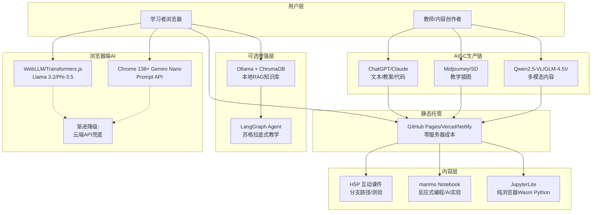

## 6. 技术基础设施：零成本启动方案

传统AI教育产品的技术栈通常意味着服务器租赁、API调用费用和运维人力——月成本动辄数千至数万元。2025–2026年，浏览器端推理、开源课件工具与AIGC内容生产链的三重突破，使"零服务器门槛"的轻量级教育社区成为现实。本章将系统梳理这些技术基础设施，并给出一个可直接落地的架构方案。

### 6.1 浏览器端AI：消除服务器门槛

#### 6.1.1 WebLLM：浏览器内运行大模型，逼近本地速度

WebLLM由MLC AI团队开发，利用WebGPU在浏览器中直接运行Llama 3.2、Phi-3.5、Mistral 7B等开源模型，实现约80%的本地推理速度[^1]。其核心优势在于三重零成本：零服务器部署、零API密钥管理、100%隐私保护（数据不出设备）。截至2026年5月，该项目在GitHub已获得17,200+ Stars[^1]，技术成熟度足以支撑教育场景的推理需求。教师可在纯静态网页中嵌入AI对话功能，无需维护任何后端服务。

Transformers.js作为Hugging Face推出的浏览器端替代方案，基于ONNX Runtime运行，同样实现了多模态模型在浏览器中的推理能力，生态内已有大量教育相关开源项目[^2]。两者形成互补：WebLLM侧重大模型推理优化，Transformers.js侧重任务型小模型（如文本分类、情感分析）的轻量化部署。

#### 6.1.2 Chrome 138+内置Gemini Nano：免费设备端AI的浏览器原生方案

Google Chrome 138及以上版本已内置Gemini Nano模型，通过Prompt API（`window.ai.languageModel`）直接调用[^3]。该模型完全在本地运行，无需云端调用，共享跨域缓存机制，即一旦下载即可被所有AI-enabled网页复用。这意味着浏览器原生AI能力从实验性走向规模化部署——用户无需安装任何插件，打开网页即可获得AI辅助[^3]。

WebLLM协议已自动适配Chrome内置AI能力，当检测到Gemini Nano可用时优先调用本地模型，否则回退至WebGPU加载的模型文件[^1]。这种渐进式降级策略确保了技术方案的可行性。

#### 6.1.3 限制：模型规模与覆盖率的双重边界

浏览器端AI的核心瓶颈在于内存限制。当前技术条件下，实用模型的参数量上限约为8B（INT4/INT8量化后），超出此规模会导致浏览器崩溃或加载时间过长[^1]。此外，WebGPU技术目前覆盖约65%的浏览器用户（主要为Chrome和Edge），Safari和Firefox的支持仍在推进中[^1]。这意味着浏览器端AI适用于苏格拉底式问答、文本摘要、基础分类等轻量任务，但尚难以替代云端大模型在复杂推理场景中的角色。

### 6.2 开源课件与互动工具

开源课件工具已从"基础内容展示"演进为"互动学习体验"，本节聚焦三个在教育社区场景中各具优势的工具。

#### 6.2.1 H5P：分支路径互动课件的标准选择

H5P是一款开源的互动内容创建框架，提供50余种内容类型（Content Types），涵盖分支路径故事、互动视频、拖放题、热点图等[^4]。其核心优势在于LTI（Learning Tools Interoperability）集成能力，可直接嵌入Moodle、Canvas等主流学习管理系统。教育社区使用H5P可实现"选择你的冒险"式互动课件——学习者根据选择进入不同分支，系统记录决策路径并给出反馈。商业竞品如Articulate Storyline 360定价高达1,399美元/用户/年，H5P的零授权费使其成为社区模式的优先选择[^4]。

#### 6.2.2 marimo：反应式Python Notebook的AI原生方案

marimo是2025年快速崛起的反应式Python Notebook，由斯坦福大学科学家团队开发，已获数百万次下载[^5]。与传统Jupyter Notebook不同，marimo将文件存储为纯Python（`.py`），天然Git友好，解决了Jupyter因`.ipynb`格式导致版本控制困难的痛点。其反应式执行引擎基于静态数据流图分析：修改一个单元格的变量，所有依赖该变量的单元格自动重新执行，彻底消除了Jupyter中隐藏状态引发的复现危机[^5]。

marimo的AI原生设计尤为突出。编辑器内置AI助手，支持Claude Code、Codex等Agent CLI直接连接Notebook会话（`marimo pair`），实现"代码+AI对话"的无缝协作。对于编程教育社区，这意味着学员可以下载`.py`文件后在本地运行，或在浏览器中通过WASM直接体验，无需配置Python环境[^5]。

#### 6.2.3 JupyterLite：纯浏览器Wasm Jupyter，离线编程教育

JupyterLite将完整的JupyterLab体验移植到浏览器中，基于Pyodide（WebAssembly编译的CPython）实现纯客户端Python执行[^6]。法国国家教育系统部署的Capytale平台已验证其规模化能力：50万高中生注册，每周20万+会话，后端仅需一台静态文件服务器[^6]。JupyterLite支持离线使用（配置PWA模式后），学员在无网络环境下仍可继续编程练习，这对网络条件不稳定的教育场景至关重要。

下表从功能定位、技术特性、部署成本和教育适用性四个维度对三款工具进行横向比较：

| 维度 | H5P | marimo | JupyterLite |
|------|-----|--------|-------------|
| 核心定位 | 互动课件创作 | 反应式数据科学/编程Notebook | 纯浏览器Jupyter环境 |
| 文件格式 | HTML5 (标准Web) | 纯Python (`.py`) | Jupyter Notebook (`.ipynb`) |
| 技术特性 | 50+内容类型，LTI集成 | 反应式执行，Git友好，AI原生 | WebAssembly，离线可用，零服务器 |
| 部署成本 | 零授权费，需Web服务器 | 零授权费，可WASM运行 | 零授权费，静态托管即可 |
| 教育适用性 | 分支路径故事、互动测验 | 编程教育、数据科学、AI实验 | Python编程入门、科学计算 |
| 典型场景 | 亲子共学互动故事 | 学员AI编程项目 | 离线编程练习营 |

上述三种工具覆盖了教育社区内容生产的不同环节：H5P负责"互动课件"（知识传递），marimo负责"反应式编程实验"（动手实践），JupyterLite负责"规模化编程环境"（零门槛入门）。三者均为零授权费，且支持静态托管部署，技术栈成本压缩至极限。对于轻量级AI教育社区，H5P与marimo的组合尤为高效——前者承载结构化课程内容，后者承载可编程的AI实验，而JupyterLite则作为规模化编程基础设施，在学员数量激增时提供成本可控的扩展能力。

### 6.3 RAG与Agent技术栈

#### 6.3.1 LangChain/LangGraph：教育Agent的事实标准

RAG（检索增强生成）已成为教育AI知识库的标准架构，而LangChain/LangGraph则是该领域的事实标准框架。开源教育项目如edu-agent、AITutorAgent、DeepTutor均基于LangGraph构建其Agent架构[^7]。LangGraph的核心贡献在于将Agent执行建模为状态图（State Graph），支持多步骤推理、工具调用和循环工作流——这正是教育场景中"苏格拉底式提问→学生回答→评估反馈→追问引导"的闭环结构所需的技术抽象[^7]。

GitHub上已有3,300+个ChromaDB相关项目，形成了LangChain/LangGraph + FastAPI + React + 向量数据库（Qdrant/ChromaDB/pgvector）的成熟技术栈[^7]。对于教育社区，这意味着可以在现有开源代码基础上快速构建学科知识库，而非从零开发。

#### 6.3.2 本地RAG：Ollama + ChromaDB + LangChain，零云费用

本地RAG方案通过Ollama（本地模型运行）+ ChromaDB（向量数据库）+ LangChain（编排框架）的组合，实现完全零云、零API费用的知识库问答系统[^8]。Ollama的本地模型调用成本在月使用量超过30万次时，约为云端API（GPT-4o mini）的1/5至1/6[^8]。对于教育社区，该方案的核心价值不仅是成本节约，更在于数据合规——学员问题和知识库内容完全保留在本地设备，符合教育数据隐私要求。

#### 6.3.3 GraphRAG：学科知识天然的图结构优势

教育知识天然具有概念依赖关系：数学中的"代数→函数→微积分"、物理中的"力学→电磁学→量子力学"，这些依赖关系天然构成图结构。GraphRAG（基于知识图谱的RAG）通过显式建模概念间的先修关系、关联主题和典型误区，在学科知识检索中比传统向量检索更加精准[^7]。例如，当学员询问"为什么需要学习导数"时，GraphRAG可以沿知识图谱追溯至"变化率→斜率→瞬时速度"的概念链，给出结构化的解释路径，而非仅返回向量相似的文档片段。

### 6.4 AIGC内容生产工具链

AIGC（AI生成内容）已从"辅助工具"升级为教育社区的核心生产力引擎。研究表明，AIGC可将教育内容生产成本压缩70%以上[^9]。

#### 6.4.1 文本：从教案到互动故事书的分钟级生产

ChatGPT/Claude等大语言模型在文本教育内容生产中的应用已高度成熟。教师使用ChatGPT创建具有分支路径的互动故事书，从构思到完成仅需15分钟——过去这项工作可能需要数小时[^10]。在AI教育社区场景中，PGC（专业生成内容）团队可用AIGC快速产出教案、课件文本、练习题和代码示例，再由社区成员审核和迭代，形成"AI生成初稿+人工精修"的高效工作流。

#### 6.4.2 图像：教学插图与概念可视化的自动生成

Midjourney和Stable Diffusion在生成教学插图、概念可视化图表方面已具备实用质量。例如，"用Midjourney生成一个展示光合作用过程的科学插图"或"用Stable Diffusion生成一个解释递归算法的流程图"。Stable Diffusion的开源特性使其更适合社区场景——社区可部署自有模型，无需支付Midjourney的订阅费用，且可训练针对特定学科风格的LoRA模型。

#### 6.4.3 多模态：理解力提升43.8%的跨模态学习

Qwen2.5-VL-32B-Instruct和GLM-4.5V等领先多模态模型能够同时处理文本、图像、视频和文档[^11]。教育研究显示，多模态解释系统使复杂主题的理解能力提升43.8%，自动转录服务将口语讲座转换为文本后提升了62.7%的可及性[^12]。对于AI教育社区，这意味着学员可以上传手写的数学作业照片，获得图文并茂的解答；或上传一段科学实验视频，获得AI生成的步骤分析和改进建议。2025–2026年，多模态AI的实时交互延迟目标已降至100ms以下，使实时视觉+语音+文本的沉浸式教学体验成为可能[^13]。

### 6.5 技术架构推荐

综合上述技术组件，一个轻量级AI教育社区的理想架构应遵循"浏览器端优先、静态托管、渐进增强"的设计原则。以下为推荐架构的文字描述：

该架构的运作逻辑如下：学习者通过浏览器访问社区，优先利用本地AI能力（WebLLM或Chrome Gemini Nano）进行苏格拉底式问答和知识检索，失败时回退至云端API。所有内容（H5P课件、marimo Notebook、JupyterLite环境）通过静态托管（GitHub Pages/Vercel/Netlify）分发，无需任何服务器基础设施。社区运营者通过AIGC工具链生产内容，经审核后发布至静态站点。对于需要个性化知识库的高级场景，可选部署Ollama + ChromaDB本地RAG系统，由LangGraph编排教育Agent完成复杂教学任务。

这一架构的月度运营成本可压缩至极致：域名约50元/年，静态托管免费（GitHub Pages/Vercel免费层），浏览器端AI零推理费用。相比传统"云服务器+API调用+运维团队"的月成本数千元方案，轻量级架构将冷启动资金从数万元降至数百元，使"一人公司运营教育社区"从技术幻想变为工程现实。

[^1]: LocalAI Master. *WebLLM: Run LLMs in Your Browser at 80% Native Speed (2026)*. 2026-05-21. https://localaimaster.com/blog/webllm-browser-ai-guide

[^2]: GitHub. *ONNX Runtime JavaScript repositories*. 2026-04-06. https://github.com/topics/onnx-runtime?l=javascript

[^3]: WebLLM Official. *WebLLM - Browser-Native AI Protocol*. https://www.webllm.org/blog/chrome-ai-vs-open-web

[^4]: H5P. *H5P - Create and Share Rich HTML5 Content*. 2026-07-08. https://h5p.com/

[^5]: marimo Team. *marimo - A Reactive Notebook for Python*. https://github.com/marimo-team/marimo

[^6]: Research ModelCitizen Developer. *Browser Python Execution Libraries Survey*. 2026-03-06. https://research.modelcitizendeveloper.com/survey/1-110-4/

[^7]: GitHub Gist. *RAG Production Engineering Guide 2025-2026*. 2026-03-24. https://gist.github.com/1kalin/ab7dff1afd6821cf20404c9fea7a0c07

[^8]: Shareuhack. *本地跑AI 完整選型指南2026*. 2026-04-17. https://www.shareuhack.com/zh-TW/posts/local-private-ai-tools-guide-2026

[^9]: 袁义. *AIGC赋能教学资源建设与应用研究*. 2026. https://pdf.hanspub.org/ces_3096127.pdf

[^10]: 台湾科技部. *以喜悅為導向：人工智慧融入語言教學的多模態實踐*. https://www.nstc.gov.tw/nstc/attachments/32b4de0d-ec0d-4488-862b-2a1c9ae2a40b

[^11]: SiliconFlow. *终极指南- 2026年教育领域最佳多模态AI模型*. 2025-09-01. https://www.siliconflow.com/articles/zh-Hans/best-multimodal-ai-models-for-education

[^12]: WJAETS. *Multimodal AI: The future of integrated intelligence*. 2025. https://wjaets.com/sites/default/files/fulltext_pdf/WJAETS-2025-0688.pdf

[^13]: ForceInjection. *AI基础设施课程讲稿 - 多模态应用场景革命*. GitHub. https://github.com/ForceInjection/forceinjection.github.io
