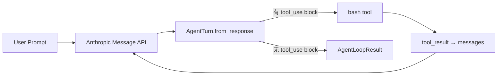

# Agent Loop

## 一个循环就够了

<div class="pt-8 text-xl text-$tw-gray-500">

learn-workbuddy · 从 0 手搓桌面 AI 助手 · 第 1 课

</div>

<div class="abs-br m-6 text-sm text-$tw-gray-400">

💡 底部可以随时问 AI 助教："为什么 tool_result 要喂回去？"

</div>

---
transition: fade-out
---

# 你已经在手动当 Agent 了

你给大模型提了个需求：

> "帮我读取目录下有哪些文件，并且执行 xxx.py"

<v-click>

模型输出了一条 `bash` 命令 —— **然后停了**。
它不会自己跑，也看不到执行结果。

</v-click>

<v-click>

于是你：复制命令 → 手动运行 → 把输出粘贴回对话框 → 模型给出下一条命令 → 再来一遍……

</v-click>

<v-click>

<div class="p-4 rounded-lg bg-$tw-gray-100 border-l-4 border-$tw-gray-400">

**每一个来回，你都在做中间层。**

</div>

</v-click>

---

# 把中间层自动化，就是这一课



<v-click>

WorkBuddy 生产级的 `agent bridge`，拆到底也是这一个循环。

</v-click>

---
layout: two-cols
---

# 核心规则

**模型返回工具调用就继续，没有工具调用就停止。**

- 内容块决定 <u>"是否继续"</u>
- `stop_reason` 解释 <u>"为什么停止"</u>
- Harness 自己维护 <u>轮次预算</u>

::right::

<div class="pl-4">

```python
while 有 tool_use:
    response = LLM(messages, tools)
    执行工具
    结果喂回 messages
```

<div class="mt-4 text-sm text-$tw-gray-500">

先接受单进程简化，后续课程再把 UI、Sidecar、Session 拆开。

</div>

</div>

---

# 四种停止原因，全部显式

| 观察结果 | Harness 解释 | 循环动作 |
|------|------|---------|
| 有 `tool_use` block | 模型请求执行真实 I/O | 执行 → 喂回 → 继续 |
| 无工具块，普通结束 | 模型给出最终回答 | 返回 `final_answer` |
| 无工具块，`max_tokens` | 回答被 provider 截断 | 返回 `max_tokens` |
| 达到 `max_turns` | Harness 预算耗尽 | 返回 `max_turns` |

<v-click>

```python
class LoopStopReason(str, Enum):
    FINAL_ANSWER = "final_answer"
    MAX_TOKENS   = "max_tokens"
    MAX_TURNS    = "max_turns"
```

**循环必须有一个确定的停止点** —— 这是 harness 的责任，不是模型的。

</v-click>

---

# code.py 地图：三个契约对象

```txt {all|1|3-5|7-11|all}
ToolInvocation   # provider tool_use block 的最小切片: id + name + arguments

AgentTurn        # 一次归一化的模型响应: content / stop_reason / tool_calls / text
                 #   from_response() 把 provider 响应读成唯一事实源

AgentLoopResult  # 循环的可观测结果: stop_reason / turns / tool_calls / final_text
```

<v-click>

为什么这么设计？——**循环的每个决策都依赖归一化后的数据**，
而不是直接信任 provider 的原始响应结构。

</v-click>

---

# AgentTurn.from_response — 归一化

```python {all|4-6|8-13|15-20}
@classmethod
def from_response(cls, response: Any) -> AgentTurn:
    content = list(getattr(response, "content", []) or [])
    text_parts: list[str] = []
    tool_calls: list[ToolInvocation] = []

    for block in content:
        block_type = getattr(block, "type", None)
        if block_type == "text":
            text_parts.append(str(getattr(block, "text", "")))
        elif block_type == "tool_use":
            arguments = dict(getattr(block, "input", {}))
            tool_calls.append(ToolInvocation(
                tool_use_id=str(getattr(block, "id", "")),
                name=str(getattr(block, "name", "")),
                arguments=arguments,
            ))

    return cls(content=content,
               provider_stop_reason=getattr(response, "stop_reason", None),
               tool_calls=tuple(tool_calls),
               text="".join(text_parts))
```

<v-click at="4-6">

一次响应可能同时包含文本和多个工具调用 —— 都收集，不丢。

</v-click>

<v-click at="15-20">

文本和工具调用**读一次**，循环决策只用这一份。

</v-click>

---

# stop_reason_for — 显式停止契约

```python {all|5-7|9-10}
def stop_reason_for(turn: AgentTurn) -> LoopStopReason | None:
    """Return None to continue, otherwise the explicit harness stop reason."""

    # Inspect content instead of trusting stop_reason alone.
    # 流式响应里 provider 的 stop 元数据可能晚于内容块到达。
    if turn.tool_calls:
        return None                        # 继续循环
    if turn.provider_stop_reason == "max_tokens":
        return LoopStopReason.MAX_TOKENS   # 截断
    return LoopStopReason.FINAL_ANSWER     # 正常结束
```

<v-click>

⚠️ 误区预警：**直接信任 `stop_reason` 容易漏掉流式响应里的工具调用**。
看内容块，不看（只看）元数据。

</v-click>

---

# agent_loop — 核心循环逐段看

```python {all|4-9|11-19|21-25|27-29}
def agent_loop(messages, max_turns=MAX_TURNS) -> AgentLoopResult:
    tool_call_count = 0
    last_turn: AgentTurn | None = None

    for turn_number in range(1, max_turns + 1):
        response = client.messages.create(
            model=MODEL, system=SYSTEM, messages=messages,
            tools=TOOLS, max_tokens=8000,
        )
        turn = AgentTurn.from_response(response)
        last_turn = turn

        # 1. 先把完整 assistant turn 追加进历史，再执行任何 I/O
        messages.append({"role": "assistant", "content": turn.content})

        # 2. 无工具调用 → 终止；具体原因保持可见
        stop_reason = stop_reason_for(turn)
        if stop_reason is not None:
            return AgentLoopResult(stop_reason=stop_reason, turns=turn_number, ...)

        # 3. 执行全部工具调用，收集协议形状的结果
        results = [execute_bash_call(call) for call in turn.tool_calls]

        # 4. 结果作为一条 user turn 喂回 → 下一轮继续
        messages.append({"role": "user", "content": results})

    return AgentLoopResult(stop_reason=LoopStopReason.MAX_TURNS, ...)
```

<v-click at="11-19">

顺序很重要：先记 history 再执行工具 —— 崩溃时消息序列仍然完整。

</v-click>

<v-click at="21-29">

`max_turns` 用尽时**拒绝发起无界的第 9 轮**，停止是 harness 的显式选择。

</v-click>

---

# 执行边界：单工具也要有护栏

```python
def run_bash(command: str) -> str:
    dangerous = ["rm -rf /", "sudo", "shutdown", "reboot", "> /dev/"]
    if any(item in command for item in dangerous):
        return "Error: Dangerous command blocked"        # ① 黑名单拦截
    try:
        completed = subprocess.run(
            command, shell=True, cwd=os.getcwd(),
            capture_output=True, text=True, timeout=120,  # ② 超时预算
        )
        output = (completed.stdout + completed.stderr).strip()
        return output[:50000] if output else "(no output)"  # ③ 输出截断
    except subprocess.TimeoutExpired:
        return "Error: Timeout (120s)"
```

<v-clicks>

- ① 危险命令 → 文本错误，不抛异常（循环不能被单个工具打崩）
- ② 120s 超时 —— 工具执行必须有界
- ③ 50000 字符截断 —— 为 s13「输出外部化」埋下伏笔

</v-clicks>

---

# 常见误区

<v-clicks>

- 🚫 把 agent 写成**一次性 prompt 调用** —— 后面很难加入工具、记忆和恢复
- 🚫 直接信任 `stop_reason` —— 漏掉流式响应里的工具调用
- 🚫 无界 `while True` —— 模型持续调工具时 harness 没有确定停止点
- 🚫 一开始就上复杂框架 —— 看不清 harness 的真正边界

</v-clicks>

---

# 检查点：这一课你获得了什么

<v-clicks>

- ✅ 最小 agent loop：`while` + 单 bash 工具
- ✅ `tool_use` / `tool_result` 可观察、可测试的交互边界
- ✅ `AgentLoopResult` 显式区分正常回答 / token 截断 / 轮次预算
- ✅ 循环的形状已经具备 —— 后续 23 课都往这个形状上加机制

</v-clicks>

<v-click>

<div class="p-4 rounded-lg bg-$tw-gray-100">

**离线验证**：`python examples/full_tour/code.py` 不需要任何 API key

</div>

</v-click>

---

# 下一课预告

# s02 · Tool Dispatch

<div class="text-xl text-$tw-gray-500 pt-4">

只有一个 bash 工具时，循环可以直接写死调用；

当工具扩展到 read / write / edit / glob 之后 ——

**你需要的不是更多 if/elif，是一条明确的 dispatch boundary。**

</div>

<div class="abs-br m-6 flex gap-2 text-sm">

提问示例："用一个最小例子解释 stop_reason_for 为什么返回 None 表示继续"

</div>
