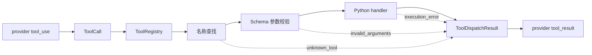

# Tool Dispatch

## 一个注册表就是工具边界

<div class="pt-8 text-xl text-$tw-gray-500">

learn-workbuddy · 从 0 手搓桌面 AI 助手 · 第 2 课

</div>

<div class="abs-br m-6 text-sm text-$tw-gray-400">

> 模型只提出调用意图，Harness 决定它能否以及如何成为一次本地执行。

</div>

---

# 问题：s01 的写法撑不住了

s01 只有一个工具，循环里可以直接写：

```python
output = run_bash(call.arguments["command"])
```

<v-click>

工具扩展到 read / write / edit / glob 之后，硬编码分支同时承担 **七件事**：

</v-click>

<v-clicks>

1. 告诉模型有哪些工具
2. 根据名字找到 Python 函数
3. 判断参数是否完整
4. 把参数传给 handler
5. 决定能否并发
6. 把成功/失败编码回 provider 协议
7. 决定工具子进程可以继承哪些宿主环境变量

</v-clicks>

<v-click>

这些信息散落在 schema 列表、dispatch 字典和循环分支里 —— **迟早不一致**。

</v-click>

---

# 解决方案：每个工具只注册一次

```python
ToolSpec(
    name="read_file",
    description="Read UTF-8 file contents from the workspace.",
    input_schema=object_schema(
        {
            "path": {"type": "string"},
            "limit": {"type": "integer", "minimum": 1},
        },
        ["path"],
    ),
    handler=run_read,
    concurrent_safe=True,
)
```

<v-click>

一个 `ToolSpec` 同时回答四个问题：

| 字段 | 面向谁 | 作用 |
|------|--------|------|
| `name` | 模型协议 + Harness | 稳定查找键 |
| `description + input_schema` | 模型 | 描述调用方式 |
| `handler` | 本地执行 | Python 实现 |
| `concurrent_safe` | Harness | 批量执行策略 |

</v-click>

<v-click>

项目中不再存在一份独立的 `TOOLS` 列表 + 另一份 `TOOL_HANDLERS` 字典。

</v-click>

---

# 分发链路：一条边界走到底



<v-click>

三类失败 —— 未知工具、错误参数、handler 异常 —— 都转换成**显式错误结果**，
不让 Agent Loop 崩溃。

</v-click>

---

# 为什么用 ToolCall / ToolDispatchResult 隔离

<v-clicks>

- `ToolCall`：隔离 provider block —— 循环层不知道 Anthropic/OpenAI 的结构差异
- `ToolDispatchResult`：隔离本地执行 —— 协议编码集中在结果对象里
- Agent Loop 保持 s01 的形状：**它只认识归一化的调用和结果**

</v-clicks>

<v-click>

```txt
s01:  provider block ──────────► 循环直接执行 bash
s02:  provider block → ToolCall → ToolRegistry.dispatch() → ToolDispatchResult → 循环
                              └─ 循环从"知道每个工具"退化为"只知道一条边界"
```

</v-click>

<v-click>

新增工具 = 注册一个 `ToolSpec`，**循环零改动**。

</v-click>

---

# 并发是策略，不是默认

```python
# 只有标记 concurrent_safe 的只读工具批次才能并发
if all(spec.concurrent_safe for spec in batch_specs):
    with ThreadPoolExecutor() as pool:
        results = list(pool.map(dispatch_one, batch))
else:
    results = [dispatch_one(call) for call in batch]   # 保守串行
```

<v-clicks>

- ✅ `read_file` / `glob` —— 只读，标记 `concurrent_safe=True`，批次并发
- ⚠️ `write_file` 后紧跟 `read_file` —— **竞态**，写入和未知调用保守串行
- 🚫 "把所有同轮工具都并发" 是误区，不是优化

</v-clicks>

---

# 模型看过 schema ≠ 参数可信

<v-click>

即使 schema 已经发给模型，输出仍可能：缺字段、类型错误、多余字段。

模型产生的是**不可信协议输入**，Harness 必须在执行前验证。

</v-click>

<v-click>

```python
def validate_arguments(schema: dict, arguments: dict) -> list[str]:
    errors = []
    for field in schema.get("required", []):
        if field not in arguments:
            errors.append(f"missing required field: {field}")
    # 类型检查、多余字段检查……
    return errors   # 非空 → ToolDispatchResult(kind="invalid_arguments")
```

</v-click>

<v-click>

🚫 直接执行 `handler(**block.input)` —— 协议错误和 Python 异常会穿透到循环层。

</v-click>

---

# bash handler 的最小环境

```python
def run_bash(command: str) -> str:
    env = {
        k: v for k, v in os.environ.items()
        if k in TOOL_ALLOWED_ENV   # PATH / HOME 等白名单
    }
    completed = subprocess.run(
        command, shell=True, env=env, ...
    )
```

<v-click>

🚫 误区：认为设置 `cwd` 就完成了隔离 —— 工作目录不会自动移除父进程的
**API key、SSH agent socket** 或其他环境变量。

</v-click>

<v-click>

为子进程**重新构造最小环境**，避免 provider 凭据随工具调用传出 Harness。

</v-click>

---

# 常见误区

<v-clicks>

- 🚫 分别维护 `TOOLS` 和 `TOOL_HANDLERS` —— 改了 schema 忘了改 handler
- 🚫 认为"模型看过 schema"就不会传错参数
- 🚫 直接执行 `handler(**block.input)` —— 协议错误穿透循环层
- 🚫 把所有同轮工具都并发 —— write 后紧跟 read 就是竞态
- 🚫 把安全策略塞进 Agent Loop —— 循环会逐渐知道每种工具的细节

</v-clicks>

---

# 检查点：这一课你获得了什么

<v-clicks>

- ✅ 单一事实源的工具注册表：schema + handler + policy 在同一个 `ToolSpec`
- ✅ `ToolCall` / `ToolDispatchResult` 让循环层与 provider 协议解耦
- ✅ 结构化错误：`unknown_tool` / `invalid_arguments` / `execution_error`
- ✅ 只读批次并发，写入串行 —— 并发是显式策略
- ✅ 工具子进程最小环境，凭据不出 Harness

</v-clicks>

<v-click>

<div class="p-4 rounded-lg bg-$tw-gray-100">

**回顾 s01**：循环的形状没变 —— 变的是循环内部那条 `execute_bash_call`，
被展开成了一条完整的 dispatch 边界。

</div>

</v-click>

---

# 下一课预告

# s03 · Deferred Loading

<div class="text-xl text-$tw-gray-500 pt-4">

工具会越来越多 —— 工具太多时上下文窗口秒炸。

下一课：先让模型**搜索工具**，需要时再展开 schema。

</div>

<div class="abs-br m-6 text-sm text-$tw-gray-400">

提问示例："concurrent_safe 为什么不给 bash 工具开？"

</div>
