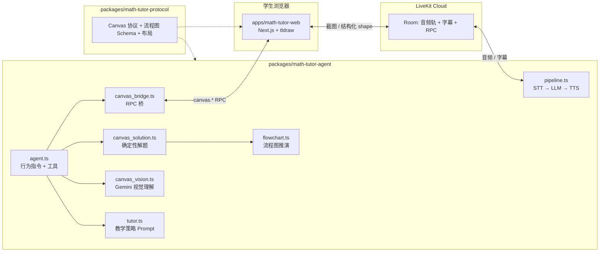
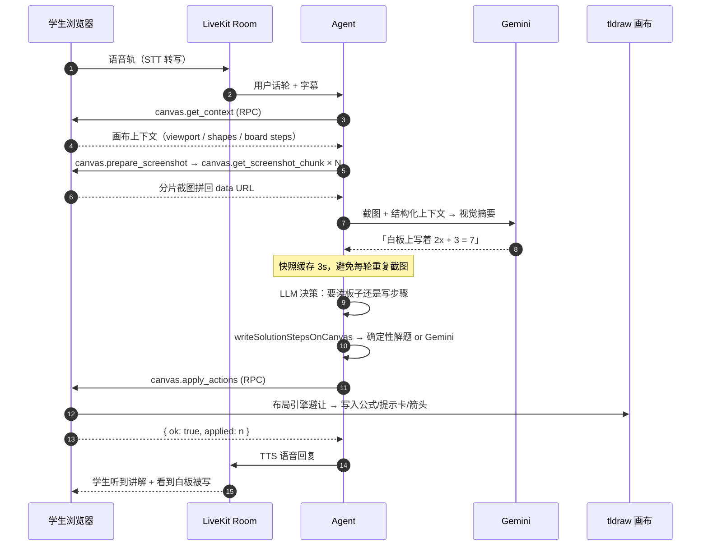

# Lesson 1：AI Math Tutor（语音 + 白板）项目拆解

> 对应 GitHub Issue [#5 Demo AI Meth](https://github.com/qdriven/tutorials-maker/issues/5)
>
> 源项目：`ai-edu-tutorials/ai-math-tutor`（LiveKit Agents + Next.js + tldraw）
> 迁移后位置：`apps/math-tutor-web` + `packages/math-tutor-agent` + `packages/math-tutor-protocol`

本课回答三个问题：

1. **原理**：这个项目到底是怎么把「老师」搬进浏览器的？
2. **模块**：代码被拆成了哪些部分，各自负责什么？
3. **交互**：学生说一句话之后，系统内部发生了什么？

---

## 1. 一句话原理

> 把「一块可写的白板」和「一个能听见学生说话、能看白板、能在白板上写字的老师」接进同一个实时音频房间，
> 让 AI 老师通过 RPC 读取/改写白板，而不是在聊天框里吐答案。

原始形态是「学生拍照作业 → 进入白板 → 点击 Start tutoring → 语音提问 → AI 在同一块白板上写出下一步」。
它刻意复刻一对一辅导的节奏，而不是问答式解题。

三个关键机制：

| 机制 | 作用 | 实现 |
| --- | --- | --- |
| 实时音频通道 | 让辅导像对话而不是像提交表单 | LiveKit Rooms + Agents（Deepgram STT / Cartesia TTS） |
| 画布即上下文 | 让 AI 看到「学生正在写什么」而不是只看聊天记录 | tldraw 白板 + 截图 + 结构化 shape 列表 |
| 结构化动作协议 | 让 AI 的输出是**可校验的画布指令**，而不是自由文本 | Zod 协议 `TutorCanvasCommand` |

> 迁移后这套协议被抽到独立包 `packages/math-tutor-protocol`，web 与 agent 共用同一份定义，
> 避免「浏览器认得的动作」和「Agent 会发出的动作」长期漂移。

---

## 2. 模块地图



### 2.1 `packages/math-tutor-protocol`（新增的共享层）

| 文件 | 职责 |
| --- | --- |
| `src/canvas-protocol.ts` | 浏览器与 Agent 之间的**唯一契约**：画布上下文结构、12 种画布动作、坐标归一化（clamp 0–4000） |
| `src/flowchart.ts` | 流程图数据结构 `FlowchartSpec`（nodes/edges）、分层布局算法、分支标签判定（是/否 ↔ true/false） |
| `src/*.test.ts` | 协议与布局的单测 |

**为什么单独成包**：迁移前 `apps/agent/src/canvas_protocol.ts` 与 `apps/web/lib/math-tutor/canvas-protocol.ts` 是**逐字重复**的两份文件。
任何一次「加一个动作」都要改两处，漏改就会静默失效。mono repo 里这类重复必须用包来消灭。

### 2.2 `apps/math-tutor-web`（教室 / 可见层）

| 模块 | 职责 |
| --- | --- |
| `app/page.tsx` + `components/math-tutor/homework-upload-page.tsx` | 入口：上传作业照片 / 粘贴图片 / 选示例题，图片存 sessionStorage |
| `app/tutor/page.tsx` + `components/math-tutor/math-tutor-workspace.tsx` | 教室主界面：tldraw 白板 + 实时字幕 + 通话控制 + 文字兜底输入 + **5 个 RPC handler** |
| `lib/math-tutor/canvas-protocol.ts` → 已迁移至共享包 | 协议（见上） |
| `lib/math-tutor/board-understanding.ts` | 把原始 tldraw shape 归纳成「题目 / 学生步骤 / 草稿」，推断当前焦点步骤 |
| `lib/math-tutor/canvas-context.ts` | 打包发往 Agent 的画布上下文，控体积、保留关键信息 |
| `lib/math-tutor/tutor-action-layout.ts` | **防遮挡布局引擎**：AI 批注要放在不覆盖学生笔迹的位置 |
| `lib/math-tutor/apply-tutor-actions.ts` | 把结构化动作翻译成真实 tldraw shape（文字/公式/提示卡/箭头/对错标记） |
| `lib/math-tutor/flowchart-canvas.ts` | **本次新增**：把 `FlowchartSpec` 画成流程图 shape，并给执行路径打序号徽章 |
| `lib/math-tutor/session-health.ts` | 会话健康度：连接中/卡住/失败/等待 AI，UI 显式说明而不是静默卡死 |

### 2.3 `packages/math-tutor-agent`（老师 / 行为层）

| 模块 | 职责 |
| --- | --- |
| `src/main.ts` | LiveKit Agent worker 入口，注册 job、启动 pipeline |
| `src/pipeline.ts` | 组装语音管线：STT → LLM → TTS |
| `src/agent.ts` | Agent 行为指令 + 三个工具：`readCanvas` / `writeCanvasActions` / `writeSolutionStepsOnCanvas` |
| `src/tutor.ts` | 教学策略 Prompt：苏格拉底式提问、一次只写一步、不擦学生笔迹、坐标只是提示 |
| `src/canvas_bridge.ts` | Agent 侧 RPC 桥：读上下文、拼装分片截图、下发动作 |
| `src/canvas_vision.ts` | Gemini 视觉理解：读手写/上传的作业图；**本次新增**：结构化抽取流程图 |
| `src/canvas_solution.ts` | 确定性解题路径（分式方程、一次方程、二次因式分解），命中不了再走 Gemini |
| `src/flowchart.ts` | **本次新增**：流程图推演引擎（表达式求值 + 分支跟踪 + 变量状态） |
| `src/canvas_flowchart.ts` | **本次新增**：把推演结果组装成画布动作，并从题面抽取变量的初始值 |
| `src/observability.ts` | 结构化日志：canvas 调用、动作类型、耗时、失败原因 |

---

## 3. 交互流程：学生说一句「这题怎么做」之后发生了什么



关键点：

- **画布是唯一真源**。每次要判断「学生写得对不对」，都必须先 `readCanvas`，而不是相信历史对话。
- **Agent 只发意图，浏览器负责落笔**。坐标是提示，最终位置由浏览器的布局引擎决定，AI 永远不擦学生笔迹（学生 shape 与 AI shape 分属不同 `meta.owner`）。
- **截图分片传输**。白板截图是 data URL，体积大，因此走 manifest + chunk 的分片 RPC 协议。
- **动作必须过 Zod**。模型输出先 `normalizeTutorCommand`，非法动作直接抛错，不会污染画布。

---

## 4. 本次新增：流程图（程序框图）问题支持

原项目只覆盖「方程求解」类题目，README 里也把流程图列为未来方向。本次迁移把它做成了可运行的能力。

### 4.1 能力拆解

| 能力 | 说明 |
| --- | --- |
| **读流程图** | `canvas_vision.ts` 用 Gemini 把白板截图里的流程图抽成结构化 `FlowchartSpec`（节点 + 箭头 + 分支标签） |
| **画流程图** | 新增 `draw_flowchart` 动作，浏览器把 `FlowchartSpec` 渲染成 tldraw 图形（起止=椭圆，判断=菱形，输入输出=平行四边形，处理=矩形） |
| **走流程图** | 新增 `trace_flowchart` 动作，浏览器给执行路径上的节点打绿色序号徽章 |
| **解流程图** | `flowchart.ts` 确定性推演：表达式求值 → 分支判定 → 变量状态追踪 → 输出结果 |
| **教流程图** | `tutor.ts` / `agent.ts` 的 Prompt 新增流程图教学策略：先读起点、一次走一条边、边走边记变量值 |

### 4.2 数据结构

```jsonc
{
  "title": "求输出",
  "nodes": [
    { "id": "s",   "kind": "start",    "label": "开始" },
    { "id": "in",  "kind": "io",       "label": "输入 a" },
    { "id": "p1",  "kind": "process",  "label": "a = a + 1" },
    { "id": "d",   "kind": "decision", "label": "a > 2" },
    { "id": "p2",  "kind": "process",  "label": "a = a * 2" },
    { "id": "out", "kind": "io",       "label": "输出 a" },
    { "id": "e",   "kind": "end",      "label": "结束" }
  ],
  "edges": [
    { "from": "s",  "to": "in" },
    { "from": "in", "to": "p1" },
    { "from": "p1", "to": "d" },
    { "from": "d",  "to": "out", "label": "是" },
    { "from": "d",  "to": "p2", "label": "否" },
    { "from": "p2", "to": "d" },
    { "from": "out","to": "e" }
  ]
}
```

> 这份 spec 就是 `packages/math-tutor-agent/src/canvas_flowchart.test.ts` 里的回归用例，
> 文档与代码不会各说各话。

### 4.3 推演规则

- `start` / `end`：控制流。
- `process`：标签是 `变量 = 表达式` 就赋值，否则当作普通表达式求值并记录。
- `io`：`输入/读入` 走赋值，`输出/打印` 记录输出值。
- `decision`：条件表达式求值后，按箭头标签（是/否 ↔ yes/no ↔ true/false）选分支；只有一个出边时直接走。
- 表达式支持 `+ - * / % ^`、括号、比较运算，以及中文 `× ÷`（`evaluateExpression` 自带递归下降解析器，不使用 `eval`）。
- **初始值从题面来**：教材题通常把「输入 a」画在框图里，把「a 的初始值为 1」写在题干里。
  `extractInitialState` 会从学生说的话里把这种赋值抽出来作为推演的初始状态（只认流程图里真正出现过的变量）。
- 死循环保护：默认最多 60 步，超出即标记 `step_limit` 并停下。

### 4.4 一次完整回答长什么样

学生：「已知 a 的初始值为 1，这个流程图的输出是什么」

1. `readCanvas` 拿到画布 + 截图；
2. 识别到流程图 → Gemini 抽取 `FlowchartSpec`；
3. 从题面取出初始值 `a = 1`，命中确定性推演 →
   `a = 2 → 2 > 2 否 → a = 4 → 4 > 2 是 → 输出 4`；
4. 下发画布动作：
   - `draw_flowchart`：重画一张干净的流程图；
   - `trace_flowchart`：给 `s → in → p1 → d → p2 → d → out → e` 这 8 个节点打上 1..8 号徽章；
   - `write_text` × N：每一步的变量值；
   - `write_formula`：`4`（绿色，答案）；
5. TTS 播报：「我重画了流程图并逐步走了一遍，输出是 4。」

---

## 5. 迁移前后的目录对照

```text
# 迁移前（源项目独立仓库）
ai-math-tutor/
  apps/agent/        →  packages/math-tutor-agent/
  apps/web/          →  apps/math-tutor-web/
  （两份重复的 canvas protocol）→ packages/math-tutor-protocol/

# 迁移后（本 mono repo）
tutorials-maker/
  package.json            # pnpm workspace 根
  pnpm-workspace.yaml     # apps/*, packages/*
  apps/
    math-tutor-web/       # Next.js 教室
  packages/
    math-tutor-protocol/  # 共享协议 + 流程图 Schema + 布局
    math-tutor-agent/     # LiveKit Agent
  build-path/
    math-edu/lesson-1/    # 本文档
```

迁移时做过的实质性改动：

1. **协议去重**：两份逐字重复的 `canvas_protocol` 合并为 `@tutorials-maker/math-tutor-protocol`。
2. **工作区化**：npm 脚本 → pnpm workspace；web 补上直接依赖的 `zod`（原先靠 npm 扁平化 hoist 才能跑）。
3. **打包配置**：`next.config.ts` 增加 `transpilePackages`；agent 的 `vite.config.ts` 增加 `ssr.noExternal`，让 TS 源码协议包被打进产物而不是变成运行时裸 import。
4. **流程图能力**：新增协议动作、渲染层、推演引擎与相关单测。

---

## 6. 怎么跑起来

```bash
# 1. 安装（pnpm workspace）
pnpm install

# 2. 准备环境变量
cp apps/math-tutor-web/.env.example apps/math-tutor-web/.env.local
cp packages/math-tutor-agent/.env.example packages/math-tutor-agent/.env.local

# 3. 起教室
pnpm dev:web      # http://localhost:3000

# 4. 起老师（另开一个终端）
pnpm dev:agent
```

必需环境变量：

```text
# web
LIVEKIT_API_KEY=      LIVEKIT_API_SECRET=      LIVEKIT_URL=
AGENT_NAME=math-tutor                         NEXT_PUBLIC_AGENT_NAME=math-tutor
NEXT_PUBLIC_TLDRAW_LICENSE_KEY=              ALLOW_PUBLIC_TOKEN_ENDPOINT=false

# agent
LIVEKIT_URL=          LIVEKIT_API_KEY=         LIVEKIT_API_SECRET=
AGENT_NAME=math-tutor
GOOGLE_API_KEY=                               # Gemini：视觉理解 / 流程图抽取
GEMINI_LLM_MODEL=google/gemini-2.5-flash
GEMINI_CANVAS_VISION_MODEL=gemini-2.5-flash
MATH_TUTOR_STT_MODEL=deepgram/nova-3
MATH_TUTOR_TTS_MODEL=cartesia/sonic-3
```

测试与类型检查：

```bash
pnpm test        # protocol / agent / web 三个包的 vitest
pnpm typecheck   # 三个包的 tsc --noEmit
```

---

## 7. 配套文件

| 文件 | 内容 |
| --- | --- |
| [`architecture.md`](./architecture.md) | 分层架构、协议契约、时序细节 |
| [`flowchart-support.md`](./flowchart-support.md) | 流程图支持的完整设计与边界 |
| [`../../apps/math-tutor-web`](../../apps/math-tutor-web) | 教室前端 |
| [`../../packages/math-tutor-agent`](../../packages/math-tutor-agent) | LiveKit Agent |
| [`../../packages/math-tutor-protocol`](../../packages/math-tutor-protocol) | 共享协议包 |
