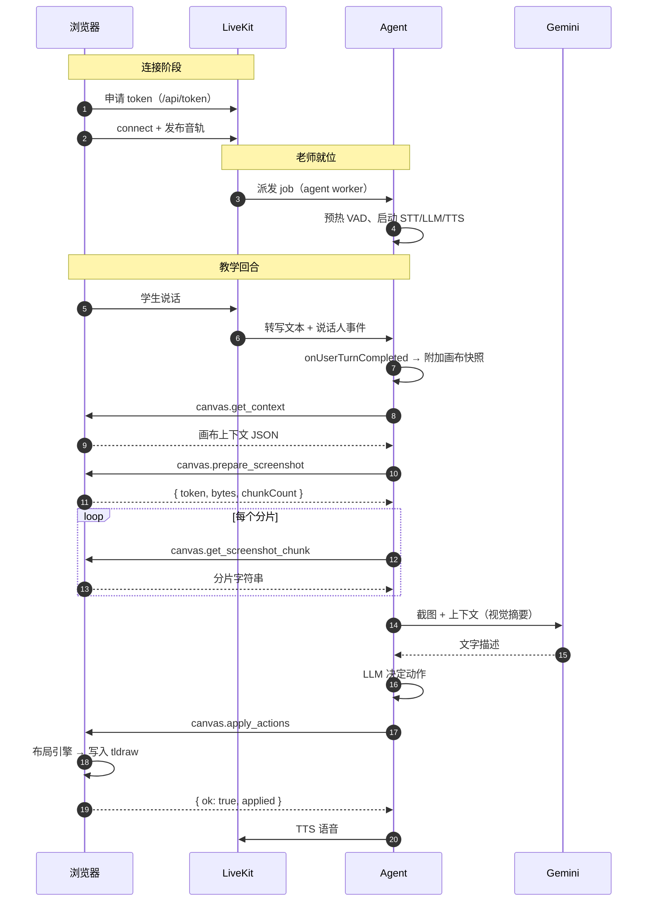

# 架构细节：分层、契约与时序

配套文档：[README.md](./README.md)（原理 / 模块 / 交互总览）、[flowchart-support.md](./flowchart-support.md)（流程图扩展）

---

## 1. 四层架构

```text
┌──────────────────────────────────────────────────────────────┐
│ L4 教学策略层  tutor.ts / agent.ts 的 instructions             │
│    决定「先说什么、什么时候写板子、一次写几步」                │
├──────────────────────────────────────────────────────────────┤
│ L3 推理层      canvas_solution.ts / canvas_flowchart.ts /     │
│                canvas_vision.ts / flowchart.ts                 │
│    决定「板子上写什么」：确定性优先，不行再问模型                │
├──────────────────────────────────────────────────────────────┤
│ L2 协议层      @tutorials-maker/math-tutor-protocol            │
│    决定「怎么描述」：Zod schema + 坐标归一化 + 流程图布局        │
├──────────────────────────────────────────────────────────────┤
│ L1 渲染层      apps/math-tutor-web（tldraw + 布局引擎）          │
│    决定「画在哪、画成什么样」：避让学生笔迹、形状映射            │
└──────────────────────────────────────────────────────────────┘
```

**依赖方向是单向的**：L1 → L2 ← L3，L4 只依赖 L3/L2 的语义。
协议放在 L2 是这次迁移的关键收获：动作的「名字 + 参数 + 合法性」只定义一次。

---

## 2. 协议契约

### 2.1 画布上下文（Agent → 浏览器方向的反向数据）

浏览器把以下内容回传给 Agent：

| 字段 | 说明 |
| --- | --- |
| `roomName` | 当前 LiveKit 房间 |
| `viewport` | 视野范围与缩放，用于判断「哪里有空间」 |
| `selectedShapeIds` | 学生当前选中的图形 |
| `recentEvents` | 最近 80 条画布事件（创建/更新/删除/选中） |
| `shapes` | 最多 400 个图形的结构化索引（id/type/x/y/w/h/text/latex/owner） |
| `board` | `board-understanding` 归纳出的步骤（题目 / 学生步骤 / 草稿 + 焦点步骤） |
| `tutorTurn` | 上一轮是否在等学生回答 |
| `screenshotDataUrl` | 可选截图，视觉理解用 |

`owner` 字段区分 `student / ai / system`，所有「不要覆盖学生笔迹」的规则都建立在这一个字段上。

### 2.2 动作集合（Agent → 浏览器方向）

| 动作 | 作用 | 关键字段 |
| --- | --- | --- |
| `write_text` | 写一句讲解 | `text, x, y, color, targetShapeId?` |
| `write_formula` | 写一行 LaTeX 公式 | `latex, x, y, color, targetShapeId?` |
| `hint_card` | 苏格拉底式提示卡 | `title, body, equation?, x?, y?` |
| `highlight` | 高亮区域 | `x, y, w, h, color, label?` |
| `draw_arrow` | 画箭头 | `from, to, label?` |
| `mark_wrong` / `mark_correct` | 打叉/打勾 | `x, y, reason/note, targetShapeId?` |
| `correct_step` | 一处错误 + 一个修正公式 | `targetShapeId, reason, latex` |
| `ask_student` | 让学生继续做 | `question, targetShapeId?` |
| `clear_ai_annotations` | 清除 AI 批注 | — |
| `draw_flowchart` | **新增**：画流程图 | `spec, x?, y?` |
| `trace_flowchart` | **新增**：标记执行路径 | `path[], note?, spec?, x?, y?` |

`correct_step` 与 `ask_student` 是**语义动作**，浏览器端会展开成基础动作再执行（`correct_step` → `mark_wrong` + `write_formula`）。

### 2.3 归一化

`normalizeTutorCommand` 做的事：

1. Zod 校验整个命令（模型幻觉出的非法动作直接抛错）；
2. 裁剪坐标到 `[0, 4000]`，防止模型给出离谱坐标把内容写到画布外；
3. 去掉空 narration。

---

## 3. 交互时序（细节版）



### 3.1 快照缓存

`getCanvasSnapshot` 带 3 秒 TTL。同一轮里 `readCanvas` 工具、`onUserTurnCompleted`、写步骤工具共享同一份快照，
避免「一次提问截 3 次图」。写入画布后缓存立即失效（`invalidateCanvasSnapshot`）。

### 3.2 为什么截图要分片

LiveKit RPC 有单条消息大小限制。白板截图是 base64 data URL，全屏时轻松上百 KB。
协议采用 `prepare_screenshot`（返回 token 与分片数）+ `get_screenshot_chunk`（按 index 取片）两段式，
Agent 侧拼回完整 data URL，且在 `MAX_SCREENSHOT_BYTES`（120KB）与 `MAX_SCREENSHOT_CHUNKS`（16 片）双重限制内。

---

## 4. 渲染层的防遮挡布局

`tutor-action-layout.ts` 是浏览器端最容易被低估的模块：

1. **视觉尺度推断**：从学生笔迹的高度中位数推出公式字号、批注字号、标记尺寸、间距等一整套 `TutorVisualScale`；
2. **占用矩形收集**：学生图形按 `owner='student'` 计入，AI 自己的图形在 `clear_ai_annotations` 时被清出占用表；
3. **候选位排序**：优先「上一条批注正下方」，其次「提示坐标」，再次「右侧通道」「视口内空白」「画板下方」；
4. **兜底**：全都冲突时放到右侧通道 / 画板下方，保证一定能画出来。

`draw_flowchart` 也走这套布局：整张流程图被视为一个矩形整体参与避让，而不是每个节点各自避让。
