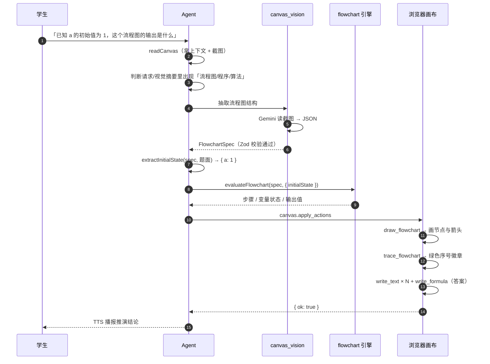

# 流程图（程序框图）问题支持

配套文档：[README.md](./README.md)（总览）、[architecture.md](./architecture.md)（架构与契约）

> Issue #5 原始要求：「agents 部分写入到 packages 包中，**但是需要有流程图的问题支持**」。

---

## 1. 目标与非目标

### 目标

1. 学生把一道**程序框图题**（教材常见题型：读流程图求输出）发到白板上，AI 能读懂它；
2. AI 能把流程图**重画成规范图形**，而不是让模型在画布上自由涂鸦；
3. AI 能**逐步推演**这条路径，并在白板上标出「走过的路」和「每一步的变量值」；
4. 推演结论（输出值）必须是**算出来的**，不是模型口头断言的。

### 非目标

- 不做通用程序解释器（只支持赋值/算术/比较/输入输出这四类节点语义）；
- 不做循环次数的形式化证明（用步数上限兜底）；
- 不做图形识别算法（用现成的 Gemini 视觉能力，抽结构而非自己识别像素）。

---

## 2. 三层改动

### 2.1 协议层：`packages/math-tutor-protocol`

新增两个动作与一套数据结构：

```ts
// src/flowchart.ts
export const FlowchartNodeKindSchema = z.enum(['start', 'process', 'decision', 'io', 'end']);
export const FlowchartSpecSchema = z.object({
  title: z.string().max(80).optional(),
  nodes: z.array(FlowchartNodeSchema).min(1).max(40),
  edges: z.array(FlowchartEdgeSchema).max(80),
});
```

```ts
// src/canvas-protocol.ts
{ type: 'draw_flowchart', spec: FlowchartSpec, x?, y? }
{ type: 'trace_flowchart', path: string[], note?, spec?, x?, y? }
```

同时提供**分层布局** `layoutFlowchartSpec(spec, origin)`：

- 用「最长路径」算法给每个节点算层号（起点第 0 层，箭头指向的节点至少深一层）；
- 同层节点横向排开（用于「是 / 否」两条分支），层与层之间纵向推进；
- 边按「源节点底边中点 → 目标节点顶边中点」连线，同层边走侧面。

布局放在协议包而不是 web 包，是因为 agent 侧也需要「这张图大概多大、该放在哪」的判断。

### 2.2 渲染层：`apps/math-tutor-web/lib/math-tutor/flowchart-canvas.ts`

| 节点类型 | tldraw 几何图形 |
| --- | --- |
| `start` / `end` | `ellipse` |
| `process` | `rectangle` |
| `decision` | `diamond` |
| `io` | `parallelogram` |

- 每个节点 shape 带 `meta.flowchartNodeId` / `meta.flowchartKind`，这是路径标记能对上号的关键；
- 边渲染为 `arrow` shape，箭头上的「是 / 否」写进 `richText`；
- `trace_flowchart` 通过 `meta.flowchartNodeId` 反查 shape，在节点左上角叠一个**绿色序号徽章**，并在起点下方写一句路径说明。

### 2.3 推理层：`packages/math-tutor-agent`

| 文件 | 职责 |
| --- | --- |
| `src/flowchart.ts` | 推演引擎：表达式求值 + 节点语义 + 分支选择 + 变量状态 |
| `src/canvas_flowchart.ts` | 把推演结果组装成画布动作；并从学生题面抽取变量的初始值 |
| `src/canvas_vision.ts` | `extractFlowchartFromCanvasWithGemini`：从截图抽 `FlowchartSpec` |
| `src/agent.ts` | 识别「这题可能是流程图」→ 触发抽取 → 把 spec 传进解题链路 |
| `src/tutor.ts` / `src/agent.ts` Prompt | 流程图教学策略 |

---

## 3. 推演引擎

### 3.1 表达式求值

`evaluateExpression(expr, state)` 是**自研递归下降解析器**（不使用 `eval`）：

- 文法：`comparison → additive → multiplicative → unary → power → primary`；
- 支持 `+ - * / % ^`、括号、一元负号、比较运算 `> >= < <= == !=`；
- 中文符号自动归一：`× ÷ （ ） ＜ ＞ ＝ ，`；
- 未知标识符按 `0` 处理（读入前未赋值的变量）。

### 3.2 节点语义

| kind | 标签样例 | 行为 |
| --- | --- | --- |
| `start` | 开始 | 沿唯一出边继续 |
| `process` | `a = a + 1` | 解析 `变量 = 表达式` 并赋值；无赋值则按表达式求值并记录 |
| `io` | `输入 a` / `输出 a` | 输入走赋值；输出记录到 `outputs` |
| `decision` | `a > 2` | 条件求值 → 布尔 → 按边标签选分支 |
| `end` | 结束 | 停止 |

分支选择顺序：

1. 出边只有 1 条 → 直接走；
2. 边标签命中当前布尔值（`是/yes/true/y/1` ↔ `否/no/false/n/0`，含 `满足/不满足`）→ 走它；
3. 边标签与条件文本完全相同 → 走它；
4. 兜底走第一条出边。

### 3.3 初始值从题面来

教材的「求输出」题，框图里往往只写「输入 a」，**a 的取值写在题干里**（「已知 a 的初始值为 1」）。
框图本身没有这个数，所以推演前必须把它找回来。

`extractInitialState(spec, instruction)` 负责这一步：

- 识别的写法：`a=1`、`a = 1`、`a＝1`、`a 为 1`、`a 等于 1`、`a 的初始值为 1`；
- 只认**纯数值**右值，`a = a + 1` 这种表达式不会被当成初始值；
- 只保留**流程图里真正出现过的变量**，避免把题干里无关的数塞进变量表；
- 抽到的值作为 `evaluateFlowchart(spec, { initialState })` 的起点，之后流程图里自己的赋值语句照常覆盖它。

> 没有这一步，框图里没有初始值 → `a` 视为 0 → 「求输出」这道题会算错，而且错得很安静。

### 3.4 安全阀

- 默认最多 60 步，超出标记 `stopped='step_limit'` 并停机；
- 指向不存在节点的箭头 → `stopped='dead_end'`，并把原因写进 `message`；
- 除零 → 抛错 → 该步 `stopped='error'`，错误信息进入步骤说明（学生能看到「这里算不出来」）。

---

## 4. 端到端流程



---

## 5. 关键设计取舍

| 取舍 | 理由 |
| --- | --- |
| 抽结构交给 Gemini，**推演交给确定性代码** | 视觉模型擅长「图上有什么」，不擅长「连乘加除算对」；把两件事拆开，算错的可能性大幅下降 |
| 画流程图用**声明式 spec**而不是逐个 shape 指令 | 模型输出 `nodes/edges` 比输出十几个坐标可靠得多；布局交给算法，模型只负责语义 |
| 流程图作为**一个整体**参与避让布局 | 否则每个节点各自找空位会把流程图排成一团乱麻 |
| 路径标记依赖 `meta.flowchartNodeId` | 动作之间是「先画后标」，靠元数据对齐比靠坐标对齐稳定 |
| 死循环用步数上限兜底 | 教材题不会真死循环，但模型抽错的图可能；宁可停下并说明，也不要无限跑 |
| 初始值从**题面**抽，不从框图抽 | 教材题的取值写在题干里，框图只有「输入 a」；抽不到就按 0 起算，宁可算出一个可疑的答案让学生来质疑，也不要假装题目里没有这个数 |

---

## 6. 已知限制

1. **结构抽取依赖 Gemini**：没有 `GOOGLE_API_KEY` 时，流程图能力不可用（会退化为纯文本对话）。
2. **节点标签必须接近自然语句**：`输入 a`、`a = a + 1`、`a > 2`、`输出 a` 这类写法识别最好；复杂中文流程图描述可能只走到「读懂」而走不到「算对」。
3. **只覆盖单变量或简单多变量**：不支持数组、字符串、函数调用。
4. **不含循环计数结论**：能走完循环并给出最终输出，但不给出「共循环 n 次」这类显式结论（步骤说明里可推断）。
5. **初始值必须说得出口**：题面里没写初始值时，变量按 `0` 起算，答案会错。识别得了 `a=1` / `a 为 1` / `a 的初始值为 1`，但「a 先取 1 再加 2」这类叙述还抓不住。

---

## 7. 测试覆盖

| 测试文件 | 覆盖点 |
| --- | --- |
| `packages/math-tutor-protocol/src/flowchart.test.ts` | 分层布局、同层不重叠、起点识别、分支标签映射 |
| `packages/math-tutor-protocol/src/canvas-protocol.test.ts` | 新动作的 Zod 校验、坐标裁剪、非法 kind 拒绝 |
| `packages/math-tutor-agent/src/flowchart.test.ts` | 表达式优先级/比较/中文符号、分支选择、变量状态、循环上限、死链 |
| `packages/math-tutor-agent/src/canvas_flowchart.test.ts` | 画图 + 追踪 + 分步 + 答案公式的组装，纯画图请求的短路、初始值抽取、**文档示例的回归用例** |
| `apps/math-tutor-web/lib/math-tutor/flowchart-canvas.test.ts` | 节点/箭头数量、几何图形映射、节点 id 标注、序号徽章、未知节点忽略 |

> 文档 §2 的 JSON 示例就是 `canvas_flowchart.test.ts` 里的 `loopSpec`，
> 改文档必须同步改用例，跑测试就能发现文档与实现漂移。
