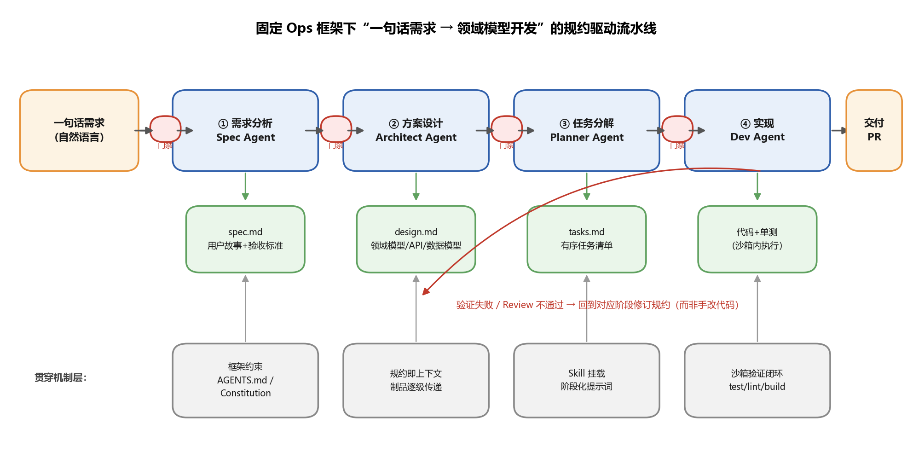
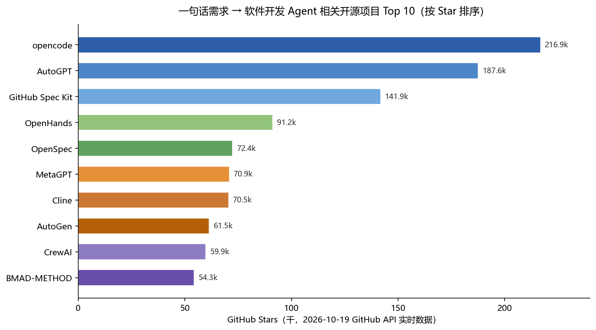

# 固定 Ops 框架下“一句话需求 → 领域模型开发”的 AI Agent 调度与 Workflow 执行原理深度调研

> 调研日期：2026-10-19 ｜ 数据口径：GitHub API 实时星数 + 官方文档 + 学术论文（arXiv）+ 厂商技术资料

---

## 摘要（TL;DR）

你描述的这套东西——**一套约定好的前后端 Ops 框架 + 从一句需求出发的领域模型开发流水线（需求分析 → Review → 任务分解 → 设计方案 → 实现）**——在 2025–2026 年已经有明确的行业名称：**Spec-Driven Development（规约驱动开发，SDD）**。GitHub 官方的 [Spec Kit](https://github.com/github/spec-kit)（Specify → Plan → Tasks → Implement）、Amazon 的 Kiro（Requirements/EARS → Design → Tasks）、OpenSpec、BMAD-METHOD 都是同一思想的实现。

**核心结论：**

1. **这套流程完全可行，且已是主流范式。** 关键不是"更强的模型"，而是把人类的 SOP（标准作业程序）物化为 Markdown 制品链（spec.md → design.md → tasks.md），让每个阶段的 Agent 在结构化上下文中工作，而不是在聊天历史里即兴发挥。
2. **固定框架是最大的杠杆。** 框架约定通过 `AGENTS.md` / `CLAUDE.md` / Constitution / Steering 文件注入 Agent 上下文，把"无限的代码生成空间"收敛为"在既定骨架内填空"，这是领域模型开发能被 Agent 可靠执行的根本原因。
3. **OpenHands 类项目可以执行这个流程**，但它设计目标是"通用软件工程 Agent"（事件流 + CodeAct + 沙箱），更擅长 Issue→PR；要跑"需求分析→评审→分解→设计"的阶段门禁流水线，Spec Kit / BMAD / Kiro 这类规约驱动框架更贴身。两者可以组合：Spec Kit 负责上游制品，OpenHands 负责下游沙箱执行。
4. **底层原理**可以归纳为六条：SOP 物化、上下文工程、动作空间代码化（CodeAct）、验证闭环（ReAct + 测试回灌）、阶段门禁（HITL Gate）、以及约束收敛（固定框架压缩解空间）。

---

## 1. 问题本质：为什么"固定框架 + 约定"是前提

### 1.1 一句话需求的真实难点

"一句话需求"（如"给订单系统加一个在库校验"）对人类高级工程师是足够的，因为工程师脑中有：项目骨架、领域术语、数据模型、代码规范、测试习惯。**Agent 没有这些，除非你把它们写下来。** 这就是整个方法论的出发点：BMAD 社区反复观察到的失败模式是——"Agent 生成看似合理的代码，但偏离你的意图，且每次后续提示都在放大这种漂移"（[Nitor Infotech, 2026](https://www.nitorinfotech.com/blog/what-is-the-bmad-method-a-complete-guide-to-ai-driven-software-development-in-2026/)）。

因此，固定 Ops 框架的价值不是"开发效率高"，而是**为 Agent 提供了可注入的确定性上下文**：

- **目录约定**：`backend/src/modules/<domain>/` 下固定有 `controller/service/repository/entity`，前端固定 `pages/components/api/store`——Agent 的"任务分解"才能映射到确定文件。
- **技术栈约定**：ORM、校验库、错误码规范、统一响应包装——写进 `AGENTS.md` 或 Spec Kit 的 `constitution.md`，每次会话自动注入。AWS 官方文档把这类文件统称为 "rules files"，并给出了 Claude Code / Codex / Cursor / Kiro 各自的挂载位置对照表（[AWS Agent Toolkit 文档](https://docs.aws.amazon.com/agent-toolkit/latest/userguide/mcp-ug.pdf)）。
- **领域约定**：统一语言（Ubiquitous Language）词汇表、聚合根清单、限界上下文边界——这是"领域模型开发"能被 Agent 执行的关键：DDD 的战术模式（Entity / VO / Aggregate / Repository / Domain Service / Domain Event）本身就是强约定，天然适配"框架内填空"的生成模式。

### 1.2 Agentic Coding Manifests：约定的载体已有学术定义

2025 年 arXiv 上已有专门研究把 `CLAUDE.md` / `AGENTS.md` 这类文件命名为 **Agentic Coding Manifests（ACMs，智能体编码宣言）**，并系统分析了 806 个开源仓库中的 838 个 `CLAUDE.md` 文件，结论是：ACM"通过记录项目特定的上下文和约定，消除了重复解释的需要，减少了开发者与 AI 助手之间的误解；当它们与代码库一起纳入版本控制时，能确保 AI Agent 在整个开发生命周期中保持对每个项目独特需求的一致理解"（[arXiv:2509.14744](https://arxiv.org/pdf/2509.14744)）。这正是"固定 Ops 框架"在 Agent 时代的标准表达形式。

---

## 2. 全流程逐步分解：每个阶段的目标、制品、Skill 与门禁

下图是本调研综合 GitHub Spec Kit（Specify → Plan → Tasks → Implement → Converge）、Amazon Kiro（Requirements → Design → Tasks → Implementation + Hooks）、BMAD（8 阶段）、DSPI（Design → Specify → Plan → Implement）四套主流实现后抽象出的通用流水线：



### 2.1 阶段一：需求分析（Specify / Requirements）

**目标**：把一句话需求展开为无歧义、可验收的规约。

**执行方式**：Spec Agent（或 PM Agent）读取一句话需求 + 项目 Constitution（技术栈铁律）+ 领域词汇表，产出 `spec.md`。Kiro 的做法是强制使用 **EARS 记法**（Easy Approach to Requirements Syntax）：`WHEN [条件/事件] THE SYSTEM SHALL [期望行为]`，把"系统应允许用户导出交易记录"改写为"当用户点击导出时，系统应生成包含当前所有已显示交易的 CSV 文件"——这种结构化句式让 AI 和人类都难以误读（[AWS in Plain English](https://aws.plainenglish.io/what-is-spec-driven-development-and-how-to-implement-it-with-kiro-b5846bd55869)）。

**产出制品**：用户故事、EARS 验收标准、边界情况清单、明确的"非目标"（Out of Scope）。

**本阶段需要的 Skill**：
- 需求澄清 Skill（主动追问欠规约点，对应 Spec Kit 的 `/speckit.clarify`）；
- 领域词汇表检索 Skill（保证术语与已有聚合一致）；
- 用户故事/验收标准写作 Skill（EARS 或 Gherkin 模板）。

### 2.2 阶段二：需求 Review（Clarify Gate）

**目标**：在写任何代码之前，让人类确认"机器理解的=我想要的"。

**执行方式**：这是一个**阶段门禁（Phase Gate）**。Spec Kit 官方工作流明确要求每个阶段产出 Markdown 制品并由人审阅后才进入下一阶段，`/speckit.clarify` 会"审问"规约中欠规约的部分——"这是整个流程中杠杆最高的一步，因为在这里抓住一个假设错误，就意味着一个 bug 永远不会进入代码"（[dreaming.press 实操指南](https://www.dreaming.press/posts/how-to-run-spec-driven-development-github-spec-kit.html)）。DSPI 框架把门禁规则写进了每个阶段的 Skill 定义里："After drafting specs.md: review for completeness before finalizing——每一阶段的文档就是契约，Agent 实现文档所说的，而不是它以为的"（[DSPI, dev.to](https://dev.to/jhagerer/spec-driven-development-based-on-dspi-design-specify-plan-implement-dm2)）。

**本阶段需要的 Skill**：
- 规约完整性检查清单 Skill（checklist，对照 Constitution 逐条验证）；
- 歧义检测 Skill（找出"快""合理""等"这类不可测词）；
- 人类审批接口（workflow 在此阻塞等待 approve/reject）。

### 2.3 阶段三：设计方案（Plan / Design —— 领域建模核心）

**目标**：在固定框架内完成领域模型设计——这是"领域模型开发"字样落地的地方。

**执行方式**：Architect Agent 读取 `spec.md` + 代码库现状（通过 Glob/Grep/读现有聚合代码）+ 框架约定文件，产出 `design.md`/`plan.md`。Kiro 在这一步"分析现有代码库并产出覆盖技术架构、数据流、API 定义和集成点的设计文档"（[Cloud Security Partners](https://www.cloudsecuritypartners.com/blog/kiro-ide-guidance)）。在固定前后端框架下，设计文档的章节是**被框架预定义**的：

| 设计章节 | 后端（固定框架内） | 前端（固定框架内） |
|---|---|---|
| 领域模型 | 聚合根/实体/值对象/领域事件清单，落到 `entity/` | 视图模型（ViewModel）与领域模型的映射 |
| 应用服务 | 用例编排、事务边界，落到 `service/` | 页面状态流转（store）设计 |
| 接口契约 | REST/RPC endpoint + DTO + 校验规则 | API client 函数签名 |
| 持久化 | 表结构/迁移脚本/Repository 接口 | —— |
| 横切关注 | 错误码、鉴权、幂等、审计日志 | 权限指令、 loading/异常规范 |

**本阶段需要的 Skill**：
- 代码库探查 Skill（找现有模式，保证新设计复用而非另起炉灶）；
- DDD 建模 Skill（聚合划分、不变式识别）；
- API 契约设计 Skill（OpenAPI/Proto 模板）；
- 数据库设计 Skill（ migration 规范）。

### 2.4 阶段四：任务分解（Tasks）

**目标**：把设计分解为**有序的、单个会话可完成的、可验证的**任务清单。

**执行方式**：Planner Agent 读取 spec + design，产出 `tasks.md`。DSPI 的任务文件规范非常有代表性，每个任务必须包含：明确目标、**要修改的具体文件**、逐步指令、**验证标准**、对其他任务的依赖；且规则写明"每个任务应能在一个专注会话内完成""任务必须排序以尊重依赖""每条规约需求必须被至少一个任务覆盖"（[DSPI](https://dev.to/jhagerer/spec-driven-development-based-on-dspi-design-specify-plan-implement-dm2)）。Spec Kit 还提供 `/speckit.analyze` 做跨制品一致性检查——专门抓"spec.md 里的某条需求从未变成任何任务"这类覆盖缺口。

**本阶段需要的 Skill**：
- 任务分解 Skill（按依赖拓扑排序）；
- 覆盖率分析 Skill（spec ↔ tasks 双向追溯矩阵）；
- 工作量粒度控制 Skill（过大拆分、过小合并）。

### 2.5 阶段五：实现与收敛（Implement / Converge）

**目标**：逐任务执行，每个任务完成即验证，全部完成后对照验收标准收敛。

**执行方式**：Dev Agent 逐条消费 `tasks.md`，在**沙箱**中写代码、跑测试、根据失败反馈自我修正（ReAct/CodeAct 循环）。关键纪律是：**发现实现与规约不符时，回到规约层修改并重新生成，而不是手改代码**——"当 waitlist 功能下季度要加推荐字段时，你不是向一个已经忘了上下文的 Agent 重新解释，而是编辑 spec.md、重新生成受影响的片段、审阅 diff。意图活在版本化的文件里，而不是丢失的聊天记录里"（[dreaming.press](https://www.dreaming.press/posts/how-to-run-spec-driven-development-github-spec-kit.html)）。Spec Kit 社区进一步把这个纪律形式化为"双环校验"：内环 `reconcile`（实现偏离规约时回写规约），外环 `archive`（合并后把 feature 规约归档进项目长期记忆）（[spec-kit Discussion #152](https://github.com/github/spec-kit/discussions/152)）。

**本阶段需要的 Skill**：
- 框架代码生成 Skill（按骨架模板产出 controller/service/entity）；
- 测试生成 Skill（EARS 验收标准 → 测试用例的天然转换）；
- 验证执行 Skill（test/lint/build 沙箱命令）；
- 规约回写 Skill（reconcile）。

---

## 3. 整体 SKILL 清单：一套可落地的资产目录

把上面五个阶段汇总，一套完整的"固定框架领域模型开发 Ops"需要以下 Skill 资产（可按 Claude Skills / SKILL.md 规范实现为独立挂载单元）：

| # | Skill | 挂载阶段 | 输入 → 输出 | 关键规则示例 |
|---|---|---|---|---|
| 1 | 需求澄清（clarify） | ①② | 一句话需求 → 追问清单 → spec.md | 每个歧义必须显式确认；禁止假设业务规则 |
| 2 | EARS/用户故事写作 | ① | 需求草稿 → EARS 验收标准 | WHEN…THE SYSTEM SHALL… 句式强制 |
| 3 | 框架宪法（constitution） | 全程注入 | 技术栈铁律、目录约定、禁令 | "所有 endpoint 必须鉴权""禁止密钥入库" |
| 4 | 领域词汇表检索 | ①③ | 术语 → 已有聚合/限界上下文 | 新术语必须与既有统一语言对齐 |
| 5 | 代码库探查 | ③④ | 关键词 → 相关文件与模式 | 引用必须带文件路径与行号 |
| 6 | DDD 建模 | ③ | spec.md → 聚合/实体/值对象设计 | 不变式必须显式声明；贫血模型禁令可选 |
| 7 | API 契约设计 | ③ | 用例 → OpenAPI/DTO | 契约先行；错误码字典强制 |
| 8 | 任务分解 | ④ | design.md → tasks.md | 单任务单会话可完成；依赖拓扑排序 |
| 9 | 覆盖率分析 | ②④ | spec ↔ plan ↔ tasks | 每条需求至少映射一个任务 |
| 10 | 框架代码生成 | ⑤ | tasks.md → 骨架内代码 | 只允许在约定目录生成约定形态的文件 |
| 11 | 测试生成 | ⑤ | EARS 标准 → 测试用例 | 每条验收标准至少一个测试 |
| 12 | 沙箱验证 | ⑤ | 代码 → test/lint/build 结果 | 验证失败回灌 Agent 上下文 |
| 13 | 规约回写（reconcile） | ⑤后 | 实现偏差 → 规约修订 | 代码与规约最终必须一致才准入库 |
| 14 | Review 清单 | ②及各门禁 | 制品 → 审查意见 | 对照产品准则/风格指南/历史教训 |

这套清单与 DSPI 开源实现（design/spec/plan/implement 四个 SKILL.md，每个都有 Input / Workflow / Stopping Points / Rules 四段式结构）在形态上完全一致（[DSPI](https://dev.to/jhagerer/spec-driven-development-based-on-dspi-design-specify-plan-implement-dm2)），说明"Skill = 阶段化提示词 + 工具白名单 + 停止点"已经成为事实标准。

---

## 4. AI Agent 如何调度：三种范式与编排框架

### 4.1 范式一：单 Agent 推理-行动循环（ReAct / CodeAct Loop）

OpenHands 是代表：一个 Agent 在"模型决策 → 执行动作 → 观察结果 → 再决策"的循环中完成全部工作。DataCamp 对其架构的拆解是：模型只做推理（通过 LiteLLM 路由到任意提供商），Agent 逻辑层负责运行推理-行动循环、管理上下文（condenser 压缩历史）、并把每一步动作与观察记录进事件历史供下一轮模型参考（[DataCamp OpenHands 教程](https://www.datacamp.com/tutorial/openhands)）。

**适用**：任务边界清晰、一次会话可完成的实现类工作。**不适用**：需要人类在多个节点审批的流水线——循环本身没有"门禁"概念，需要外挂。

### 4.2 范式二：多角色 SOP 模拟（Virtual Software Company）

MetaGPT 和 ChatDev 是代表。MetaGPT 的论文（arXiv:2308.00352，ICLR 2024  oral）明确提出 `Code = SOP(Team)` 哲学：拿到用户需求后，产品经理 Agent 先产出含用户故事和需求池的 PRD → 架构师 Agent 翻译成系统设计（文件清单、数据结构、接口定义）→ 项目经理 Agent 分发任务 → 工程师 Agent 执行 → QA Agent 编写测试用例强制质量（[MetaGPT 论文](https://arxiv.org/html/2308.00352v7)）。它官方的自我描述就是"**输入一行需求，输出用户故事/竞争分析/需求/数据结构/API/文档**"（[MetaGPT 文档](https://docs.deepwisdom.ai/main/en/guide/get_started/introduction.html)）——与你的问题描述几乎逐字对应。

ChatDev 则用"聊天链（ChatChain）"把瀑布模型（设计→编码→测试→文档）固化为顺序相位。两者对比的关键差异是：**MetaGPT 用结构化文档（PRD、设计稿）作为阶段间接口，ChatDev 只用聊天历史**——前者能显著减少幻觉和范围蔓延，因为后续 Agent 被前序制品"锚定"而非被聊天记录"暗示"（[inferensys 对比分析](https://inferensys.com/differences/agentic-workflow-orchestration-frameworks/multi-agent-orchestration-frameworks/chatdev-vs-metagpt)）。

**适用**：绿地原型、教学、需要完整文档链的场景。**局限**：角色是"演"出来的，对既有仓库的增量修改能力弱（2026 年的 arXiv 综述指出 MetaGPT/ChatDev 聚焦代码生成，而 SWE-agent/OpenHands 才面向仓库级任务）（[arXiv:2606.22082](https://arxiv.org/html/2606.22082v1)）。

### 4.3 范式三：规约驱动流水线（Spec-Driven Pipeline）—— 本报告推荐范式

Spec Kit / Kiro / BMAD / OpenSpec 是代表。**Agent 不按公司角色分工，而按制品阶段分工**；调度由"制品是否通过门禁"驱动，而不是由 Agent 间对话驱动。BMAD V6 的资料最完整：12+ 角色 Agent、8 个阶段、三种规模轨道（Quick Flow / BMAD Method / Enterprise）按任务复杂度匹配流程深度，三种协作模式——Sequential Handoff（可预测流水线）、Party Mode/Roundtable（多 Agent 同场辩论）、On-Demand Specialist（窄任务按需调用）（[Nitor Infotech](https://www.nitorinfotech.com/blog/what-is-the-bmad-method-a-complete-guide-to-ai-driven-software-development-in-2026/)）。

**调度逻辑的本质**：workflow 引擎（可以是 LangGraph 状态图、GitHub Actions、或 Spec Kit 的斜杠命令序列）持有全局状态机；每个节点 = 一个 Skill 挂载的 Agent 会话；边 = 门禁条件（制品存在且获批）。Agent 之间**不直接对话**，全部通过版本化 Markdown 制品传递上下文——这就是"上下文工程"取代"提示词工程"的实践形态。

### 4.4 编排框架选型对比

| 框架 | 编排模型 | 状态管理 | 适用定位 | 风险点 |
|---|---|---|---|---|
| LangGraph | 有向图状态机，节点/边/条件路由全部显式编码 | 显式类型化状态 + checkpoint 可回放 | 需要审计追踪、失败重放、确定性控制流的生产流水线 | 学习曲线陡，图拓扑设计成本高 |
| CrewAI | 角色制 crew + 层级委派；Flows 提供事件驱动编排 | 框架托管为主 | 问题天然可按团队角色分解；快速搭建 | 复杂条件路由表达力弱于图模型 |
| AutoGen | 多 Agent 结构化对话轮流发言 | 对话历史 | 研究型、需要 Agent 协商的场景 | 正并入 Microsoft Agent Framework，有迁移风险（[Nexus 对比](https://agent.nexus/blog/langgraph-vs-crewai)） |
| Spec Kit / Kiro | 无引擎：斜杠命令 + 文件制品 + 人工门禁 | 文件系统即状态 | 规约驱动开发，任何编码 Agent 皆可驱动 | 自动化程度取决于外围 CI 编排 |

一个值得注意的 2026 年趋势是 **Planner–Executor 分离**成为新兴标准（LangGraph、CrewAI、AutoGen 均已采纳）：由前沿模型做规划、廉价模型做执行，可降本约 90%（[KommoMCP 架构综述引述](https://github.com/ampulex-23/KommoMCP)）。在你的 Ops 框架里，这意味着：需求分析与方案设计用强模型，任务执行用快模型，验证用确定性脚本（零模型成本）。

---

## 5. Workflow 如何执行：四个运行机制

### 5.1 事件流（Event Stream）—— 可持久化、可续跑、可审计

OpenHands 最具辨识度的设计：Agent 的所有动作（读文件、执行命令、调用工具、模型推理）都被序列化为事件，经统一服务器串联，支持任务持久化、断点续跑与多智能体编排（[OpenHands 介绍](https://blog.csdn.net/wangchunyu114/article/details/164299430)）。2025 年 11 月发布的 V1 SDK（arXiv:2511.03690）进一步把架构改为**无状态、事件溯源（event-sourced）**的四包结构（SDK / Tools / Workspace / Server），原生支持远程执行和 100+ 模型提供商路由，并用 `AgentDelegateAction` 支持多 Agent 委派（[deep-research-comparison 分析](https://github.com/rohitpatill/deep-research-comparison/blob/master/claude-deep-research.md)）。

对你的 Ops 框架的含义：**workflow 的每一步都应是可回放的事件**，而不是易失的进程内状态——这样需求评审意见、设计决策、验证失败日志才能进入审计链。

### 5.2 制品流转（Artifact Relay）—— Markdown 即接口

规约驱动流水线的执行机制极简：每个阶段把一个 Markdown 文件写进 `.specify/` 或 `.kiro/specs/` 目录，下一阶段 Agent 把它读入上下文。**文件系统就是消息总线，Git 就是版本与审批系统**。BMAD 称之为"context-engineered development"：Scrum Master Agent 把 PRD 切成 story 文件，每个 story 是"自包含的 Markdown，已包含 Developer Agent 需要的每一个决策"（[Bright Coding](https://www.blog.brightcoding.dev/2025/09/19/ai-agent-framework-for-agile-software-and-creative-projects-inside-the-bmad-method%E2%84%A2)）。这种设计消灭了多 Agent 系统里最头疼的"共享状态一致性"问题——因为根本没有共享可变状态，只有单向流动的不可变制品。

### 5.3 沙箱与验证闭环（Sandboxed Verification Loop）

实现阶段的执行标配是 Docker 沙箱：OpenHands 在隔离容器中运行任务避免污染宿主机（[CSDN](https://blog.csdn.net/wangchunyu114/article/details/164299430)）；SWE-agent 同样在隔离环境中操作仓库。验证闭环的节奏是：写代码 → 跑 test/lint/build → 失败输出回灌 Agent 上下文 → 自我修正 → 直到通过或触发卡住检测（OpenHands 有专门的 stuck detector，4 组以上重复动作对即判定死循环并终止，[Viblo 深度指南](https://viblo.asia/p/openhands-deep-dive-build-your-own-guide-OXLA0jKMJGr)）。

### 5.4 人机门禁（HITL Gate）与事件钩子（Hooks）

门禁有两种实现：**阻塞式审批**（Kiro 在每个 spec 阶段后等待人工确认，"如果 Kiro 误解了意图，你可以在任何代码被写出之前纠正它"）与**事件驱动自动化**（Kiro Agent Hooks：文件保存/创建/删除时触发测试运行、文档更新等后台动作，类比 git hooks 但接入了 AI Agent）（[ComputingForGeeks](https://computingforgeeks.com/cursor-vs-windsurf-vs-kiro/)）。成熟度路径通常是：先全门禁（每步人审），再把稳定的检查下沉为 Hooks/CI 自动门禁，最后只对架构级变更保留人工门禁。

---

## 6. GitHub Top 10 项目调研（2026-10-19 实时数据）

以下从"与一句话需求 → 软件开发全流程相关"的开源项目中，按 GitHub API 实时星数选出 Top 10：



| 排名 | 项目 | Stars | 许可证/语言 | 定位 | 与"需求→领域模型流水线"的关系 |
|---|---|---|---|---|---|
| 1 | [opencode](https://github.com/anomalyco/opencode)（原 sst/opencode） | **216.9k** | MIT / Go | 终端原生编码 Agent，客户端/服务器架构，Build/Plan 双模式，75+ 模型提供商 | 通用执行层；Plan 模式 = 只读规划，可承接任务分解后的实现阶段 |
| 2 | [AutoGPT](https://github.com/Significant-Gravitas/AutoGPT) | **187.6k** | 自有许可 / Python | 最早的自主递归 Agent，现为低代码 Agent 平台 | 通用自动化，不针对 SDD；历史上验证了"无约束自主循环"的局限 |
| 3 | [GitHub Spec Kit](https://github.com/github/spec-kit) | **141.9k** | MIT / Python | SDD 官方工具包：`/speckit.specify → plan → tasks → implement`，支持 30+ 编码 Agent | **本报告方法论的直接参照**；Constitution 机制 = 固定框架约束的官方实现 |
| 4 | [OpenHands](https://github.com/OpenHands/OpenHands) | **91.2k** | MIT / TypeScript+Python | 通用软件工程 Agent 平台：事件流 + CodeAct + Docker 沙箱 + Agent SDK | 可做执行层（Issue→PR 全自动）；SWE-bench Verified ~77%（Claude Sonnet 4.5） |
| 5 | [OpenSpec](https://github.com/Fission-AI/OpenSpec) | **72.4k** | MIT / TypeScript | 轻量 SDD：change 文件夹承载 proposal/spec/tasks，棕地友好 | Spec Kit 的轻量替代，适合在既有仓库上做增量规约 |
| 6 | [MetaGPT](https://github.com/FoundationAgents/MetaGPT) | **70.9k** | MIT / Python | 多 Agent"软件公司"：一行需求 → PRD/设计/代码/文档 | 多角色 SOP 范式代表；产物完整但偏绿地生成 |
| 7 | [Cline](https://github.com/cline/cline) | **70.5k** | Apache-2.0 / TypeScript | VS Code 内自治编码 Agent，Plan/Act 双模式 | 执行层；Plan 模式天然是"设计评审"门禁 |
| 8 | [AutoGen](https://github.com/microsoft/autogen) | **61.5k** | CC-BY-4.0 / Python | 微软多 Agent 对话编排框架 | 编排研究基座；正并入 Microsoft Agent Framework |
| 9 | [CrewAI](https://github.com/crewAIInc/crewAI) | **59.9k** | MIT / Python | 角色制多 Agent 编排 + Flows 事件驱动 | 可用于自建"分析/设计/开发/QA"crew 流水线 |
| 10 | [BMAD-METHOD](https://github.com/bmad-code-org/BMAD-METHOD) | **54.3k** | MIT / Python | 12+ 角色、8 阶段敏捷 AI 开发框架，规模自适应三轨道 | **与目标流程重合度最高**的开源实现之一 |

> 落选但值得一提：[Aider](https://github.com/Aider-AI/aider)（49.6k，终端结对编程）、[LangGraph](https://github.com/langchain-ai/langgraph)（43.5k，图编排基座）、[ChatDev](https://github.com/OpenBMB/ChatDev)（34.5k，聊天链瀑布）、[GPT-Pilot](https://github.com/Pythagora-io/gpt-pilot)（33.7k，分步应用生成）、[claude-task-master](https://github.com/eyaltoledano/claude-task-master)（28.2k，任务分解层）、[SWE-agent](https://github.com/SWE-agent/SWE-agent)（20.6k，Issue 修复基准先驱）、[Continue](https://github.com/continuedev/continue)（36.3k，IDE 助手）。

**榜单解读**：星数结构清晰地反映了行业重心的迁移——2023 年的明星是"自主循环"（AutoGPT），2024–2025 年是"通用编码 Agent"（opencode/OpenHands/Cline），而 **2025 下半年起爆发的是"规约驱动"（Spec Kit 一年冲到 141.9k、OpenSpec 72.4k、BMAD 54.3k）**。这直接回答了"这套流程是否可行"：它不仅可行，而且是当前增长最快的方向。

## 7. OpenHands 类项目能否执行这套流程？

**能，但要分层使用。** OpenHands 的能力覆盖与缺口如下：

**它原生擅长的（执行层）**：给一个 Issue 或任务描述，它在沙箱中自主探索代码库、规划、修改、测试并产出可合并的 PR（[CSDN](https://blog.csdn.net/wangchunyu114/article/details/164299430)）；GitHub Action/Resolver 可以把"打标签的 Issue → PR"做成无人值守流水线（[Agentstant 评测](https://agentstant.com/tools/opendevin/)）；V1 SDK 的 `AgentDelegateAction` 支持子 Agent 委派，理论上可编排多 Agent。基准上，SWE-bench Verified 单次约 60.6%、五次并行 + critic 选择达 66.4%（[aiwiki](https://aiwiki.ai/wiki/openhands)），配 Claude Sonnet 4.5 可达约 77%。

**它不做或很弱的（上游规约层）**：需求澄清对话、EARS 验收标准、阶段门禁审批、spec/plan/tasks 制品链——这些不在 OpenHands 的概念模型里，它的输入假设就是"任务已经说清楚"。此外要注意三点现实约束：性能高度依赖模型（同一架构换 Qwen3 Coder 480B 掉到约 65%）；V0→V1 换代导致大量公开资料描述的是旧代码库；headless 模式等于 always-approve，必须配 Docker 沙箱限制爆炸半径（[Viblo](https://viblo.asia/p/openhands-deep-dive-build-your-own-guide-OXLA0jKMJGr)）。

**推荐组合架构**：

```
一句话需求
   │
   ▼ 上游（规约层）：Spec Kit / BMAD / 自建 Skill 链
spec.md → design.md → tasks.md  （人工门禁 × 3）
   │
   ▼ 下游（执行层）：OpenHands / opencode / Cline
tasks.md 逐条 → 沙箱实现 → test/lint/build 验证 → PR
   │
   ▼ 收敛层
spec-kit reconcile + archive（双环校验，规约与代码最终对齐）
```

学术侧的证据也支持这种分层：MDPI 2026 年的多 Agent 编排综述指出，MetaGPT 在 HumanEval 达 85.9%、MBPP 87.7% 且每行代码 token 消耗约为 ChatDev 一半，而 OpenHands 的 CodeActAgent 面向的是仓库级任务；同时警示 SWE-bench 高分中有相当比例来自仓库记忆而非可迁移的编码推理（同一系统在分布外仓库上的文件定位诊断从 76% 跌至 53% 以下）（[MDPI, 2026](https://www.mdpi.com/1999-5903/18/6/326)）。**含义：固定框架 + 规约约束恰恰是抵消"记忆型高分、泛化型翻车"的工程手段。**

## 8. 底层原理分析：这套方法论为什么有效

### 原理 1：SOP 物化（SOP Materialization）

MetaGPT 的核心洞见 `Code = SOP(Team)`：人类软件工程的可靠性不来自个人天才，而来自流程。**把 SOP 从"组织惯例"变成"Agent 可读取的结构化制品"，就等于把可靠性移植给了 LLM 团队。** 结构化文档作为阶段间接口（而非聊天历史）能显著减少幻觉与范围蔓延，因为后续 Agent 被前序制品锚定（[inferensys](https://inferensys.com/differences/agentic-workflow-orchestration-frameworks/multi-agent-orchestration-frameworks/chatdev-vs-metagpt)）。

### 原理 2：上下文工程取代提示词工程

规约驱动流水线的每一环本质是在做一件事：**在正确的时机，把正确的最小上下文，注入正确的 Agent 会话**。ACM 研究（arXiv:2509.14744）证明项目级 Markdown 约定文件能让 Agent 在整个生命周期保持一致理解；BMAD 把 PRD 切成自包含 story 文件是同一原理的极致——Dev Agent 永不需要"记住"整个项目，因为它的任务上下文已经被预先打包（[Bright Coding](https://www.blog.brightcoding.dev/2025/09/19/ai-agent-framework-for-agile-software-and-creative-projects-inside-the-bmad-method%E2%84%A2)）。

### 原理 3：动作空间代码化（CodeAct）

CodeAct 论文（arXiv:2402.01030，ICML 2024）证明：让 LLM 输出可执行 Python 代码作为动作，比 JSON 函数调用更自然、更强——因为模型在训练中见过海量代码，却只见过少量人工构造的 tool call 样本。一次动作可以是一整个程序：循环遍历文件、链式调用工具、自捕异常（[CodeAct 技术解读](https://www.zhongzhuzhou.org/blog/2026-05-25-codeact-technical-review-en/)）。2025 年中起，代码即动作已成为所有主流框架的默认选择（OpenHands、Claude Computer Use、Codex、LangChain/LlamaIndex 的 Python REPL 一等公民化）。

### 原理 4：验证闭环（Verifier in the Loop）

SWE-bench 曲线（2022 年约 4% → 2026 年 70–80%+）来自三个复利来源：更好的基座模型、更好的脚手架（CodeAct、反思、**验证器循环**）、更好的基准（[AI Engineering from Scratch](https://aiengineeringfromscratch.com/lesson?path=phases%2F15-autonomous-systems%2F09-coding-agent-landscape)）。EARS 验收标准 → 测试用例是天然可机器化的转换，这让"需求"与"验证"共享同一份形式化表达——规约同时是开发的输入和验收的预言机（oracle）。

### 原理 5：阶段门禁与有界自治（Bounded Autonomy）

行业共识正在收敛为"确定性控制流 + LLM 灵活性"的有界自治：门禁把不可逆的决策（需求确认、架构选型）留给人类，把可逆的执行（写代码、跑测试）交给 Agent。LangGraph 的 checkpoint 可回放、Kiro 的阶段确认、DSPI 的 Stopping Points，都是同一原理的不同实现。

### 原理 6：约束收敛（Constraint Convergence）—— 固定框架的第一性原理

这是回答"为什么必须是固定框架"的核心：**代码生成是一个搜索问题，框架约定把搜索空间从"所有可能的程序"压缩到"既定骨架内的有限填空"**。目录固定则任务分解可映射到确定文件；模式固定则生成结果自动通过风格审查；契约固定则前后端可并行生成而不失控。DDD 之所以特别适合这条路线，正因为它的战术模式（聚合/实体/值对象/仓储/领域服务/领域事件）本身就是一套强约束的"代码词汇表"——限界上下文给出模块边界，聚合给出事务边界，领域事件给出集成协议。规约驱动开发的全部实践，都是在给这个搜索问题不断加确定性约束。

## 9. 落地路线图建议

| 阶段 | 动作 | 工具选型 | 产出 |
|---|---|---|---|
| 第 1 步 | 把前后端框架约定写成 `AGENTS.md`（目录、技术栈、禁令、"完成"定义），加一行 `CLAUDE.md` → `@AGENTS.md` | [AGENTS.md 最佳实践](https://mac.install.guide/ai/agent-instructions/best-practices) | 框架宪法 v1 |
| 第 2 步 | 引入 Spec Kit，跑通 Specify→Clarify→Plan→Tasks→Implement 单需求闭环 | github/spec-kit | 首个 spec 制品链 |
| 第 3 步 | 把领域资产沉淀为 Skill：领域词汇表、聚合目录、API 契约模板、测试模板 | SKILL.md 规范 | 领域 Skill 库 |
| 第 4 步 | 接入沙箱执行层，tasks.md 自动派发 | OpenHands SDK / opencode | Issue→PR 自动化 |
| 第 5 步 | 建立双环校验与度量：reconcile/archive + 每阶段通过率、返工率、验证一次通过率 | spec-kit 社区扩展 + CI | 流水线度量看板 |

**风险与局限**需如实说明：其一，流水线成本不为零——MetaGPT 完整项目约 $2–5/项目，BMAD 属于重型方案（6–7 个角色、高 token 消耗、数周学习期）（[CodeMySpec 对比](https://codemyspec.com/blog/bmad-method-explained)），小需求应走 Quick Flow 级轻流程；其二，METR 的对照实验发现经验丰富的开源维护者在自己的仓库上使用 AI 辅助反而慢了 19%，与厂商宣称的提速结论相反（[MDPI 综述引述](https://www.mdpi.com/1999-5903/18/6/326)）——流水线价值主要体现在**意图对齐与可审计**，而非单纯提速；其三，规约文档必须随实现持续演化，"冻结规约"已被实践证明不可持续，需采用验收驱动的规约迭代双环（[spec-kit Discussion #152](https://github.com/github/spec-kit/discussions/152)）。

## 10. 结论

你设想的"固定 Ops 框架 + 一句话需求 → 领域模型开发全流程"不是设想，而是 2025–2026 年开源社区增长最快的工程范式（Spec-Driven Development）。它的完整形态是：**框架约定（AGENTS.md/Constitution）+ 制品链（spec → design → tasks）+ 阶段门禁（人审/自动 Hooks）+ 沙箱执行（CodeAct + 验证闭环）+ 双环收敛（reconcile/archive）**。OpenHands 类项目承担执行层完全胜任且是研究事实标准，但上游规约层应交给 Spec Kit / BMAD 类框架或自建 Skill 链。其底层原理可归纳为：SOP 物化、上下文工程、动作代码化、验证闭环、有界自治、约束收敛——六者共同把"LLM 的概率性生成"工程化为"可审计的确定性流水线"。
